# JS Runtime 的 Promise 调度与进程退出：源码分析

分析模型：GPT 6 Astra。日期：2026-10-23。

分析对象：本目录的 Node.js、Deno、LLRT、txiki.js、Dune，以及 Cargo.lock 对应的本地依赖源码。

## 目录（Table of Contents）

<!-- toc -->
- [1. 核心结论](#1-核心结论)
- [2. 分析范围与可复核性](#2-分析范围与可复核性)
  - [2.1 源码快照](#21-源码快照)
  - [2.2 源码分析与实验](#22-源码分析与实验)
- [3. 术语与完整执行链](#3-术语与完整执行链)
  - [3.1 使用哪些英文术语](#31-使用哪些英文术语)
  - [3.2 `await readFile()` 的典型路径](#32-await-readfile-的典型路径)
  - [3.3 `resolve()` 不是“绝不执行用户代码”](#33-resolve-不是绝不执行用户代码)
- [4. libuv 与 Tokio：编程模型与底层机制](#4-libuv-与-tokio编程模型与底层机制)
  - [4.1 先区分机制所在的层次](#41-先区分机制所在的层次)
  - [4.2 Reactor 与 Proactor：readiness 和 completion 的区别](#42-reactor-与-proactorreadiness-和-completion-的区别)
  - [4.3 libuv：显式 event loop + callback-based continuation](#43-libuv显式-event-loop--callback-based-continuation)
  - [4.4 Rust `Future` / `async` / `await`：可暂停的状态机](#44-rust-future--async--await可暂停的状态机)
  - [4.5 Tokio：executor + I/O driver + timer driver + blocking pool](#45-tokioexecutor--io-driver--timer-driver--blocking-pool)
  - [4.6 平台 backend 与公共 API 可以采用不同模型](#46-平台-backend-与公共-api-可以采用不同模型)
  - [4.7 对 JS runtime 的直接影响](#47-对-js-runtime-的直接影响)
  - [4.8 唤醒、完成、取消与保活是不同操作](#48-唤醒完成取消与保活是不同操作)
  - [4.9 从 native operation 到 JS job 的保活交接](#49-从-native-operation-到-js-job-的保活交接)
- [5. 五种 JS runtime 的架构](#5-五种-js-runtime-的架构)
  - [5.1 Node.js：native request + resolver + callback-scope checkpoint](#51-nodejsnative-request--resolver--callback-scope-checkpoint)
  - [5.2 txiki.js：QuickJS job queue 显式接入 libuv](#52-txikijsquickjs-job-queue-显式接入-libuv)
  - [5.3 Dune：crabuv resources + JS completion queue](#53-dunecrabuv-resources--js-completion-queue)
  - [5.4 Deno：PromiseId 关联 + async-op driver + host liveness state](#54-denopromiseid-关联--async-op-driver--host-liveness-state)
  - [5.5 LLRT：rquickjs-owned futures 与 QuickJS jobs 协同驱动](#55-llrtrquickjs-owned-futures-与-quickjs-jobs-协同驱动)
- [6. 四个场景的端到端实现对照](#6-四个场景的端到端实现对照)
  - [6.1 `fs.readFile`：从文件操作到 JS continuation](#61-fsreadfile从文件操作到-js-continuation)
  - [6.2 `queueMicrotask()` 的入队、执行与保活](#62-queuemicrotask-的入队执行与保活)
  - [6.3 `nextTick`：同名 API 的不同队列政策](#63-nexttick同名-api-的不同队列政策)
  - [6.4 Dynamic import：加载、求值与退出是三个问题](#64-dynamic-import加载求值与退出是三个问题)
- [7. 行为实验](#7-行为实验)
  - [7.1 结果汇总](#71-结果汇总)
  - [7.2 关键复现代码](#72-关键复现代码)
- [8. 退出判定的统一理解](#8-退出判定的统一理解)
  - [8.1 三个独立维度](#81-三个独立维度)
  - [8.2 各项目的政策](#82-各项目的政策)
- [9. 对实现新 runtime 的启示](#9-对实现新-runtime-的启示)
<!-- /toc -->

## 1. 核心结论

**libuv / Tokio 主要决定 native asynchronous operations 如何推进、完成、唤醒宿主；它们都不直接实现 JavaScript 的 Promise / `await`。**

需要区分四种状态：

```text
pending Promise object
    ≠ runnable Promise job
    ≠ pending Rust Future
    ≠ work that keeps the JS runtime alive
```

- **Promise state / reactions** 由 V8 或 QuickJS 管理。一个尚未完成的 Promise 可以只有挂起的 reaction，没有任何可执行 job。
- **Engine job queue / microtask queue** 保存已经可以运行的工作，由宿主选择时机驱动。
- **In-flight native operations** 由 libuv 的 handles / requests，或 Rust futures 及其 scheduler 跟踪。
- **Runtime liveness policy** 决定哪些工作必须完成后才能结束 JS execution。它不是“堆里还有多少 pending Promise”。

因此：

1. `new Promise(() => {})`，甚至一个普通 async function 一直 `await` 它，通常都不能单独保活进程。
2. `readFile(...).then(...)` 即使没有被用户 `await`，native request / future 仍然可以保活。
3. `unref()` 改变保活策略，不等于取消操作，也不等于使 Promise 完成。
4. 未完成的 **top-level await（TLA）** 是额外的 module lifecycle 问题，各 runtime 的处理并不相同。
5. **同样使用 Tokio 的 Deno 与 LLRT、同样使用 libuv 的 Node 与 txiki.js，checkpoint 策略也不完全相同。** 这些差异不能都归因于底层事件循环。
6. `import()` 返回 Promise，不代表源码加载一定异步；还必须区分 **module loading、module evaluation 与宿主保活**。当前快照中 Node 主线程、txiki.js、LLRT 都有同步加载本地模块的路径。

## 2. 分析范围与可复核性

### 2.1 源码快照

| 项目 | 当前 HEAD | JS engine | 主 JS execution 的异步基础设施 |
|---|---|---|---|
| Node.js | [`fd204481115fe32277beb86ccc726976deb61f79`](https://github.com/nodejs/node/commit/fd204481115fe32277beb86ccc726976deb61f79) | V8 | libuv + Node host queues |
| Deno | [`7e4306fbe8587dc7d4c103deb8a95af56cca00cb`](https://github.com/denoland/deno/commit/7e4306fbe8587dc7d4c103deb8a95af56cca00cb) | V8 | Tokio + deno_core op driver + uv compatibility layer |
| LLRT | [`bd60ee68f337e120c9cbb7816c9409eb701d691d`](https://github.com/awslabs/llrt/commit/bd60ee68f337e120c9cbb7816c9409eb701d691d) | QuickJS-ng，经 rquickjs 绑定 | Tokio + rquickjs 私有 future scheduler |
| txiki.js | [`fc2b5f3b2d09e6db739eb619cfb1acca37d6bdf0`](https://github.com/saghul/txiki.js/commit/fc2b5f3b2d09e6db739eb619cfb1acca37d6bdf0) | QuickJS-ng | libuv |
| Dune | [`5958b6460d4a567a41e6194f637a86a45b265f95`](https://github.com/aalykiot/dune/commit/5958b6460d4a567a41e6194f637a86a45b265f95) | V8 | crabuv：Mio + Rayon + completion callbacks |

源码核对时，五个工作副本均无未提交修改，HEAD 如上表所列。

**Deno 的本地 `origin` 是 `https://github.com/denoland/deno`，HEAD 等于本地 `origin/main`。** 该快照包含 `uv_compat` 和 Node compatibility 实现，本文基于上述源码快照分析其行为。

Rust 依赖以 Cargo.lock 为准：

| 项目 | 本次核对的依赖 |
|---|---|
| Deno | Tokio `1.47.1`、deno_unsync `0.4.4`；deno_core 随 Deno 仓库固定到同一 commit |
| LLRT | rquickjs / rquickjs-core / rquickjs-sys `0.14.0`、Tokio `1.53.3` |
| Dune | crabuv `2fda099a374bccf6d928bd59aa576be944ed2b39`；Tokio `1.53.1` 用于 inspector 等辅助代码 |

**源码引用均为 GitHub 永久链接，固定完整 40 位 commit SHA，并附 `#L起始行-L结束行`（单行用 `#L行号`）。** 不连续的行号范围拆成各自的链接。

依赖源码的 commit 也已单独定位：

| 依赖源码 | 固定 GitHub commit | 定位依据 |
|---|---|---|
| rquickjs-core `0.14.0` | [DelSkayn/rquickjs@`d7ef5eeae702fea24c03643064de454f1c1dd4b0`](https://github.com/DelSkayn/rquickjs/commit/d7ef5eeae702fea24c03643064de454f1c1dd4b0) | crate 的 `.cargo_vcs_info.json`；仓库相对目录为 `core/` |
| rquickjs-sys 内嵌 QuickJS | [quickjs-ng/quickjs@`0fdea21ff1090084e91dad812b343d92e79ba9d9`](https://github.com/quickjs-ng/quickjs/commit/0fdea21ff1090084e91dad812b343d92e79ba9d9) | 上述 rquickjs commit 的 `sys/quickjs` submodule gitlink |
| txiki.js 固定的 QuickJS | [quickjs-ng/quickjs@`10b99693cdc3f37cdf05114bc2d5225de495c4a3`](https://github.com/quickjs-ng/quickjs/commit/10b99693cdc3f37cdf05114bc2d5225de495c4a3) | txiki.js HEAD 的 `deps/quickjs` gitlink；未展开的文件按该 commit 从 GitHub 读取 |
| deno_unsync `0.4.4` | [denoland/deno_unsync@`eefd38ef5a1d51f97666f2ced1476a7244ba90c7`](https://github.com/denoland/deno_unsync/commit/eefd38ef5a1d51f97666f2ced1476a7244ba90c7) | crate 的 `.cargo_vcs_info.json` |
| 本文引用的 Tokio `1.53.3` 源码 | [tokio-rs/tokio@`a85c3f5baa298a6b554fd3700daf0342289881af`](https://github.com/tokio-rs/tokio/commit/a85c3f5baa298a6b554fd3700daf0342289881af) | crate 的 `.cargo_vcs_info.json`；仓库相对目录为 `tokio/` |
| 本文引用的 Mio `1.2.0` 源码 | [tokio-rs/mio@`ce39a6be2cc739165daaeb10cce609b9b77242ac`](https://github.com/tokio-rs/mio/commit/ce39a6be2cc739165daaeb10cce609b9b77242ac) | LLRT Cargo.lock 与 crate 的 `.cargo_vcs_info.json` |
| crabuv | [aalykiot/crabuv@`2fda099a374bccf6d928bd59aa576be944ed2b39`](https://github.com/aalykiot/crabuv/commit/2fda099a374bccf6d928bd59aa576be944ed2b39) | Dune Cargo.lock 与本地 git checkout HEAD 一致 |

链接核对时先检查 `git status --short` 与 `git rev-parse HEAD`，再核对 GitHub 对应 commit 的文件内容或 Git blob hash。本地已有的引用源码与对应版本内容一致；txiki.js 未展开的 QuickJS 源码来自上述 gitlink 固定的 GitHub blob。引用的行号范围也按各自版本核对，两个 QuickJS 快照不混用行号。

### 2.2 源码分析与实验

本文的行为证据覆盖 64 组“二进制 × 样例”组合，每组在独立进程中运行：基础实验 42 组、四场景扩展 20 组，以及 LLRT job 执行错误后的队列处理 2 组。扩展实验包括 `queueMicrotask()` 递归入队、该 API 的参数/返回值/异常、nextTick 混合队列、定时器 TLA 的 dynamic import、无进展 TLA 的 dynamic import，各运行 4 个二进制；重复复跑不重复计数。实验使用现有二进制，版本为：

- Deno：本目录 `target/debug/deno`，`2.9.8`。
- Dune：本目录 `target/debug/dune`，`0.11.4`。
- LLRT：本目录 `target/debug/llrt`，`0.9.0-beta`。
- Node：系统安装的 `v24.14.0`，**仅作为行为参照，不是上述 Node HEAD 的构建产物**。
- txiki.js：本次未做该源码快照的二进制实测。本地依赖子模块目录未展开，本文基于 host 源码与 gitlink 固定的 QuickJS 源码分析。

实验验证语义和退出行为，不用于比较性能。无限 microtask 实验在 2 秒后由外部测试进程终止。

本次内容复核重新运行前 62 组，退出码、标准输出和预期超时均与记录一致；另补的 2 组确认了第 6.2.6 节的 LLRT 错误分支差异。

## 3. 术语与完整执行链

### 3.1 使用哪些英文术语

| Term | 含义 | 注意事项 |
|---|---|---|
| **Promise state / reaction records** | Promise 的 pending / fulfilled / rejected 状态及注册的 reactions | 挂在 pending Promise 上的 reaction 尚不是 runnable job |
| **Engine job queue / microtask queue** | 已可执行的 Promise reaction、thenable assimilation、`queueMicrotask` 等 jobs | 不包含所有 pending Promises |
| **In-flight operation registry** | 尚未向 JS 交付完成结果的 native operations | 可包含 I/O 已完成、但结果还没交付的操作 |
| **Completion dispatch** | 把 native completion 送到有权访问 JS engine 的执行上下文 | 可以是 callback、completion queue 或被 poll 的 future |
| **Promise resolution / rejection** | 调用 resolver / reject function，把结果接入 JS Promise machinery | resolution 不保证立刻变为 fulfilled |
| **Microtask checkpoint** | 宿主驱动引擎执行 microtasks 的边界 | QuickJS 通常通过循环执行 pending jobs 实现 |
| **Host task queues** | `nextTick`、immediate、native completion 等宿主额外队列 | 不应全部叫 microtasks |
| **Liveness predicate** | 宿主是否还需要继续驱动 JS runtime 的判据 | 与 GC reachability、操作是否 ready 分开 |

**Completion dispatch + Promise resolution/rejection** 共同完成 native result 到 JS Promise 的交付，描述的是执行路径，而非独立的 pending-operation registry。

### 3.2 `await readFile()` 的典型路径

以下时序图展示需要等待 native I/O 的逻辑交接；立即完成的 fast path 可以省去等待阶段。图中的参与者表示逻辑组件，不必各自占用一个线程。Promise 创建、native work 登记和首次 poll 的先后由 binding 决定，不存在所有 runtime 都必须遵循的“先创建 Promise，再启动 I/O”顺序；登记一个 future 也不等于其底层 I/O 已经开始。

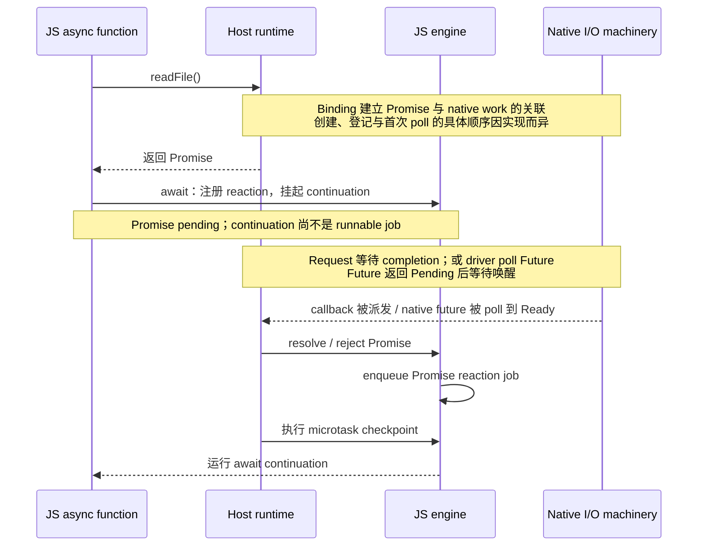

JS 的 `async function` 不是一个由 Tokio 自动创建的 Rust future；JS Promise 也不是 `tokio::task::JoinHandle`。适配发生在 native API 边界。

V8 的直接证据：[`node/deps/v8/src/builtins/promise-abstract-operations.tq:469–505`][code-001] 中，`PerformPromiseThenImpl` 在 Promise pending 时只保存 `PromiseReaction`；已 fulfilled / rejected 时才创建并 enqueue reaction job。

QuickJS 的直接证据：[`quickjs/quickjs.c:2494–2554`][code-002] 中，`JS_IsJobPending()` 只检查 `rt->job_list`，`JS_ExecutePendingJob()` 取出并执行一个 job；它们没有遍历所有 Promise 对象。

本次三个 V8-based runtime 都配置了 **Explicit microtask policy**，由宿主安排 checkpoint：Node 在 [`node/src/node.h:473`][code-003]，Deno 在 [`deno/libs/core/runtime/setup.rs:284`][code-004]，Dune 在 [`dune/src/runtime.rs:148`][code-005]。这描述的是这些宿主的配置，并非所有 V8 embedding 都只能采用这一策略。

### 3.3 `resolve()` 不是“绝不执行用户代码”

通常 `.then` callback / `await` continuation 会在之后的 job 中运行，但 `resolve(thenable)` 会读取 `thenable.then`；这个属性如果是 getter，就可能**同步执行用户 JS**。

```js
let resolve;
const p = new Promise(r => resolve = r);
p.then(v => console.log('reaction', v));

console.log('before-resolve');
resolve({
  get then() {
    console.log('getter');
    return r => { console.log('then-call'); r(42); };
  }
});
console.log('after-resolve');
```

四个实测二进制的输出均为：

```text
before-resolve
getter
after-resolve
then-call
reaction 42
```

源码：V8 [`node/deps/v8/src/builtins/promise-resolve.tq:160–186`][code-006]；QuickJS [`quickjs/quickjs.c:55766–55819`][code-007]。

所以准确说法是：**Promise reactions 通过 jobs 执行；resolution 路径自身仍须考虑同步重入。** 若 resolve 到另一个 pending Promise，外层 Promise 也可能继续 pending。

## 4. libuv 与 Tokio：编程模型与底层机制

### 4.1 先区分机制所在的层次

理解这两种模型，可以沿着“谁等待、谁调度、谁保存 continuation、谁执行 JS”四个问题展开。

| Layer / concept | 职责 | 典型实体 |
|---|---|---|
| **OS I/O notification** | 通知资源 ready，或通知某个 I/O operation completed | epoll、kqueue、IOCP、io_uring |
| **Reactor / Proactor** | 把 OS 通知转成程序可以处理的事件 | readiness dispatcher / completion dispatcher |
| **Event loop** | 反复处理 runnable work、推进 timers、等待并派发外部事件 | `uv_run()`；Tokio scheduler 与 drivers 的协作 |
| **Executor / scheduler** | 选择哪个 task 运行，调用其 future 的 `poll()` | Tokio task scheduler、rquickjs scheduler |
| **Callback / Future** | 表达异步操作的后续逻辑，并保存跨等待阶段的状态 | function pointer + context；compiler-generated state machine |
| **JS host integration** | 把 native result 交给 Promise，并驱动 engine jobs | resolver、completion dispatch、microtask checkpoint |

**Event loop 是协调流程，Reactor / Proactor 是 I/O 事件处理模式，callback / Future 是表达控制流的方式。** 它们并不处在同一抽象层，也不是互斥选项。

异步运行意味着：一个操作暂时不能推进时，调度线程可以去处理其他工作。它不要求每个操作都有自己的线程，也不保证所有计算都自动并行。Event loop 可以在没有 runnable work 时阻塞于 OS poller，这与在某个 callback 中执行长期 blocking I/O 是两种情况：前者等待能唤醒整个 loop 的事件，后者会占住当前执行线程。

阅读实现时，可以把几个核心名词对应到具体问题：

- **Callback / continuation**：操作推进到某一步以后，接下来执行哪段代码？跨等待阶段的局部状态存在哪里？
- **Event loop / executor**：谁选择下一段代码来执行？没有可执行工作时，谁进入等待？
- **Reactor / Proactor**：外部事件告诉我们的是“可以尝试执行操作”，还是“某次操作已有结果”？
- **Liveness policy**：即便现在无事可做，是否仍有必须等待的工作？

libuv 把 loop 与 callback API 显式暴露给调用者；Tokio 通常让应用编写 futures，由 scheduler 与 drivers 协作驱动。**Tokio 并没有消除 event loop 的职责，而是把调度、等待和唤醒组织到了 executor/driver 的实现中。** 两种架构都需要另行接入 JS engine。

### 4.2 Reactor 与 Proactor：readiness 和 completion 的区别

#### Reactor：通知“可以尝试 I/O”

典型路径是：注册 socket 的 read/write interest → 等待 readiness → 运行 handler → handler 或 I/O library 执行非阻塞 `read` / `write`。

- Readable 不保证一次读到完整业务消息，也可能意味着 EOF 或错误。
- 通知可能已经过时或是 spurious readiness；实际 syscall 仍可能返回 `EAGAIN` / `WouldBlock`。
- 因此状态机要根据**实际 syscall 结果**推进，并正确保留或重新安排下一次 readiness 等待。

#### Proactor：通知“提交的 I/O 操作已经完成”

典型路径是：提交带 buffer / operation context 的异步请求 → OS 或异步 I/O backend 执行请求 → 收到 completion → completion handler 消费结果。

- 通知对应某个 operation，通常带完成字节数或错误状态。
- Completion 仍可能是 short read / short write；一个 I/O request 完成不等于整个协议消息处理完成。
- 提交的 buffer 和 operation context 必须满足 backend 要求的生命周期，不能仅因提交函数返回就释放。

下面展示需要等待的一般路径；两种模式都可能有立即成功的 fast path。

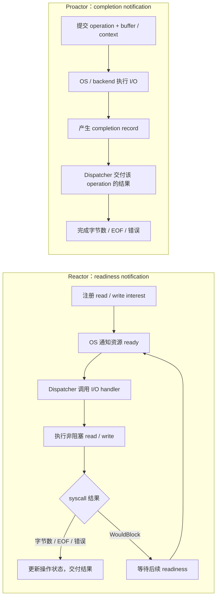

**Callback 可以处理 readiness，也可以处理 completion；Future 也可以封装两者。** 将 callback 等同 Proactor，或将 Future 等同 Reactor，都会遗漏实现中的适配层。

Readiness 的具体合约见 [Mio 关于 spurious events、draining readiness 和 EOF/error 的说明][model-002]。

可以用下表检查自己正在观察哪一层：

| 问题 | Reactor / readiness | Proactor / completion |
|---|---|---|
| 事先登记什么？ | 资源及 read/write interest | 某个具体 operation 及其 buffer / context |
| 通知到来意味着什么？ | 可以尝试 I/O，仍需检查 syscall 结果 | 该 operation 已完成，可以消费结果 |
| 谁实际搬运数据？ | 收到通知后的 handler / I/O library 调用非阻塞 I/O | 提交后由异步 backend 推进操作 |
| 为什么仍需要状态机？ | 可能 `WouldBlock`、只读写一部分数据 | completion 也可能是部分成功、EOF 或错误 |
| 能否包成 callback 或 Future？ | 都可以 | 都可以 |

例如，Unix 下 libuv 可以在内部收到 readiness 后先执行 `read`，再把**读到的数据**交给上层 callback。因此，上层 callback 拿到操作结果，并不能反推底层一定是 Proactor。类似地，future 返回 `Ready(bytes)`，也不能反推这些 bytes 是由 readiness syscall、内核异步请求还是 blocking pool 取得的。

### 4.3 libuv：显式 event loop + callback-based continuation

#### Handles、requests 与 callback context

libuv 给调用方两个主要抽象：

| 抽象 | 典型用途 | 跨异步阶段保存的内容 |
|---|---|---|
| `uv_loop_t` | 驱动某个 loop 的 I/O、timers、pending/close callbacks | poller、native work 状态、各阶段队列 |
| **Handle**，如 `uv_tcp_t`、`uv_timer_t` | 生命周期相对长，可持续接收事件或反复触发 | resource state、callbacks、用户 context |
| **Request**，如 `uv_fs_t`、`uv_write_t`、`uv_work_t` | 一次文件操作、write 或 worker-pool job | operation 参数、结果、completion callback、用户 context |

调用 `start/read/write/...` 时先登记操作，然后返回；后续状态通过 handle/request 及其 `data` 等字段保留。Event loop 调用 callback 时，再从这些对象取回状态并继续后续逻辑。**原先的 C/C++ 调用栈不需要一直挂在那次 I/O 上。**

持续读取的 stream callback 可能触发多次；一次性 request 则有自己的完成边界。Request / handle / buffer 的生命周期也要分别管理，例如 handle memory 要等 close callback 才能回收。

来源：[libuv handles、requests 与 loop-thread 设计][model-001]。

#### Callback 保存后续逻辑，request/context 保存跨阶段状态

考虑一个“打开文件 → 读取 → 关闭 → 交付结果”的抽象 callback API。它可以采用下面的结构；这是编程模型示意，省略错误处理，不代表五个 runtime 都按此函数序列实现 `readFile()`。

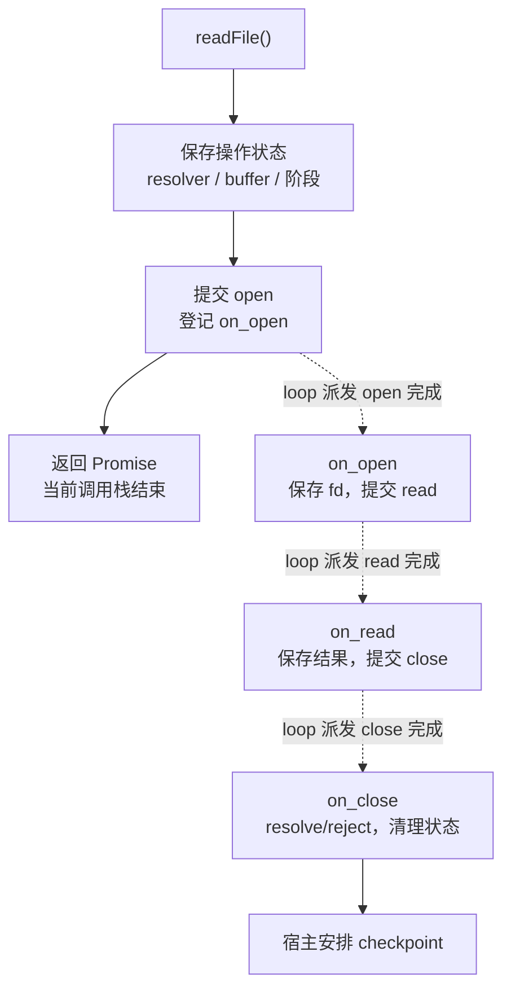

这里有三个不同的生命周期：**一次函数调用的栈帧、一次 native request、整个逻辑操作的 context**。Context 可以跨多个 requests 存活；后续 callback 是一次新的函数调用，而不是让最初那条 C 调用栈一直阻塞等待。

需要注意 callback 的调用上下文：

- 同一个 libuv loop 的正常事件派发在其 loop thread 上顺序执行；不意味着每个 callback 都有一条线程。
- `uv_queue_work` 的 `work_cb` 是明确的例外：它在 worker pool 上执行，`after_work_cb` 才回到 loop thread。
- 某个 loop callback 长时间不返回，就会延迟该 loop 上其他 callbacks；异步 API 不会自动把 callback 内的耗时计算搬到 worker pool。
- 提交失败与异步完成是两条路径，应按具体 API 的返回值合约清理状态，不能假设失败后还一定会收到 completion callback。

实际 request / worker callback 的区分见 [`uv_queue_work()` 与 `uv__queue_done()`][model-006]；Node 的文件操作提交失败会显式进入 `after` 处理，见 [`AsyncDestCall()`][model-019]。

#### `uv_run()` 如何循环

下图对应本文 Node 快照中的 **Unix `UV_RUN_DEFAULT` 主路径**，省略统计等辅助代码。Callbacks 在各阶段执行，不是等所有阶段结束才集中执行。

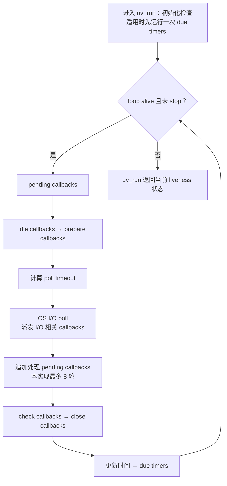

来源：[`uv_run()` 完整循环与 timer 顺序][model-003]。该版本在进入 default loop 前保留一次 timer pass，正常循环内的 timers 在 I/O poll 之后；不能直接套用其他版本的阶段图。

另外两个 mode 改变驱动方式：`UV_RUN_ONCE` 最多推进一轮且可能等待；`UV_RUN_NOWAIT` 最多推进一轮而不阻塞等待事件。如果进入时 loop 已不 alive，或 stop flag 阻止迭代，也可能不进入循环体。`uv_run()` 返回不等于 OS 进程退出，调用方仍可继续运行或再次进入 loop。

Poll timeout 协调“现在能睡多久”：有待派发的 native callbacks（`pending_queue` 非空）、active idle handles 或待关闭的 handles 时会避免阻塞；否则通常受最近 timer deadline 约束，无 deadline 时可以等待 I/O。**尚未完成的 active request 本身是保活条件，不等于存在 ready callback，也不意味着 poll timeout 必须为 0。** Idle callback 的名字不表示“只在空闲时运行”，active idle handle 会在进行中的 loop iterations 中触发。

来源：[`uv__backend_timeout()`][model-004]。

#### Worker completion 如何回到 loop

下面用 `uv_queue_work()` 展示线程切换。`work_cb` 在 worker pool 执行，`after_work_cb` 回到 loop 线程执行；不能把这两类 callback 混为一谈。

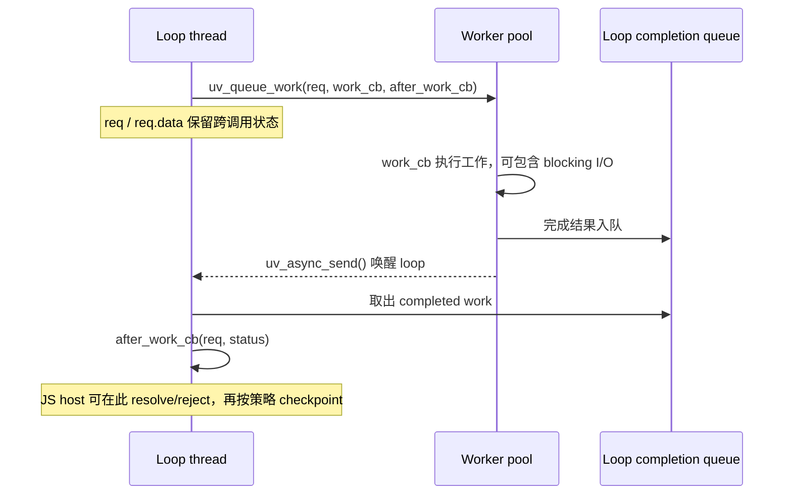

来源：[worker 执行及 completion 入队 / wake][model-005]、[loop 消费结果与 after-work callback][model-006]。

这条路径还展示了一个保活细节：`uv_queue_work()` 登记 active request，worker 完成后只是把结果送回 loop；直到 loop 的 `uv__queue_done()` 才注销 request 并调用 `after_work_cb`。因此 **“worker 已完成，loop 尚未消费结果”这段时间仍有 active request 覆盖**。注销发生在 callback 之前，但 callback 会在本次派发中执行完，随后 host 还需要处理由它产生的 JS jobs。

#### Liveness 与 JS integration

当前 Node 所带 libuv 的 Unix liveness 判据是：

```c
// https://github.com/nodejs/node/blob/fd204481115fe32277beb86ccc726976deb61f79/deps/uv/src/unix/core.c#L393-L398
return uv__has_active_handles(loop) ||
       uv__has_active_reqs(loop) ||
       !uv__queue_empty(&loop->pending_queue) ||
       loop->closing_handles != NULL;
```

来源：[`uv__loop_alive()`][code-008]。其中 `active_handles` 计数受到 **ACTIVE 与 REF 两个 flag** 控制。`uv_ref()` / `uv_unref()` 是幂等的 flag 操作，不是每调用一次就增减一次对象所有权引用计数。来源：[active/ref 与 request 计数实现][code-009]。

libuv 的上述循环不包含 JS Promise jobs。Host 可以在 callback scope 结束时 checkpoint、在 check phase drain jobs，或者用 referenced idle handle 表示“有 ready JS work，应继续迭代且不能阻塞”。跨线程通知可用 [`uv_async_send()`][code-010]。具体的 checkpoint 与保活映射由各 JS runtime 决定。

### 4.4 Rust `Future` / `async` / `await`：可暂停的状态机

#### Future 的接口与驱动责任

`Future` 的核心接口可以简化为：

```rust
// 接口示意，不是某个 JS runtime 的源码摘录。
fn poll(self: Pin<&mut Self>, cx: &mut Context<'_>) -> Poll<Output>;

enum Poll<T> {
    Ready(T),
    Pending,
}
```

- **`Ready(value)`**：这个 future 已完成；I/O failure 通常表现为 `Ready(Err(error))`。
- **`Pending`**：本次不能完成，需要在之后重新 poll；它不等于阻塞当前 OS thread。
- **`Context` / `Waker`**：把“有机会继续了”传给驱动当前工作的人。Tokio task 的 Waker 通常通知 task scheduler；嵌套 scheduler 也可先通知自己的 ready queue。
- **`Pin`**：约束需要位置稳定的 future 在 poll 期间及后续生命周期中的移动，配合编译器保存跨 `await` 状态；它不表示绑定某个 CPU 或线程。

调用 Rust `async fn` 时先构造 future，其函数体在被 poll 时运行；参数表达式仍在调用时求值。编译器把跨 `await` 需要保留的局部变量、子 future 和继续执行的位置保存到状态机中。

`Future` trait 本身不要求使用 Tokio，也不要求 `Send`、`'static` 或每个 future 独占一个 task。Future 可以由父 future、自定义 scheduler 或 executor 来 poll；具体的调度 API 才会追加约束，例如 `tokio::spawn` 要求 `Future + Send + 'static`。来源：[`spawn` 的类型约束][model-020]。

**JS 的 `async` 与 Rust 的 `async` 在启动时机上也不同：**

| 操作 | JavaScript | Rust |
|---|---|---|
| 调用 `async function` / `async fn` | 函数体立即开始执行，直到暂停或结束，并返回 Promise | 构造 future；函数体等到被 poll 才执行 |
| 等待一个已经完成的值 | `await` 后的 continuation 仍通过 Promise job 恢复 | 子 future 返回 `Ready` 时，父 future 可在本次 `poll` 内直接继续 |
| 不等待返回值 | 已调用的 native API 通常已经登记工作，可能继续执行 | 仅构造、从未 poll 的 `async fn` future，其函数体不会开始执行 |

表中的 Rust 惰性语义针对 `async fn` / `async` block 的函数体。一个普通函数可以先启动操作，再返回 future；`JoinHandle` 也可以对应已经提交的 task。LLRT 的 async binding 则主动把产生的 Rust future 登记到 rquickjs scheduler，所以 **JS 用户不写 `await readFile()`，不妨碍宿主继续推进它**。见 [`Promise::wrap_future()`][code-089]。

#### `.await` 是状态机之间的组合

在 `.await` 处，外层 future poll 子 future：子 future 若 Ready 就继续执行；若 Pending，就保留状态并向上返回 Pending，待下一次 poll 继续。**一次 `.await` 不必产生一次挂起；一个子 future 也不必成为独立 task。**

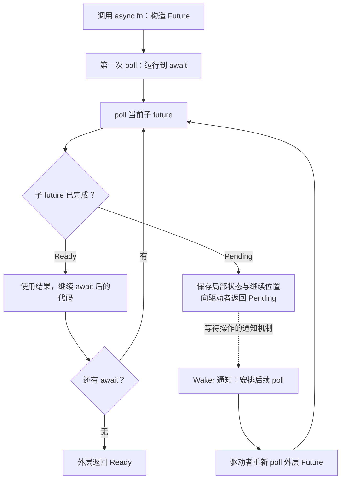

图中的 wake / scheduling 由 driver、executor 或自定义 scheduler 提供；future 不会因为返回了 Pending 就自行恢复。手写 future 需要正确处理 Waker 注册与状态变化之间的竞态。

与 callback style 相比，二者都保存“下一步执行什么”：callback style 通常把 continuation 和状态放在函数指针、closure、request context 中；`async/await` 把它们组织成编译器生成的可组合状态机。

#### `.await` 与 `spawn` 的调度边界不同

`tokio::spawn(future)` 会创建一个可独立调度的 Tokio task，返回的 `JoinHandle` 又是可以等待结果的 future。下面对比 `child().await` 与 `tokio::spawn(child()).await`；图中 task 不代表 OS thread。

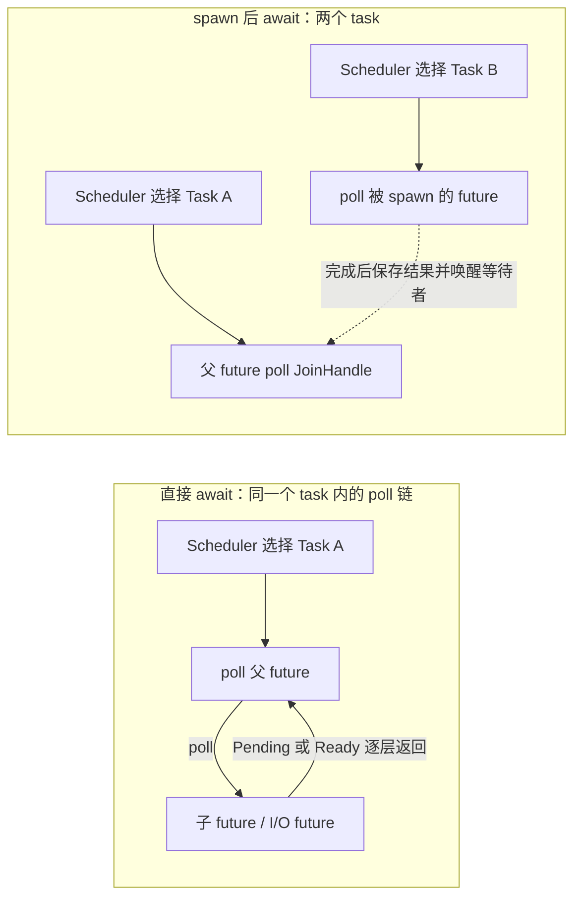

- 直接 `.await` 不会自动添加一个 Tokio task；父子 futures 共享当前 task 的执行机会，并可沿等待链传递 Waker。
- `spawn` 后即便不 await `JoinHandle`，task 也可在 runtime 被驱动时运行。`spawn` 本身保证不会在当前调用栈上同步 poll 新 task；多线程 runtime 中，另一个 worker 仍可能很快开始执行它。
- `FuturesUnordered`、rquickjs scheduler 等可以在外层驱动之下管理多个子 futures；每个子 future 可有自己的通知状态，但不必各自成为 Tokio task。
- 任务采用 **cooperative scheduling**：一次 `poll` 长时间不返回，就会占住执行线程。把同步计算写进 `async fn`，不会自动把它变成可抢占的工作；`.await` 一路得到 Ready 时也未必会让出执行权。

来源：[Tokio task 模型][model-007]、[`spawn` 的启动与非同步 poll 合约][model-021]、[Deno 的聚合 driver][code-059]、[rquickjs scheduler][code-091]。

### 4.5 Tokio：executor + I/O driver + timer driver + blocking pool

Tokio runtime 把几类机制组合起来：

| 组件 | 做什么 | 不应混同的概念 |
|---|---|---|
| **Task scheduler / executor** | 调度 runnable tasks，poll 根 future | task 数量不等于 JS Promise 数量 |
| **I/O driver** | 经 Mio 等 backend 接收事件，记录 readiness，唤醒等待者 | readiness notification 不一定是操作结果 |
| **Timer driver** | 等 deadline，唤醒 `Sleep` 等等待者 | 每个 timer 不需要一个独立线程 |
| **Blocking pool** | 执行不适合占用 async scheduler 线程的阻塞工作 | blocking function 运行期间仍占用一个 OS thread |

这些是逻辑组件，不要求每个组件都有一条专用线程。Current-thread runtime 也能交错推进很多异步任务；multi-thread runtime 可在多个 worker 上调度符合约束的 tasks，但不会自动让同一个 JS isolate 并行执行。

#### Scheduler 处理 runnable work，driver 提供再次 runnable 的机会

下图展示 spawned task 的调度骨架，省略 Tokio 不同 scheduler 的本地队列、work stealing 等细节。`block_on` 所直接驱动的 root future 还有自己的路径，不能把图中的“某个 task 完成”理解为整个 runtime 必须退出。

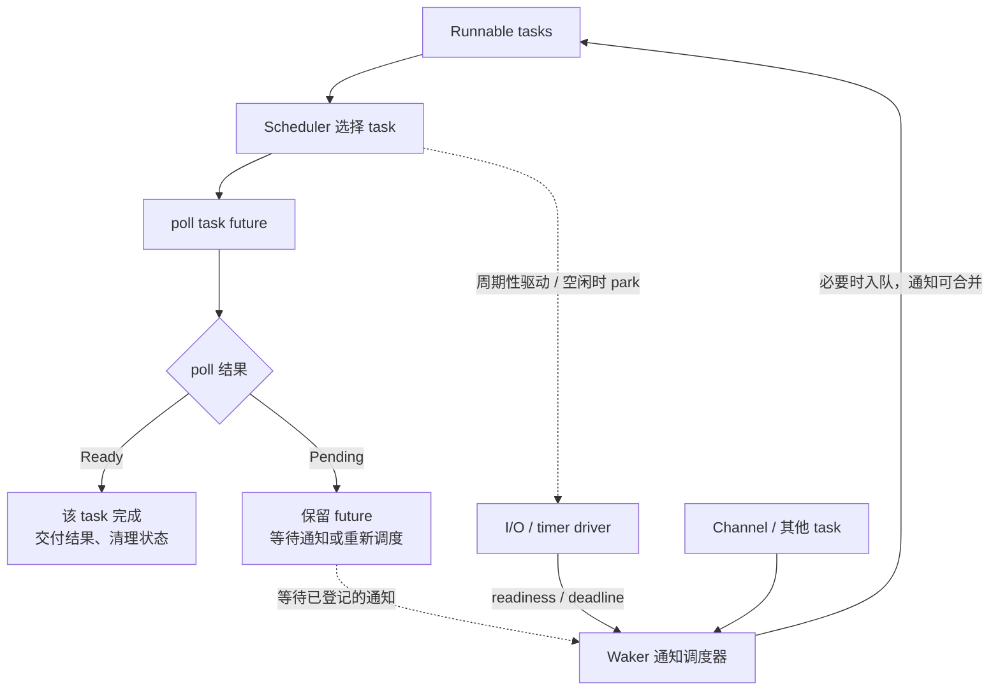

**Runnable queue 为空只说明现在没有已安排的执行机会。** 等待 socket、timer 或 channel 的 futures 仍可存在；Tokio 也会按调度策略检查 drivers，而非一定要等所有 tasks 都 Pending 才处理 I/O。来源：[Tokio 的调度与 I/O/timer 驱动说明][model-024]。

Waker 可以理解为一种小型的通知回调，但它通常只负责“请重新调度这个 task”。业务 continuation 仍保存在 future 状态机中，下一次 poll 才继续执行。Tokio 的 task Waker 根据状态决定是否调用 `schedule()`，并不直接运行 JS。来源：[`wake_by_ref()`][model-011]。

#### 一次 readiness-based socket read 的唤醒链

以下是没有 cached readiness 时的简化路径。`poll` 沿外层 future → 子 future → I/O primitive 逐层调用，Pending 再逐层返回。

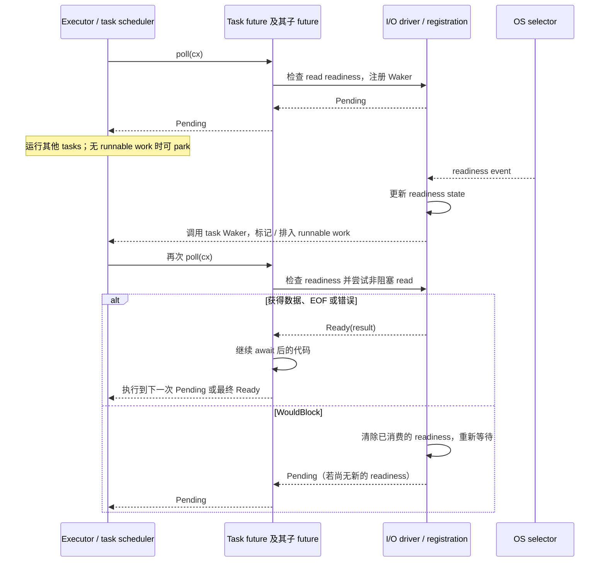

这条链在源码中分成几处：

1. [I/O driver][model-008] 调用 Mio poll，处理事件时 `set_readiness(...)`，然后 `wake(ready)`。
2. [I/O registration][model-009] 尝试操作；遇到 `WouldBlock` 清除相应 readiness 并再次进入等待 / 尝试循环。
3. [ScheduledIo][model-010] 保存调用方 Waker，注册后再次检查 readiness，以避免注册期间的状态变化被漏掉。
4. [Task Waker][model-011] 通知 task 并在需要时调用 `schedule()`。它不是直接在 I/O notification 的调用栈上运行 JS continuation。

**`Future::poll()` 与 `epoll` / `Mio::Poll::poll()` 是不同层次的操作。** 前者推进一个 Rust 状态机，后者接收 OS 事件；正常使用 Waker 不需要不停扫描所有 pending futures。

#### 为什么需要“检查状态、登记 Waker、再检查”

一个常见错误是：future 检查到未 ready，随后事件已发生，但 Waker 还没登记；最后 future 登记 Waker 并返回 Pending，却再也没有新的事件来唤醒它。这个问题叫 **lost wake-up**。

下面展示这类竞态的一种时序，以及通过持久 readiness 状态与复查避免丢失进展的方式：

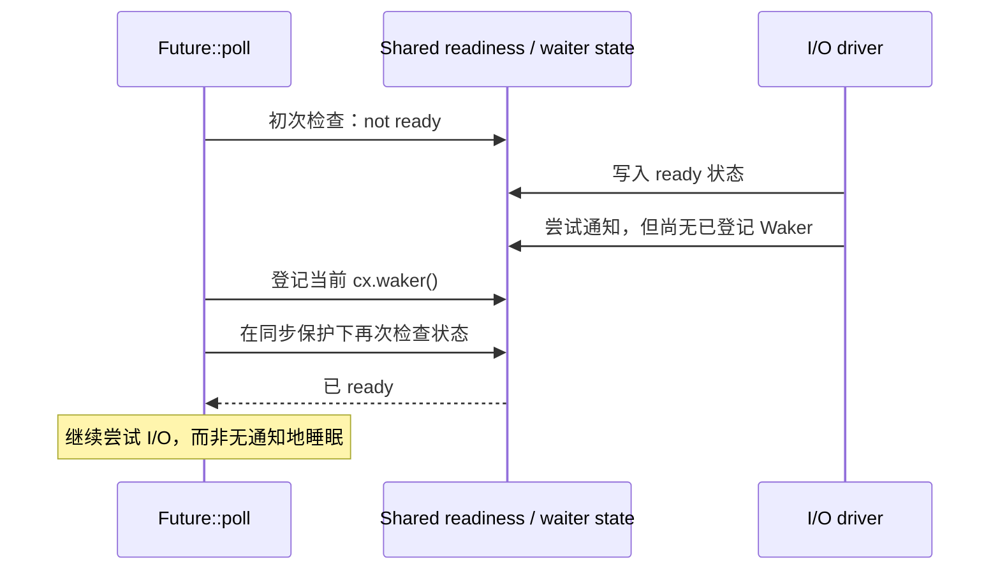

Tokio 的 `ScheduledIo::poll_readiness()` 就包含注册后的复查；事件若在更晚的时候发生，则由已登记 Waker 通知。具体实现需要锁或原子状态协议，不能仅靠无同步的两次读。来源：[`poll_readiness()`][model-010]。

这也说明：

- Waker 不是结果的存储位置；结果或 readiness 必须另有状态保存。
- 多次 wake 可以合并，wake 次数不能当作 I/O 完成数。
- 返回 Pending 不保证某天必然 Ready；对于可能由外部事件推进的 future，必须正确建立后续通知路径。
- 返回 Ready 后，驱动者应把该 future 视为完成，不能假设反复 poll 仍会返回同一个结果。

#### 等待与完成策略

需要同时满足两个独立条件：

1. **Liveness**：JS runtime 是否还应该继续存在？
2. **Wake-up / progress**：下一次什么时候 poll 它？

`Poll::Pending` 只表示这次 poll 没有最终结果，**不会自动保证未来还会被 poll**。若有 ready work，应继续处理或安排 self-wake；若等待 I/O，应注册能够被通知的 Waker。

`block_on(root_future)` 等待的是 root future 的完成，不是“所有 Tokio tasks 已清空”。Root 返回后仍可能存在 spawned tasks，后续如何处理由 runtime 生命周期和 shutdown 策略决定。来源：[Tokio shutdown][code-011]、[`block_on`][code-012]。

因此 Tokio-based JS runtime 需要自行定义 **JS-work completion policy**，例如 Deno 的 op registry，或 LLRT/rquickjs 的 all-tasks list。它们可以驱动一组子 futures，并不需要为每一个 JS Promise 创建 Tokio task。

这里还要区分 Tokio 的两种运行方式：若保留 runtime，multi-thread 模式中的 spawned tasks 可以在 `block_on` 返回后继续运行；普通 current-thread 模式则需要继续有调用来驱动 runtime，先前 tasks 才能继续推进。最后 drop runtime / shutdown 是另一步，其任务清理策略也不等同于“等所有 JS Promises 完成”。见 [`block_on` 对两种 scheduler 的说明][code-012]。

### 4.6 平台 backend 与公共 API 可以采用不同模型

| 场景 | 典型底层路径 | 应如何理解 |
|---|---|---|
| libuv 的 Unix socket I/O | epoll / kqueue 等 readiness → 非阻塞 I/O → callback | 公共 callback API 可以建立在 Reactor 上 |
| libuv 的 Windows I/O | overlapped operations + IOCP completion dispatch | 有 completion-based backend，但具体操作仍可混合 readiness-style 处理 |
| Tokio 的 socket I/O | Tokio registration → Mio selector → readiness state / Waker | 对上层暴露 Future，对内仍可由 Reactor 推进 |
| Mio 的 Windows backend | 把 IOCP 等底层机制适配为 Mio 的 readiness API | OS completion 模型不强制上层也直接暴露 completion records |
| libuv 的默认 / 回退文件 I/O | worker pool 执行阻塞操作，完成后回调 loop | 是 completion-style 交付，不等于 kernel-native async file I/O |
| Tokio `fs::read` 的普通路径 | `spawn_blocking` → blocking filesystem call → 等待结果的 future | Future 包装的操作，其实际执行仍可发生在 blocking thread 上 |
| 条件启用的 Linux io_uring 路径 | 提交 operation，读取 completion | 可以藏在同样的 callback / Future API 之下 |

来源：[libuv I/O 模型][model-001]、[Mio 平台适配说明][model-015]、[libuv IOCP 派发][model-016]。

一个具体的混合例子是当前 libuv Windows TCP read：先提交 [zero-byte overlapped read][model-017] 等待通知，随后在完成处理路径中执行 [nonblocking reads][model-018]。因此“使用 IOCP”也不意味着每次上层 `read_cb` 都对应一条直接填充用户 buffer 的内核异步读取。

文件 I/O 还要带版本和配置条件看：

- 当前 libuv 文档说明 Linux 默认使用 thread pool，特定文件操作可在配置 `UV_LOOP_USE_IO_URING_SQPOLL` 后尝试 io_uring。来源：[libuv filesystem backend][model-014]。
- Tokio `1.53.3` 的 `fs::read` 普通路径通过 `asyncify` 调用 `spawn_blocking`；同时存在受 `tokio_unstable`、`io-uring` feature、平台和 runtime 配置约束的实验性 io_uring 分支。来源：[`fs::read` 路由][model-012]、[`asyncify`][model-013]。

这也说明：**仅看 API 返回 callback 还是 Future，无法判断 I/O 是 Reactor、Proactor，还是 thread-pool offloading。** 三者都可能最终完成同一个 JS Promise。

### 4.7 对 JS runtime 的直接影响

| 维度 | libuv / crabuv 风格 | Tokio 风格 |
|---|---|---|
| native 工作的表达 | handle / request + callback | `Future::poll()` + `Waker`，也可有 resource handles |
| continuation 状态保存 | callback context、request wrapper、closure | future state machine、子 futures、task state |
| native → JS completion | loop callback，或再投递 JS completion queue | future 在合法上下文中 resolve，或再投递 result queue |
| 阻塞等待位置 | loop 的 OS poller；blocking work 放 worker pool | driver / scheduler 的 park；blocking work 放 blocking pool |
| 自然结束依据 | native loop liveness + host policy | root future / JS driver 的自定义 completion policy |
| JS Promise / await 的实现者 | JS engine | JS engine |
| microtask checkpoint | host 在 callback / phase 等边界选择 | host 在 poll / completion 等边界选择 |
| unref | libuv 有 native flags；crabuv 未采用同等机制 | host 可自行维护 refed / unrefed work |

对于 Promise-based API，要恢复 JS 的 `.then` / `await` continuation，两种模型都需要经过 **Promise resolution/rejection → engine job queue → checkpoint**。普通 timer / event callback 也可以直接进入 JS，并不必先创建一个 Promise。Reactor / Proactor 决定如何获得 native result；callback / Future 决定如何表达 native continuation；JS host 决定何时交付结果、运行 microtasks，以及是否继续保活。

### 4.8 唤醒、完成、取消与保活是不同操作

这些动作常出现在相邻的几行代码中，但作用对象不同：

| 动作 | 直接改变什么 | 不由它保证什么 |
|---|---|---|
| `Waker::wake()` / `uv_async_send()` | 通知 scheduler / loop 有机会推进工作 | 不等于操作成功，也不直接恢复 JS `await` |
| native future 返回 Ready / completion callback | 得到某个 native operation 的结果 | 不等于其 JS reactions 已执行 |
| `resolve` / `reject` | 接入 Promise 状态机，并按引擎规则产生 jobs | 不保证所有 continuation 同步运行；resolve 到 thenable 还涉及额外步骤 |
| `unref` | 改变 host 是否必须因该工作继续运行 | 不取消 I/O、不释放所有权、不使 Promise 自动完成 |
| cancel / abort | 请求停止某项工作，或停止推进某个 future | 不保证立即中断已经开始的 syscall / blocking function |
| `block_on(root)` 返回 | root future 已完成 | 不代表所有 spawned tasks 或 JS Promise 都已完成 |

特别是 Rust 中，**drop 一个自己持有的 future、drop 一个 `JoinHandle`、调用 `abort()` 是不同操作**：

- Drop future 会销毁其状态并停止由这份 future 继续推进；已提交到别处的底层工作是否停止，要看具体 API 的 cancellation 合约。
- Drop Tokio `JoinHandle` 会 detach task；只要 runtime 继续驱动且未取消该 task，它仍可运行。
- `abort()` 请求取消 async task；一个已经开始运行的 `spawn_blocking` function 通常不能这样中断。Runtime shutdown 也有单独的等待策略。

来源：[`JoinHandle` 的 detach 合约][model-022]、[Tokio cancellation 与 blocking task 的边界][model-023]、[runtime shutdown][code-011]。

Tokio 不会自动理解 JS 的 `unref()` 语义。Deno 通过 `unrefed_ops`、timer ref state、uv-compatible handle flags 等自行实现；这些状态回答“宿主还需不需要等待”，而 Waker 回答“之后如何再次获得执行机会”。

### 4.9 从 native operation 到 JS job 的保活交接

对本文关注的进程退出问题，最有用的检查方式是沿**同一个逻辑操作的生命周期**看，而不是只找名字包含 `pending` 的集合。以下讨论没有显式停止或 job 执行错误的正常路径，以需要保活、未被 unref 或取消的操作为例，假设 native API 成功返回普通数据，并且已经注册 `.then` / `await` reaction：

| 时刻 | Promise / job 状态 | 必须覆盖这段时间的宿主状态 |
|---|---|---|
| 已登记操作，正在等 I/O | Promise pending；还没有可运行 reaction | active request / resource / 未完成 future 等 |
| I/O 完成，结果还没送到 JS | Promise 仍 pending；job queue 仍可能为空 | 尚未注销的 request、completed-op queue 对应计数，或有保证的当前派发路径 |
| 已调用 resolver，尚未 checkpoint | 对普通数据已产生 runnable reactions | engine job queue，以及宿主保证会执行的 checkpoint |
| 正在执行 `.then` / `await` continuation | job 被消费，也可能产生新 I/O / jobs | 当前执行路径与新登记的工作 |
| 当前操作及其 ready jobs 都处理完 | 这个操作已不再要求保活 | 继续检查其他保活源、module lifecycle 与退出 hooks |

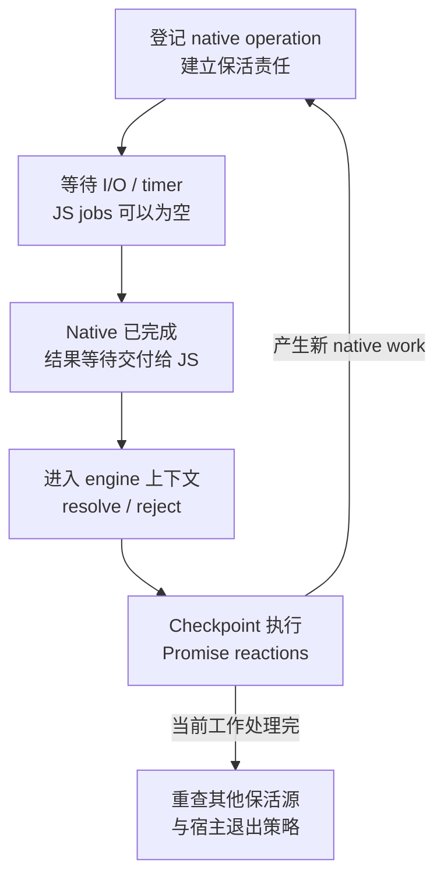

这里的关键不变量是：**宿主不能在“结果已经产生”与“JS 获得处理结果的机会”之间，错误地观察到所有工作都结束了。** 不要求每个 runtime 使用同一个全局计数器；计数、队列和调用顺序都可以承担这个保证：

- **Deno**：op driver 的 `len` 覆盖尚未被 `poll_ready()` 取走的 completed ops；取走后在当前 event-loop tick 内交付 JS，再评估 pending state。见 [driver 计数][code-060] · [完成结果出队][code-061] · [JS dispatch][code-062]。
- **LLRT/rquickjs**：wrapper future 等待 native result，调用 resolver 后才结束；scheduler 报告进展后，`idle()` 再次执行 JS jobs，然后检查是否已无 futures。见 [wrapper future][code-089] · [`idle()`][code-094]。
- **Node / txiki.js / Dune**：依靠 native work 的登记与各自的 callback/check/tick 边界衔接。Node 有 callback-scope checkpoint；txiki.js 在 check phase drain jobs 并更新 idle handle；Dune 在本轮 native loop 返回后处理 completion batch。见 [Node][code-016]、[txiki.js][code-030]、[Dune][code-046]。

最后还要留意 API 同名但范围不同：QuickJS 的 `JS_IsJobPending()` 只检查 engine job queue；rquickjs 的 `AsyncRuntime::is_job_pending()` 则把**尚未完成的 Rust futures**也纳入判断。见 [QuickJS][code-002]、[rquickjs][code-114]。所以分析“pending jobs 是否为空”之前，必须先确认这个接口实际统计了哪类工作。

## 5. 五种 JS runtime 的架构

本节集中介绍各 runtime 的状态组织、驱动入口与结束政策；第 6 节再沿同一类用户操作横向追踪完整调用链。

| Runtime | Native work 的主要持有者 | JS continuation 的执行边界 | 主要退出判据 |
|---|---|---|---|
| Node.js | libuv handles / requests，Node wrappers | callback scope、timer / immediate 批次边界 | libuv liveness，外加 platform tasks 与退出 hooks |
| txiki.js | libuv handles / requests、Promise capability | check phase，以及部分 callback 后的 job drain | libuv liveness；ready jobs 经 idle handle 接入 |
| Dune | crabuv resources / requests；ready completion Vec | 每轮 completion dispatch 后的 nextTick / V8 checkpoint | native resources 加 imports、ticks、rejections 等 |
| Deno | async-op driver；独立的 module state；uv-compatible handles | event-loop phases 与部分 callback 边界 | `EventLoopPendingState` 的多类保活状态 |
| LLRT | rquickjs-owned futures 与 QuickJS jobs | `idle()`、`async_with()`、timer callbacks | 正常 CLI 路径等 jobs 与 scheduler futures 都结束；job 执行错误另有分支 |

### 5.1 Node.js：native request + resolver + callback-scope checkpoint

#### 5.1.1 Promise-based filesystem API

[`node/src/node_file-inl.h:193–207`][code-013] · [`node/src/node_file-inl.h:226–256`][code-014] · [`node/src/node_file-inl.h:282–292`][code-015] 展示了完整的关键结构：

1. `FSReqPromise::New()` 创建 `v8::Promise::Resolver`，保存到 request wrapper 的 JS object。
2. `SetReturnValue()` 返回 resolver 对应的 Promise。
3. native completion 调用 `Resolve()` / `Reject()`。
4. 这两个方法建立 `InternalCallbackScope` 后调用 V8 resolver。

```text
uv_fs request ── completion ──> FSReqPromise::Resolve/Reject
                                      │
                                      ├─ 更新 Promise / enqueue reactions
                                      └─ InternalCallbackScope::Close
                                           → nextTick / microtask processing
```

保活来自 in-flight request 或其他 referenced native work，而不是 resolver 的强引用。已经打开但闲置的普通文件描述符，不等于一个 active libuv handle。

这是 `FSReqPromise` 所服务的逐项文件操作路径。当前快照的整文件 `readFile()` 还存在 `ReadFileJob` 快速路径，其 resolver 保存在 JS closure 中，详见第 6.1 节。

#### 5.1.2 Microtasks 与 `nextTick` 是两套机制

`InternalCallbackScope::Close()` 在外层有效 callback scope 结束时处理 task queues：

- 嵌套 scope 或 `skip_task_queues_` 会跳过这次处理；
- 没有 scheduled nextTick 时先做 V8 checkpoint；
- 有 nextTick / rejection 待处理时调用 JS `processTicksAndRejections()`。

来源：[`node/src/api/callback.cc:140–215`][code-016]。

JS drain 算法可概括为：

```text
drain nextTick queue, including newly added nextTicks
→ perform microtask checkpoint
→ if new ticks / rejection work appeared, repeat
```

来源：[`node/lib/internal/process/task_queues.js:63–109`][code-017]。

这里的 nextTick 优先级适用于相应 drain 边界；**不是 nextTick 可以抢占正在运行的 microtask checkpoint**。在 ESM evaluation 或 `.then` callback 内观察的顺序，需要考虑当前已经处于哪种执行上下文。

此外，并非所有 native→JS 调用都使用名为 `MakeCallback` 的函数：`Environment::RunTimers()` 直接建立 `InternalCallbackScope` 并调用 JS function；JS timer / immediate 批次内部又调用 `runNextTicks()`。

来源：[`node/src/env.cc:1771–1794`][code-018]；[`node/lib/internal/timers.js:518–637`][code-019]。

#### 5.1.3 `check + idle` 服务于 immediate queue

`CheckImmediate()` 和 `ToggleImmediateRef()` 主要用于 `setImmediate` / native immediate callbacks。Idle handle 既能使 loop 保持 alive，也会令 poll 不阻塞。

**这不是 V8 microtask queue 的表示方式。** 普通 Promise reactions 仍然通过上面的 checkpoint 执行。

来源：[`node/src/env.cc:1832–1868`][code-020]。

#### 5.1.4 自然结束与 TLA

`SpinEventLoopInternal()` 的主要流程：

```text
uv_run(UV_RUN_DEFAULT)
→ platform->DrainTasks(isolate)
→ uv_loop_alive()
→ 若已 idle，emit beforeExit
→ 重新检查 uv_loop_alive()
→ 未被新增工作重新保活，进入 exit 事件 / cleanup
```

来源：[`node/src/api/embed_helpers.cc:23–77`][code-021]。

`EmitProcessExitInternal()` 还会检查 unsettled TLA；没有已有非零退出码时可设置退出码 **13**。来源：[`node/src/api/hooks.cc:52–83`][code-022]、[`node/src/node_exit_code.h:30`][code-023]。

### 5.2 txiki.js：QuickJS job queue 显式接入 libuv

#### 5.2.1 Native request 如何保存 Promise capability

`TJSFsReq` 包含 `uv_fs_t req`、`JSContext *ctx` 和 `TJSPromise result`。

- `TJS_InitPromise()` 使用 `JS_NewPromiseCapability()` 获得 Promise 与 resolve/reject functions。
- `uv__fs_req_cb()` 完成后调用 `TJS_SettlePromise()`。
- `TJS_SettlePromise()` 调用 `p->rfuncs[is_reject]`，随后释放这份 capability 的引用。

来源：[`txiki.js/src/mod_fs.c:106–123`][code-024] · [`txiki.js/src/mod_fs.c:273–282`][code-025] · [`txiki.js/src/mod_fs.c:400–408`][code-026]；[`txiki.js/src/utils.c:208–230`][code-027]。

整文件 `tjs.readFile()` 使用另一种 wrapper：`TJSReadFileReq` 配合 `uv_work_t`，把整段同步读取放进 worker pool；其 Promise capability 与 settlement 原理相同，详见第 6.1 节。

#### 5.2.2 Checkpoint 粒度依调用路径而不同

| 路径 | checkpoint 时机 |
|---|---|
| timer callback | `tjs_call_handler()` 在 JS callback 返回后 drain jobs |
| filesystem Promise completion | `TJS_SettlePromise()` 本身不 drain；由后续 checkpoint，通常是本轮 check callback，执行 reactions |
| libuv check phase | `uv__check_cb()` → `tjs__execute_jobs()`，drain jobs 并处理 deferred rejections |
| EventTarget listeners | JS 实现在每个 listener 后调用 `core.drainMicrotasks()`；对应 C 入口带重入 guard |

来源：[`txiki.js/src/timers.c:78–95`][code-028]、[`txiki.js/src/utils.c:185–230`][code-029]、[`txiki.js/src/vm.c:957–1065`][code-030]、[`txiki.js/src/js/polyfills/event-target.js:640–657`][code-031]。

因此不能把 txiki.js 简化为“所有 C→JS 调用之后都 checkpoint”，也不能据此断言它与 Node 的时序完全相同。

#### 5.2.3 如何让 jobs 影响 libuv liveness
源码：[`txiki.js/src/vm.c:942–947`][code-032]。下面省略 `CHECK_EQ` 返回值断言，仅保留 idle handle 的切换逻辑：
```c
// https://github.com/saghul/txiki.js/blob/fc2b5f3b2d09e6db739eb619cfb1acca37d6bdf0/src/vm.c#L942-L947
if (JS_IsJobPending(qrt->rt) || !list_empty(&qrt->pending_rejections))
    uv_idle_start(&qrt->jobs.idle, uv__idle_cb);
else
    uv_idle_stop(&qrt->jobs.idle);
```

Prepare / check handles 被 unref；`jobs.idle` 根据 jobs / rejections 切换 active 状态。这里确实把 ready JS work 转换成了 libuv 可见的保活与 non-blocking-poll 条件。

`TJS_Run()` 在进入 `uv_run` 前更新 idle 状态，且在 `uv_run` 返回后检查是否还有 QuickJS jobs。主 runtime 的 `beforeunload` 若被取消，并且确有新 jobs / native work，会再次进入 loop；worker 则有 referenced async stop handle 保活。

来源：[`txiki.js/src/vm.c:1089–1139`][code-033]。

在已处理当前 jobs / rejections 的正常 idle 情况下，结束条件方向是：

```text
!uv_loop_alive(loop) && !JS_IsJobPending(rt)
```

这不是全部 lifecycle 分支的替代公式：还要考虑 beforeunload、worker 与异常停止。`uv_run()` 的返回值反映返回时 loop 是否仍 alive，不是“是否发生过 stop”的专用标志。

#### 5.2.4 TLA 与显式退出

txiki.js 支持 TLA：启动代码本身就包含 top-level `await`，并 `await core.evalFile(filename)`。但 `TJS_Run()` 没有把所有 pending module-evaluation Promises 另行计入 liveness，也未在上述自然结束路径看到 Node / Deno 式 stalled-TLA 诊断。

来源：[`txiki.js/src/js/run-main/index.js:160`][code-034] · [`txiki.js/src/js/run-main/index.js:307`][code-035]、[`txiki.js/src/eval.c:44–64`][code-036]。

公开的 `tjs.exit(status)` 直接调用 C `exit(status)`；内部 `TJS_Stop()` → `uv_async_send()` → `uv_stop()` 是另一条停止 loop 的路径。

来源：[`txiki.js/src/mod_os.c:31–38`][code-037]、[`txiki.js/src/vm.c:436`][code-038] · [`txiki.js/src/vm.c:1149–1152`][code-039]。

### 5.3 Dune：crabuv resources + JS completion queue

#### 5.3.1 `JsFuture` 不是 Rust `Future`
源码：[`dune/src/runtime.rs:44–48`][code-040]。
```rust
// https://github.com/aalykiot/dune/blob/5958b6460d4a567a41e6194f637a86a45b265f95/src/runtime.rs#L44-L48
pub trait JsFuture {
    fn run(&mut self, scope: &mut v8::PinScope);
}
```

它没有 `poll()` / `Waker`，是“native 工作完成后，需要在 V8 scope 中执行的动作”。所以 `pending_futures: Vec<Box<dyn JsFuture>>` 更准确地说是 **ready completion queue**。

真正 in-flight 的工作由 crabuv 管理：

```text
resources map
request queue
thread pool pending count
```

`next_tick_queue` 又是单独的 host queue，不能把两个 Vec 当成 Dune 全部 native pending operations 的 registry。

#### 5.3.2 一次 filesystem operation 的所有权与唤醒链

```text
JS native binding 创建 v8::Global<PromiseResolver>
  → LoopHandle::spawn(work, callback)
  → request_queue_empty = false
  → process_requests() 将 Task 插入 resources
  → Rayon worker 执行 work
  → event_sender.send(ThreadPool(id, result))
  → Mio waker.wake()
  → run_poll() 收到 completion
  → process_finished_task() 移除 Task resource 并运行 callback
  → callback 向 pending_futures push FsReadFuture { resolver, result }
  → event_loop.run(Once) 返回
  → run_pending_futures()：resolve/reject，执行 tick / microtask checkpoint
```

来源：[`dune/src/file.rs:187–272`][code-041]；[`crabuv/src/event_loop.rs:273–284`][code-042] · [`crabuv/src/event_loop.rs:350–358`][code-043] · [`crabuv/src/event_loop.rs:445–466`][code-044] · [`crabuv/src/event_loop.rs:732–770`][code-045]。

特别重要：**worker 完成并不只靠 `thread_pool.pending_count()` 保活；Task resource 保留到 loop 消费 completion。FS 路径也已经在 crabuv 内部 wake，不需要在每个 Dune completion callback 再写一次 interrupt。**

#### 5.3.3 Tick 顺序
源码：[`dune/src/runtime.rs:427–432`][code-046]。
```rust
// https://github.com/aalykiot/dune/blob/5958b6460d4a567a41e6194f637a86a45b265f95/src/runtime.rs#L427-L432
self.with_scope(run_next_tick_callbacks);
self.fast_forward_imports();
self.event_loop.run(RunMode::Once);
self.run_pending_futures();
```

`run_pending_futures()` 取走当前 completion batch，逐个执行，每个之后执行 `run_next_tick_callbacks()`。

后者通过 `mem::take` 取得**当前 nextTick snapshot**，跑完这一批再做 V8 checkpoint，不像 Node 那样在一次 drain 中把递归加入的 nextTicks 一直取到空。因此可观察到不同顺序，见第 6.3 节与第 7 节。

来源：[`dune/src/runtime.rs:479–504`][code-047] · [`dune/src/runtime.rs:685–718`][code-048]。

#### 5.3.4 为什么 timer 额外 interrupt

crabuv 的 timer phase 在 poll 之前。Timer callback 把 JS completion 入队后，如果还有其他资源，随后 poll 可能等待。因此 Dune timer 路径显式 interrupt，确保本轮能尽快返回并执行已 ready 的 JS completion。

FS completion 的 worker wake 和 network readiness 已经使 poll 返回；它们所处阶段不同，不能仅凭上层 callback 没有 `interrupt()` 就判定缺失唤醒。

来源：[`dune/src/timers.rs:88–104`][code-049]；[`crabuv/src/event_loop.rs:169–180`][code-050] · [`crabuv/src/event_loop.rs:235–284`][code-051]。

#### 5.3.5 Liveness 与 TLA

crabuv 的判据：

```rust
!resources.is_empty()
    || !request_queue_empty.get()
    || thread_pool.pending_count() != 0
```

Dune 外层再 OR：unhandled rejections、V8 background tasks、pending imports、nextTick callbacks。

来源：[`crabuv/src/event_loop.rs:657–661`][code-052]；[`dune/src/runtime.rs:442–465`][code-053]。

外层确实没有单独检查 `pending_futures`。在已追踪的 native completion 路径中，它们在本轮重新检查 liveness 前处理；inline module source 路径同时登记 pending module graph。这是需要保持的控制流不变量，**不构成已证实的 premature-exit bug**。

另外，`has_pending_imports()` 只检查待加载 module graph。`fast_forward_imports()` 把 ready graph 移出 pending 列表，并忽略 `module.evaluate()` 返回的 Promise。它不等于 Deno 的 pending module evaluation 跟踪。实测无进展的 TLA 会退出，code 为 0。

来源：[`dune/src/modules.rs:120–123`][code-054]、[`dune/src/runtime.rs:522–579`][code-055]。

Dune 也实现了 `process.exit(code)`，它直接调用 `std::process::exit`，与自然结束路径不同。来源：[`dune/src/process.rs:121–127`][code-056]。

### 5.4 Deno：PromiseId 关联 + async-op driver + host liveness state

#### 5.4.1 JS Promise 与 Rust future 如何关联

通用 async-op 路径中：

- JS 分配 `PromiseId`；
- `promiseRing`（4096 slots）保存 `[resolve, reject, promiseId]`，冲突的旧条目移到 `promiseMap`；
- Rust driver 持有 `(PromiseId, OpId)` 及 native future / result；
- 完成结果交给 JS `__resolvePromise(promiseId, res, isOk)`，取出并删除 resolver entry 后调用 resolve/reject。

来源：[`deno/libs/core/00_infra.js:32–41`][code-057] · [`deno/libs/core/00_infra.js:146–196`][code-058]。

这是 **native op Promise 的 correlation table**，不是用户所有 JS Promises 的全局登记表。`op_ctxs` 按 `OpId` 索引 op metadata；真正的 in-flight registry 是 `pending_ops` 的 driver。

#### 5.4.2 Native future 不必每个都 spawn 成独立 Tokio task

`FuturesUnorderedDriver` 用 `FuturesUnordered` 聚合 operations，由一个按需创建的 driver task 推进：

```text
submit op
  → eager first poll，或 lazy enqueue
  → FuturesUnordered
  → driver task poll_task
  → completed_ops: VecDeque<PendingOp>
  → completed_waker
  → JS event loop poll_ready
  → batch __eventLoopTick(id, isOk, result, ...)
  → __resolvePromise
  → checkpoint
```

**`len` 在提交后增加，在 JS loop `poll_ready()` 取走结果时才减少。** I/O 已完成而尚未交付给 JS 的 operation 仍然在计数中，避免 completion handoff 期间过早判断 idle。

来源：[`deno/libs/core/runtime/op_driver/futures_unordered_driver.rs:33–68`][code-059] · [`deno/libs/core/runtime/op_driver/futures_unordered_driver.rs:100–124`][code-060] · [`deno/libs/core/runtime/op_driver/futures_unordered_driver.rs:212–231`][code-061]；[`deno/libs/core/runtime/jsruntime.rs:3551–3618`][code-062]。

另有 eager fast path：第一次 poll 若立即完成且不是 deferred op，可以同步把结果返回给 JS stub，由 stub 返回 `PromiseResolve(result)`，不进入长期 pending registry。

来源：driver [`deno/libs/core/runtime/op_driver/futures_unordered_driver.rs:128–209`][code-063]；[`deno/libs/core/00_infra.js:218–235`][code-064]。

#### 5.4.3 `'static`、`Send`、V8 handles 是不同约束

`OpDriver` 要求 `Future + 'static`，没有普遍要求 `Send`。实际 driver 使用 `Rc<RefCell<...>>` 和 `deno_unsync::spawn()`；后者明确允许 non-Send future，限定 current-thread executor。

`'static` 不能借用短生命周期的 `Local` / `HandleScope`，但不表示不能拥有 persistent V8 handle。Deno 的 Rust 代码确实存储 `v8::Global<v8::Promise>` 和 `PromiseResolver`，例如 rejection state 与 dynamic imports。

因此 PromiseId 是这一 op pipeline 的实现设计，不能推出“Tokio 或 `'static` 强制 resolver 必须在 JS 侧”。访问 engine 的核心约束是 isolate / context、线程与互斥访问规则。

来源：[`deno/libs/core/runtime/op_driver/mod.rs:56–98`][code-065]；[`deno_unsync/src/tokio/task.rs:49–64`][code-066]；[`deno/libs/core/runtime/exception_state.rs:17–25`][code-067]；[`deno/libs/core/modules/map/dynamic.rs:33–38`][code-068]。

#### 5.4.4 Checkpoints 与 uv compatibility

这个快照的 `poll_event_loop_inner()` 显式组织 timers、pending work、idle/prepare、I/O、check、close 等 phases。多数阶段边界有 checkpoint，有些受 nextTick flag 保护。

但并非“只在 phase 后 drain”：JS `processTimers()` 在多个 timer callbacks 之间也调用 `runNextTicks()`；immediate callbacks 之间也有相应处理。

来源：[`deno/libs/core/runtime/jsruntime.rs:2425–2643`][code-069]；[`deno/libs/core/01_core.js:358–474`][code-070]；[`deno/libs/core/02_timers.js:285–289`][code-071]。

`uv_compat` 用 Tokio readiness 机制实现 libuv-compatible handle 行为。Refed `setImmediate` 通过 active idle handle 保活，check handle 本身始终 unref；event-loop Waker 负责再次调度。这说明 callback phases / handle flags 可以构建在 Tokio 上，二者不是互斥架构。

来源：[`deno/libs/core/uv_compat.rs:359–427`][code-072] · [`deno/libs/core/uv_compat.rs:577`][code-073]、[`deno/libs/core/uv_compat.rs:1380–1441`][code-074]；[`deno/libs/core/runtime/jsruntime.rs:2709–2724`][code-075]。

#### 5.4.5 完整 liveness 判据

每轮工作与 checkpoints 后，`EventLoopPendingState::is_pending()` 检查：

```text
has_pending_refed_ops
OR pending dynamic imports
OR pending dynamic module evaluation
OR pending main module evaluation
OR V8 background tasks
OR scheduled nextTick
OR pending promise-rejection events
OR external tracked operations
OR alive uv-compatible handles
```

其中：

```text
has_pending_refed_ops =
    task_spawner_factory.has_pending_tasks()
    OR user_timer.is_refed()
    OR pending_ops.len() > unrefed_ops.len()
```

来源：[`deno/libs/core/runtime/jsruntime.rs:3050–3137`][code-076]。

三个易混点：

1. `has_tick_scheduled` 是 **nextTick queue** 标记，不是 V8 microtask queue 的长度。Microtasks 在判定前通过 checkpoints 推进。
2. 本版本的 JS user timer ref/unref 走 `timerInfo` → `op_timer_schedule(-1/-2)` → `user_timer.ref_timer()/unref_timer()`；**不是把 timer 当作 PromiseId 写入 `unrefed_ops`**。
3. `ExternalOpsTracker` 是供 embedder 使用的 explicit keep-alive counter，N-API / IPC 等会用到；不是 cppgc 或 V8 external-memory 计数。

来源：[`deno/libs/core/02_timers.js:198–207`][code-077] · [`deno/libs/core/02_timers.js:396–407`][code-078]、[`deno/libs/core/ops_builtin_v8.rs:55–64`][code-079] · [`deno/libs/core/ops_builtin_v8.rs:127–143`][code-080]、[`deno/libs/core/ops.rs:366–389`][code-081]、[`deno/ext/napi/uv.rs:240–253`][code-082]、[`deno/ext/process/ipc.rs:40–104`][code-083]。

#### 5.4.6 TLA、退出 hooks 与 Tokio shutdown

Pending module evaluation 被显式跟踪。若已经没有能推进它的工作，会尝试额外 checkpoint、报告 stalled TLA；另有有限重试及 `ModuleEvaluationDeadlock` fallback，避免永久等待。

来源：[`deno/libs/core/runtime/jsruntime.rs:2727–2827`][code-084]。

Core event loop 返回 `Ready` 后，CLI 层还会执行 `beforeunload` / Node-compatible `beforeExit`，必要时重新运行 loop；最后派发 unload / exit。

来源：[`deno/cli/lib/worker.rs:1021–1043`][code-085]。

**JS loop 完成不等于所有 Tokio work 完成。** Deno 在最外层 `block_on(join_handle)` 返回后调用 `shutdown_background()`，以免仍在进行的 unrefed blocking work 阻止结束。这个动作不会强制中断已运行的 blocking function。

来源：[`deno/runtime/tokio_util.rs:124–130`][code-086]；[Tokio 的 shutdown 文档][code-011]。

### 5.5 LLRT：rquickjs-owned futures 与 QuickJS jobs 协同驱动

#### 5.5.1 Rust async function 如何变成 JS Promise

以 `fs/promises.readFile` 为例：

```text
Func::from(Async(read_file))
  → 调用 Rust async fn，得到 Future
  → Promised(future).into_js(ctx)
  → Promise::wrap_future(ctx, future)
  → 创建 Promise + resolve/reject functions
  → ctx.spawn(async { await native future; resolve/reject(...) })
```

来源：[`llrt/modules/llrt_fs/src/lib.rs:150–153`][code-087]；[`rquickjs/src/value/function/into_func.rs:35–54`][code-088]；[`rquickjs/src/value/promise.rs:48–79`][code-089] · [`rquickjs/src/value/promise.rs:243–250`][code-090]。

这些 future 可以捕获 `Function<'js>` / `Ctx<'js>`，由 rquickjs 管理其有效期。`Ctx::spawn()` 放入的是 **rquickjs 私有 scheduler**，不是直接对每个 JS Promise 执行 `tokio::spawn()`。

#### 5.5.2 Scheduler 的两类集合

`Schedular`（源码拼写如此）包含：

- **all-tasks list**：所有仍未完成的 futures；
- **should_poll queue**：现在应重新 poll 的 futures；
- 每个 task 的 Waker 与外层调度 Waker。

Ready queue 空不代表 all-tasks list 空。前者可能只是“等待 I/O”，后者才表示 scheduler 没有剩余工作。

来源：[`rquickjs/src/runtime/schedular.rs:37–85`][code-091] · [`rquickjs/src/runtime/schedular.rs:130–210`][code-092]；[`rquickjs/src/runtime/spawner.rs:15–47`][code-093]。

#### 5.5.3 `idle()` 的真实控制流
源码：[`rquickjs/src/runtime/async.rs:301–347`][code-094]。
```rust
// 按 https://github.com/DelSkayn/rquickjs/blob/d7ef5eeae702fea24c03643064de454f1c1dd4b0/core/src/runtime/async.rs#L301-L347 简化
loop {
    // 成功执行 job 时继续 drain；出错后会落入下方 scheduler 分支。
    match execute_pending_job() {
        Ok(true) => continue,
        Ok(false) => {},
        Err(error) => report_job_error(error),
    }

    // 然后才推进 rquickjs-owned Rust futures。
    match scheduler.poll(cx) {
        Empty => return Ready(()),
        Pending | ShouldYield => return Pending,
        PendingProgress => continue,
    }
}
```

它不是“跑一个 JS job，再跑一个 Rust future”的严格轮转。

还必须区分错误分支：`Ok(true)` 会立即继续执行下一个 JS job；`Err(error)` 只报告错误，随后仍进入 `scheduler.poll()`。如果 scheduler 此时为 Empty，`idle()` 就会返回，即使 QuickJS queue 中还有尚未执行的 jobs。因此“`idle()` 返回时两类队列都已空”只适用于没有 job 执行错误的正常路径。第 6.2.6 节给出了复现。

这里的 job 执行错误指 `JS_ExecutePendingJob()` 直接报告错误，例如该复现中的 `queueMicrotask` callback 抛错；它不等同于所有 Promise rejection。第 7.1 节的裸 `Promise.reject(...)` 是另一条错误报告路径。

`ShouldYield` 限制的是 **Rust scheduler 的自唤醒 / poll 工作**。纯 JS 无限 Promise chain 会一直留在 `Ok(true) => continue`，到不了该分支，因此它不能解决 microtask starvation。

来源：[`rquickjs/src/runtime/async.rs:331–339`][code-095]、[`rquickjs/src/runtime/schedular.rs:193–206`][code-096]；第 7 节有实测。

#### 5.5.4 Engine access 与额外 checkpoint

LLRT 开启 rquickjs 的 `parallel` feature。`AsyncRuntime` 使用每-runtime `Arc<async_lock::Mutex<InnerRuntime>>` 串行化 engine access；这不等于同一个 QuickJS runtime 中多个 JS callbacks 会并行执行。

入口使用默认的 `#[tokio::main]`，可以有多线程 native runtime；JS/QuickJS access 仍受上述锁保护。

来源：[`llrt/llrt_core/Cargo.toml:61–65`][code-097]；[`rquickjs/src/runtime/async.rs:59–80`][code-098]；[`llrt/llrt/src/main.rs:115–133`][code-099]。

驱动 JS 的入口也不止 `idle()`：`AsyncContext::async_with()` 的 `WithFuture` 同时推进宿主 future、scheduler 与 JS jobs。在正常 timer batch 中，LLRT 在首个 callback 之前 drain 一次 jobs，并在每个成功返回的 callback 之后再次 drain；不是在每个 callback 前都额外执行一次独立的 drain。

来源：[`rquickjs/src/context/async/future.rs:106–149`][code-100]；[`llrt/modules/llrt_timers/src/lib.rs:363–385`][code-101]。

#### 5.5.5 Timers 与 `nextTick`

LLRT 的 timer state 是 `Vec<Timeout>` 等数据结构；有 timers 时启动一个 driver future，通过 Tokio `Sleep` / `Notify` 等待并批量处理 timers。不能把它理解成“每个 JS timer 必定对应一个独立 Tokio task”。

来源：[`llrt/modules/llrt_timers/src/lib.rs:35–41`][code-102] · [`llrt/modules/llrt_timers/src/lib.rs:138–152`][code-103] · [`llrt/modules/llrt_timers/src/lib.rs:270–295`][code-104]。

`queueMicrotask()` 调用 `Function::defer()`；`process.nextTick()` 调用 `defer_arg()`，两者都进入 QuickJS job queue。**LLRT 没有在这两条路径上实现 Node 那种独立、高优先级的 nextTick queue。**

来源：[`llrt/modules/llrt_timers/src/lib.rs:80–90`][code-105]；[`llrt/modules/llrt_process/src/lib.rs:30–36`][code-106]；[`rquickjs/src/value/function/args.rs:149–165`][code-107]。

#### 5.5.6 结束条件与宿主模式

普通 CLI：`start_cli()` 返回后调用 `vm.idle().await`。在没有 job 执行错误的正常路径中，jobs 已排空且 scheduler 无剩余 futures 时返回，最后产生 `ExitCode`；错误路径可能在剩余 jobs 未排空时结束，见第 5.5.3 节。

显式 `process.exit(code)` 则直接调用 `std::process::exit`，不等待 `idle()`。来源：[`llrt/modules/llrt_process/src/lib.rs:85–90`][code-108]。

```text
正常路径（未遇到 JS job 执行错误）：
QuickJS job queue empty
AND rquickjs scheduler all-tasks list empty
    → idle() completes
```

纯 pending JS Promise 没有自动登记为 scheduler future。CLI 的 `run_file()` 对 dynamic import 加 `.catch(...)`，但没有把该 import Promise 作为必须完成的 Rust root future await；无进展 TLA 实测退出 0。

来源：[`llrt/llrt_core/src/vm.rs:158–196`][code-109]；[`llrt/llrt/src/main.rs:125–133`][code-110]。

Lambda 路径则在 `async_with()` 中运行长期 invocation loop，通过 `Promise::into_future().await` 等待 handler result。**同一个 pending JS Promise，若被显式纳入 Rust root future 的等待链，会产生不同的生命周期结果。** Invocation loop 还有可配置 iteration limit，不能称为“任何情况下都不会返回”。

来源：[`llrt/llrt_core/src/runtime_client.rs:408–441`][code-111] · [`llrt/llrt_core/src/runtime_client.rs:464–477`][code-112]。

本次检查的 timer / scheduler 没有 Node-style unref accounting；`dgram.Socket.unref()` 虽然存在，但源码明确是 compatibility no-op。

来源：[`llrt/modules/llrt_dgram/src/socket.rs:527–538`][code-113]。

## 6. 四个场景的端到端实现对照

下面以实际 API 为入口，分别回答：**什么对象保存等待状态、谁推进 native work、结果如何回到 JS、什么时候执行 callback，以及谁负责保活。** 未实现某项能力的 runtime 在该场景中跳过，不用其他 API 模拟替代。

`fs.readFile` 场景按“异步读取整个文件”这一能力比较，各项目的真实入口会明确列出；`queueMicrotask()` 与 `nextTick` 则分别指对应的 JavaScript API。Dynamic import 聚焦普通本地 ESM 的 evaluation-phase `import()`，特殊 loader hooks、HTTP imports、source/defer imports 不混入默认路径。

### 6.1 `fs.readFile`：从文件操作到 JS continuation

以 Node.js Promise API 为例，假设文件存在且读取权限允许：

```js
import { readFile } from 'node:fs/promises';

readFile('./data.txt').then(data => {
  console.log('bytes', data.byteLength);
  queueMicrotask(() => console.log('after-read'));
});
console.log('submitted');
```

| Runtime | 实际异步整文件读取入口 | 本节重点追踪的 native 路径 |
|---|---|---|
| Node.js | `fs.readFile(path, callback)`；`node:fs/promises.readFile` | `ReadFileJob` 快速路径；大文件等情况下的分步 requests |
| txiki.js | `tjs.readFile(path)` | `TJSReadFileReq` + `uv_queue_work` |
| Dune | `fs` 模块导出的 `readFile(path)` | JS 分步读取 + crabuv work/completion callbacks |
| Deno | `Deno.readFile(path)` | async op + `RealFs::read_file_async` + blocking pool |
| LLRT | `fs/promises` 模块导出的 `readFile(path)` | rquickjs wrapper future + `tokio::fs::read` |

#### 6.1.1 Node.js：先区分 callback API、Promise API 与快速路径

当前 HEAD 的 Promise 版 `readFile()`，对路径参数、没有用户 buffer、没有 VFS handler 的情况，会进入 `readFileInOneRoundTrip()`：

1. JS 创建 Promise，构造 `binding.ReadFileJob`，用 `job.ondone` closure 保存 `resolve/reject`。
2. `job.run()` 在 C++ 侧保持 wrapper 存活，调用 `ThreadPoolWork::ScheduleWork()`；后者通过 `uv_queue_work()` 登记工作。
3. Worker 的 `DoThreadPoolWork()` 以同步形式执行 open、fstat、read、close。这里 `uv_fs_*` 的 callback 参数为 `nullptr`，同步操作运行在 worker thread，而非 JS thread。
4. 对已知大小超过限制的文件，worker 交还打开的 fd 与 size；JS 随后转入 `readFileHandle()` 分块读取。用户传入 FileHandle/buffer 等情况也可能使用分步路径。
5. Loop thread 的 `AfterThreadPoolWork()` 通过 `MakeCallback(...ondone...)` 进入 JS；closure resolve helper Promise，再由 JS `async readFile()` 的 continuation 处理返回值，最终推进用户 `.then()`。

来源：[JS 入口与 resolver closure][code-116]、[`ReadFileJob` worker / completion][code-117]、[线程池调度桥][code-118]、[分块 `readFileHandle()`][code-119]。

**因此，这个快照不能一概画成“每个 `readFile()` 都只持有一个 C++ `FSReqPromise`”。** 快速路径由 JS closure 保存 resolver；分步 `binding.read(..., kUsePromises)` 等才使用第 5.1 节介绍的 `FSReqPromise`。

Callback 版 `fs.readFile(path, cb)` 同样使用 `ReadFileJob` / 分块 reader，但保存的是 `ReadFileContext.callback`，最终调用用户 callback，不需要额外创建 Promise。若 callback 里排了 microtask，仍由 callback-scope checkpoint 处理。来源：[callback API 与 `readFileAfterOneShot()`][code-115]。

保活来自 `uv_work_t` 或分步 `uv_fs_t` 的 active request。结果回到 loop 后，callback scope 会处理产生的 nextTicks/microtasks；这些 continuations 可能继续提交下一次 read/close，所以不能在两次请求之间跳过 JS checkpoint 就直接宣告完成。

#### 6.1.2 txiki.js：整文件 work request 持有 Promise capability

`tjs_fs_readfile()` 分配 `TJSReadFileReq`，保存路径、buffer、`JSContext*`、`TJSPromise result`，提交 `uv_queue_work()`，并返回 `TJS_InitPromise()` 创建的 Promise。

- Worker callback 调用 `tjs__load_file()`。它内部用 callback 为 `NULL` 的 `uv_fs_open/read/close` 同步读取文件。
- Worker 使用原始 buffer；回到 loop thread 的 after-work callback 后，才构造 QuickJS-owned `Uint8Array`，并调用 `TJS_SettlePromise()`。
- `TJS_SettlePromise()` 调用 resolver/reject function 并释放 capability 引用；它本身没有 drain jobs。
- Promise reaction 由后续 checkpoint 执行，通常是当前 libuv iteration 的 check callback；若其他路径更早触发 drain，也可先在那里执行。

来源：[`TJSReadFileReq` 的 work / after-work / 提交路径][code-120]、[同步读取 helper][code-121]、[settlement][code-027]、[check-phase drain][code-030]。

这条路径的保活先由 active work request 承担。Resolver 产生 ready jobs 后，当前 iteration 的 job drain 和 `jobs.idle` 状态切换继续衔接它们。`tjs.readFile()` 的 Promise 即便没有被用户 await，request 仍然存在。

#### 6.1.3 Dune：JS 读循环与 native completion Vec 两层状态机

JS `fs.readFile()` 自己是一个 async function：`file.open()` → `file.stat()` → `for await (chunk of file)` → `file.close()` → 返回完整数据。它不是一次调用就把整文件交给单个 Rust future。来源：[JS `readFile()`][code-122]。

以其中一次 native read 为例：

1. Rust binding 创建 `v8::Global<PromiseResolver>`，把实际文件读取 closure 和 loop-thread completion closure 交给 `LoopHandle::spawn()`。
2. Crabuv 的 request queue / resources map 跟踪任务；Rayon worker 只执行文件工作并生成结果。
3. Worker 把 `ThreadPool(id, result)` 送入 event queue，并经 Mio Waker 唤醒 loop。
4. Loop 消费完成事件，移除 Task resource，调用 completion closure；closure 把 `FsReadFuture { promise, result }` 放进 `pending_futures`。
5. 本轮 `event_loop.run(Once)` 返回后，Dune 执行这个 ready completion，再执行 nextTick snapshot 和 V8 checkpoint。JS 文件迭代器由此恢复，可能提交下一次 read。

来源：[read binding][code-041]、[crabuv work/completion][code-042] · [code-043] · [code-044] · [code-045]、[completion batch 与 checkpoint][code-047]。

保活覆盖需要看完整链：native 等待由 crabuv 跟踪；已经进入 `pending_futures` 的完成动作在本轮退出判定前消费。这个 Vec 的元素是可直接 `run(scope)` 的完成动作，不是需要 Tokio poll 的未完成 futures。

#### 6.1.4 Deno：文件 future 的结果通过 PromiseId 交付

`Deno.readFile()` 调用 `op_fs_read_file_async`，还可把 AbortSignal 关联到 cancel resource。Rust op 检查权限、选择文件系统实现，并 await `fs.read_file_async(...)`。默认 `RealFs` 把 open 和 `read_to_end` 一起放进 blocking pool。来源：[JS API][code-123]、[async op][code-124]、[`RealFs`][code-125]。

这次 native 等待被通用 async-op 管线包起来。下面展开 eager first poll 返回 Pending、需要后续等待的分支：

```text
JS op stub：选取 PromiseId，调用 native op
  → eager first poll：启动 / 尝试推进读取，尚不能完成
  → pending_ops：登记 op future 与 PromiseId / OpId
  → native 调用返回后：JS setPromise(id) 保存 resolver entry
  → driver task 继续 poll：等待 blocking read 完成
  → native future Ready：结果进入 completed_ops
  → completed_waker：通知 JS event loop
  → poll_ready：取结果并减少 driver.len
  → __eventLoopTick → __resolvePromise(PromiseId, result)
  → checkpoint：恢复 Deno.readFile() 与用户 continuation
```

这里有两个不同用途的集合：JS `promiseRing/promiseMap` 负责找到 resolver；Rust driver 的 future/completion 状态负责推进操作与保活。**I/O 完成不立刻减掉 `len`，结果等到被 JS loop 取走才减掉**，因此 completed-but-undelivered 也被覆盖。来源：[resolver 表][code-058]、[driver 提交与出队][code-060] · [code-061]、[批量交付][code-062]。

若 eager first poll 已经 Ready 且不是 deferred op，stub 可以直接返回 `PromiseResolve(result)`，不建立这份长期 pending entry；lazy op 则先登记、后由 driver 首次 poll。来源：[调度分支][code-063]、[JS fast path][code-064]。

普通 refed read 会让 `has_pending_refed_ops` 为真；用户不 await 不会把它从 driver 中移除。取消与保活则仍是不同机制：结束 op future 的等待，不保证已经开始运行的 blocking function 被中断。

#### 6.1.5 LLRT：持有 engine values 的 wrapper future 直接 resolve

LLRT 注册 `readFile` 时使用 `Func::from(Async(read_file))`。Rquickjs 把 Rust future 包进 `Promise::wrap_future()`，创建 Promise capability，并把 wrapper future 登记到自己的 scheduler。来源：[binding][code-087] · [code-088]、[wrapper][code-089]。

Rust `read_file` 执行 `tokio::fs::read(&path).await`，取得 bytes 后，在合法的 QuickJS 上下文中转换为 Buffer 或字符串。普通 Tokio 文件读取路径再通过 `asyncify` / `spawn_blocking` 执行底层读取。来源：[LLRT `read_file`][code-126]、[Tokio 路由][model-012] · [model-013]。

与 Deno 的主要区别在于完成结果的交付方式：

- LLRT wrapper future 自己持有 `Ctx`、resolve/reject functions；native future Ready 后，wrapper 在被 poll 的上下文里直接调用 resolver。
- Wrapper 完成前保留在 scheduler 的 all-tasks list；等待 I/O 时可以不在 should-poll queue。
- Native Waker 使该 future 再次可 poll；在没有 job 执行错误的正常路径上，wrapper resolve 后产生的 QuickJS jobs 会被 `idle()` 继续执行，之后才检查是否可以结束。
- 这不是“Tokio 自动运行 JS async function”，也不是每个用户 Promise 都对应一个 Tokio task。被登记的是 native binding 产生的 wrapper future。

#### 6.1.6 文件场景的两类交付模型

下面突出 Node/txiki.js 的 callback 交付与 Deno/LLRT 的 future 交付；Dune 采用前文说明的 crabuv callback → ready completion Vec 路径。

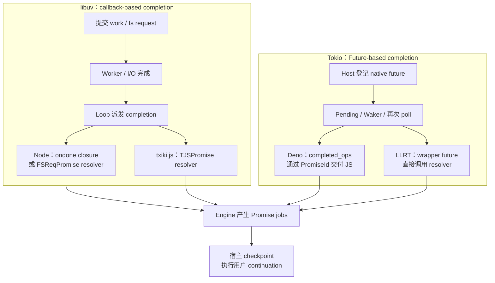

共同点是 native 工作在等待期间有宿主持有；不同点是 continuation 状态和 resolver 放在哪里、结果经过几层队列。两类模型在普通文件 I/O 上都可能使用 blocking pool，不能仅凭 callback/Future 就判断底层是否为 kernel-native async I/O。

### 6.2 `queueMicrotask()` 的入队、执行与保活

这里专门讨论 JavaScript **`queueMicrotask(callback)` API**。一次调用会登记 callback，正常返回 `undefined`，而不是返回一个供用户 await 的 Promise。Callback 的返回值不会被这个 API 用来决定任务是否完成。

先用一个同时包含 Promise reaction 的样例观察入队顺序：

```js
queueMicrotask(() => {
  console.log('micro-1');
  queueMicrotask(() => console.log('micro-2'));
});
Promise.resolve().then(() => console.log('promise'));
console.log('sync');
```

Node*、Deno、Dune、LLRT 实测均输出 `sync → micro-1 → promise → micro-2`，退出 0。解释是：开始 drain 前队列已有 `[micro-1, promise]`；执行 `micro-1` 时新入队的 `micro-2` 排在 `promise` 后面。txiki.js 以下给出源码路径，不作为实测项。

#### 6.2.1 Node.js：JS 参数检查，native binding 入 V8 queue

`queueMicrotask(callback)` 先 `validateFunction()`；根据 async context/hooks 状态，可能包一层 `AsyncResource` callback，然后调用 `enqueueMicrotask` binding。C++ binding 最终执行 `GetMicrotaskQueue()->EnqueueMicrotask(...)`。来源：[JS API][code-159]、[native enqueue / checkpoint][code-127]。

它不会为每个 callback 创建 libuv timer、request 或 idle handle。任务实际由 V8 保存，在 Node 选择的 checkpoint 运行：例如外层 `InternalCallbackScope::Close()` 或 `runNextTicks()` 中的 `runMicrotasks()`。若同一 drain 边界已有 nextTicks，Node 会先处理 nextTick queue；一旦正在执行 V8 checkpoint，nextTick 又不能抢占它。

退出前的正确性依赖这些 drain 边界。这个 API 创建的是 runnable JS work；callback 若随后发起文件读取，则新的 native request 接管后续保活。

#### 6.2.2 txiki.js：直接使用 QuickJS 的 `queueMicrotask`

固定 QuickJS 快照的 `js_global_queueMicrotask()` 检查 callback 是函数，然后调用 `JS_EnqueueJob(ctx, js_microtask_job, ...)`；job 执行时再 `JS_Call` 用户 callback。没有为了该 API 另建一个 Promise。来源：[txiki.js 固定 QuickJS 的 API 实现][code-131]。

这类 job 由 `tjs__drain_microtasks()` 循环执行。Prepare/check 路径把 `JS_IsJobPending()` 映射成 referenced idle handle 的 active 状态，既使 libuv 继续迭代，也避免有 ready jobs 时阻塞在 poll 中；timer callback 后的 drain 等路径也可能消费它。来源：[job drain][code-030]、[idle 映射][code-032]。

因此一个 ready `queueMicrotask` callback 能被宿主继续推进；一个只处于 pending 状态、没有对应 runnable job 的 Promise，不会触发同样的 idle 条件。

#### 6.2.3 Dune：包装异常处理，再调用 V8 enqueue

Dune 的全局 `queueMicrotask` 是 JS wrapper：先检查函数类型，再把带 `try/catch` 的 callback 交给 `$$queueMicro`；Rust `global_queue_micro()` 调用 V8 context 的 `enqueue_microtask`。来源：[JS wrapper][code-130]、[Rust binding][code-129]。

这个 callback 保存在 V8 queue，而不是 `pending_futures` Vec。`run_event_loop()` 在第一次检查保活条件之前就先执行 `run_next_tick_callbacks()`，其中包含 V8 checkpoint；后续在 module 与 native completion 边界再次执行。因此只有这类 ready jobs、没有 native I/O 的简单程序也可以完成回调后退出。来源：[启动 drain 与主循环][code-053]、[nextTick/checkpoint][code-048]。

#### 6.2.4 Deno：当前快照使用 V8 native API，而非每次经过 async op

`01_core.js` 捕获 V8 提供的原生 `queueMicrotask`，并用 JS wrapper 做函数检查和 callback 异常报告；snapshot 恢复路径还可能在首次使用时 lazy capture 原生函数。来源：[当前 `queueMicrotask()` 实现][code-128]。

调用该 API **不分配 PromiseId，不把一个新 future 放入 `pending_ops`，也不需要每个 callback 都 spawn Tokio task**。执行仍发生在 V8 checkpoint，Deno 在 event-loop phases 和部分 callback 边界安排这些 checkpoints。退出判定前的 drain 可以继续产生 ops、nextTicks 或 module work，再由 `EventLoopPendingState` 判断是否需要保持运行。

#### 6.2.5 LLRT：`Function::defer()` 把 callback 放进 QuickJS jobs

LLRT 的 Rust `queue_microtask` 接受类型为 `Function` 的参数，调用 `cb.defer(())`。Rquickjs 的 deferred-call 机制最终使用 `JS_EnqueueJob(...defer_call_job...)`。来源：[LLRT API][code-105]、[rquickjs enqueue][code-107]。

这和 `Async(read_file)` 不同：`queueMicrotask()` 直接产生 QuickJS job，不产生 wrapper future。在 jobs 成功执行的路径上，CLI `idle()` 优先把 QuickJS jobs 执行到空，然后才 poll rquickjs scheduler。API callback 若又排了 callback，会继续被本次 job drain 消费；无限递归 enqueue 可以一直阻止 `idle()` 走到 Rust futures 的 poll。Job 执行错误走下一小节说明的分支。

#### 6.2.6 返回值、异常与保活边界

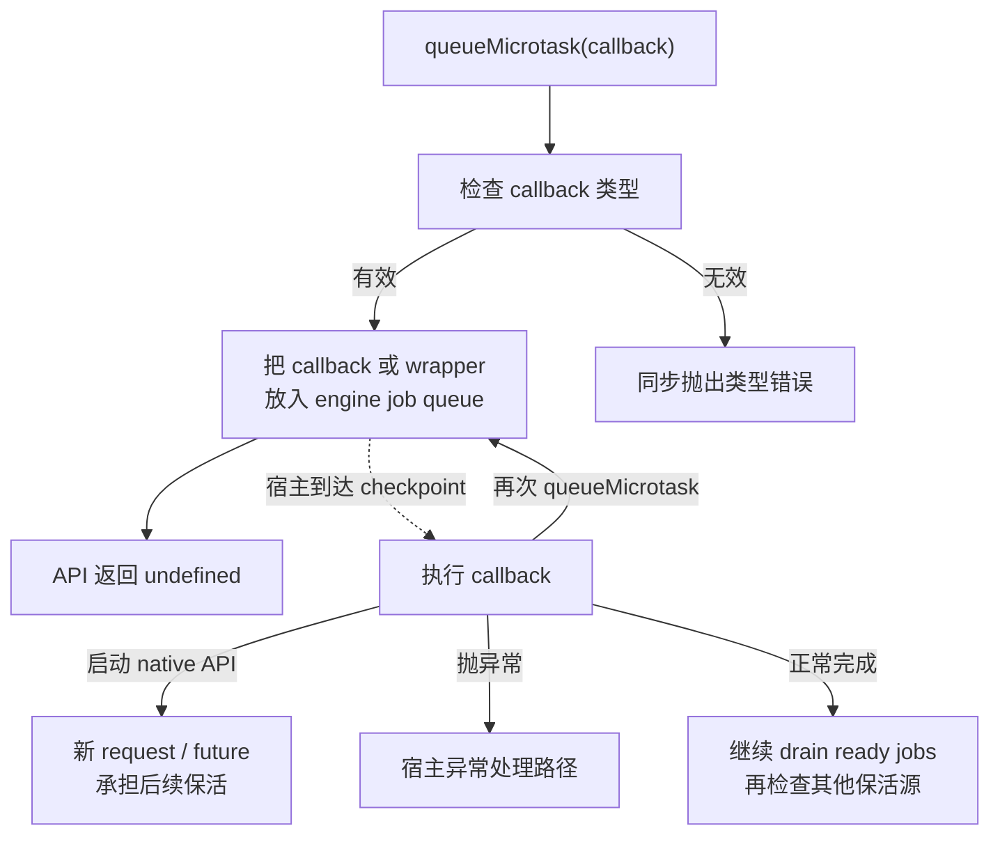

可以用下面的程序把“API 的同步返回”与“callback 稍后抛错”分开：

```js
try {
  queueMicrotask(123);
} catch (error) {
  console.log('invalid', error.name);
}
const result = queueMicrotask(() => {
  console.log('microtask');
  throw new Error('microtask-boom');
});
console.log('return', String(result));
console.log('sync');
```

四个实测二进制先输出 `invalid TypeError → return undefined → sync → microtask`。在未设置额外异常 handler 的该 CLI 案例中：

| Runtime | Callback 抛错后的结果 | 对应处理路径 |
|---|---|---|
| Node* | 报告错误，退出 1 | microtask callback 异常进入宿主 uncaught-exception 处理 |
| Deno | 报告 `Uncaught Error`，退出 1 | JS wrapper 的 `reportExceptionCallback` |
| Dune | 报告 `Uncaught Error`，退出 1 | `reportError` → 捕获异常 → `check_exceptions` |
| LLRT | 打印 `error executing job: ...`，退出 0 | rquickjs `AsyncRuntime::idle()` 记录错误后检查 scheduler；Empty 时即可返回 |

来源：[Deno wrapper][code-128]、[Dune report binding][code-160]、[rquickjs idle 错误分支][code-094]。LLRT 的这个结果限定于本例的 CLI `idle()` 路径；其他入口如 `Ctx::execute_pending_job()` 有不同的错误处理，不能概括为所有 microtask 异常都相同。见 [Ctx job 执行][code-161]。

**LLRT 的“记录 job error”不保证继续排空剩余 jobs。** 对当前 CLI 增加下面的复核样例：

```js
queueMicrotask(() => {
  console.log('first');
  throw new Error('queue-failure');
});
queueMicrotask(() => console.log('second'));
console.log('scheduled');
```

| LLRT 复核条件 | 实际输出（省略空行） | 退出码 |
|---|---|---|
| 只运行上面的代码 | `scheduled` → `first` → `error executing job: Error: queue-failure`；没有 `second` | 0 |
| 在文件开头增加 `setTimeout(() => console.log('timer'), 30)` | `scheduled` → `first` → 同一错误日志 → `second` → `timer` | 0 |

第一种情况下，出错后 scheduler 已为空，`idle()` 直接返回；第二种情况下，timer driver future 仍存在并被 poll，控制流得以再次进入 job drain。这是当前实现的错误路径行为，不能用第二个样例推出“加入 timer 是通用的异常恢复方法”。源码依据仍是 [`idle()` 的 Err 分支与 scheduler 分支][code-094]。

txiki.js 的相应源码路径是 `JS_ExecutePendingJob()` 返回错误 → `TJS_Stop()` → `TJS_Run()` 报告保留的异常；此处没有将它列作二进制实测。

最后，`queueMicrotask(async () => { ... })` 也不会让宿主自动 await callback 返回的 Promise。后续能否继续运行，要看 callback 是否登记了 native work、产生了其他 jobs，或被宿主的 module/root-future 政策要求等待。

### 6.3 `nextTick`：同名 API 的不同队列政策

本节覆盖实际提供 `process.nextTick()` 的 Node.js、Deno Node compatibility、Dune 和 LLRT。它不是 libuv 的某个同名 phase，也不是 Tokio 内置的调度 API。

下面在 timer callback 中登记任务，排除顶层 ESM evaluation 所处执行上下文对优先级观察的干扰：

```js
const processApi = typeof Deno === 'undefined'
  ? process
  : (await import('node:process')).default;

setTimeout(() => {
  const order = [];
  Promise.resolve().then(() => order.push('promise'));
  queueMicrotask(() => order.push('microtask'));
  processApi.nextTick(() => {
    order.push('tick-1');
    processApi.nextTick(() => order.push('tick-2'));
  });
  setTimeout(() => console.log(order.join(',')), 30);
}, 1);
```

| Runtime | 实测顺序 | 解释 |
|---|---|---|
| Node* | `tick-1,tick-2,promise,microtask` | nextTick queue drain 到空，再 checkpoint |
| Deno | `tick-1,tick-2,promise,microtask` | core 实现独立 nextTick queue 和相应 drain 优先级 |
| Dune | `tick-1,promise,microtask,tick-2` | drain 当前 snapshot，递归 tick 留待下次 drain |
| LLRT | `promise,microtask,tick-1,tick-2` | 三种入口使用同一 QuickJS job queue |

#### 6.3.1 Node.js：独立 FIFO queue 与共享 tick flag

`process.nextTick()` 创建含 callback、args、async context 的 TickObject，放进 JS `FixedQueue`；从空队列变为非空时设置 `tickInfo` 中的 scheduled flag，供 C++ callback scope 判断。来源：[nextTick 入队][code-134]。

`processTicksAndRejections()` 的内层 `while (queue.shift())` 会连同 callback 递归添加的新 ticks 一直处理到空，然后执行 V8 microtasks；若 microtasks 又添加 ticks，外层循环再次 drain。因此 `tick-2` 在本例中仍先于 Promise reaction。来源：[drain 算法][code-017]。

每个 TickObject 都不需要一个 libuv request。它能及时执行，靠的是 Node 在返回 native loop 前处理 host task queues 的控制流；无限 nextTick 递归也可能让控制流迟迟回不到 I/O loop。

#### 6.3.2 Deno：在 Tokio 上实现 Node-style host queue

`ext/node/polyfills/_next_tick.ts` 构造 TickObject、保存 async context，调用 `core.queueNextTick()`。Core JS queue 和 `tickInfo` 保存等待执行的状态，`processTicksAndRejections()` 采用先 ticks、后 microtasks 的 drain 算法。来源：[Node-compatible API][code-132]、[core enqueue/flag][code-135]、[core drain][code-070]。

`has_tick_scheduled` 也进入 Deno 的 liveness 判据；需要下一轮时 event-loop Waker 安排重新 poll。这里被唤醒的是驱动 JS runtime 的外层工作，不是为每个 nextTick 创建一个 Tokio task。部分 phase/callback 边界已经会在当前 poll 内处理它，无需等待另一轮 OS I/O 通知。

#### 6.3.3 Dune：`mem::take` 使递归 tick 留在下一批

Rust `next_tick()` 把 persistent callback 及参数放入 `next_tick_queue`。执行时 `run_next_tick_callbacks()` 通过 `mem::take` 取走整个 Vec，跑完这一批，再做 V8 checkpoint。来源：[入队][code-133]、[snapshot drain][code-048]。

执行 `tick-1` 时新加入的 `tick-2` 落在 state 中的新 Vec，而不在当前 snapshot 中。因此先执行本次 checkpoint 的 `promise,microtask`，再由后续一次 `run_next_tick_callbacks()` 调用处理 `tick-2`。**“下一批”不一定意味着下一个完整 event-loop iteration**：同一外层 tick 的其他边界也可能再次调用 drain。

`has_next_tick_callbacks()` 参与外层保活判定；这个 host queue 与 crabuv 的 OS poller、native resources，以及 ready completion Vec 都是不同状态。

#### 6.3.4 LLRT：`nextTick` 是 deferred QuickJS job

LLRT 把 callback 参数放入 `Args`，再调用 `cb.defer_arg(args)`；底层仍是 `JS_EnqueueJob`。没有额外的 nextTick 高优先级队列。来源：[LLRT API][code-106]、[defer enqueue][code-107]。

本例先登记 Promise reaction，再登记 `queueMicrotask` callback，最后登记 nextTick callback，所以顺序为 `promise,microtask,tick-1`；`tick-1` 再把 `tick-2` 放入队尾。CLI 保活看到的是 ready QuickJS jobs，而不是一个专门的 nextTick counter。

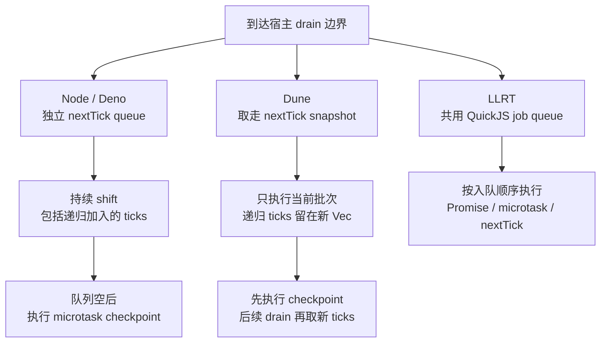

这组结果尤其说明：Node 和 Deno 的 native 调度模型不同，却能实现相同的 host queue 优先级；Deno 和 LLRT 都使用 Tokio，也不因此拥有相同的 `nextTick` 语义。

### 6.4 Dynamic import：加载、求值与退出是三个问题

下面的模块样例均没有导出可调用的 `then`。如果 namespace 上存在这样的导出，resolve namespace 还会触发 thenable assimilation，`import()` 最终 fulfilled 的值不一定就是 namespace；这遵循第 3.3 节介绍的 Promise resolution 规则。

对于 `import('./dep.mjs')`，至少要区分：

1. **Resolve/load**：找到模块并取得源码，可能来自同步读取、缓存、native work 或 futures。
2. **Link/instantiate**：建立依赖图和 bindings。
3. **Evaluate**：执行模块；遇到 TLA 时，evaluation Promise 可以继续 pending。
4. **交付 import 结果**：正常 evaluation-phase 路径应在求值成功后交付 namespace，失败时 reject。
5. **Liveness**：在上述阶段尚未结束时，宿主选择继续等待、报告无法推进，或结束执行。

Public import Promise 和内部 evaluation Promise 是两个逻辑角色，实际实现还可能有更多 Promise wrappers。**“ModuleJob” 也可能只是 loader 状态对象，不等于 engine job，更不等于 Tokio task。**

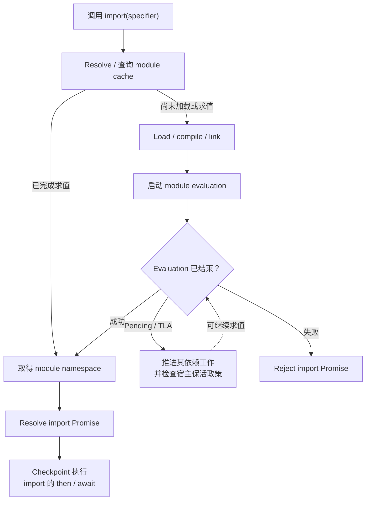

图中画的是等待求值完成再交付的路径；Dune 当前快照提前交付 namespace 的差异在下面单独说明。

#### 6.4.1 Node.js：当前主线程使用同步 loading/linking 的 ModuleJobSync

普通本地 ESM import 经 Node loader 的 `import()` 进入 `getOrCreateModuleJob()`：按解析后的 URL / attributes 查询 `loadCache`，未命中才加载和构造 job。**当前快照主线程选择的是 `ModuleJobSync`；默认 `file:` source 通过 `loaderMethods.readFileSync()` 读取。** 因此不能把这里直接画成前面 `fs.promises.readFile()` 的异步 request 链。来源：[job cache 与类型选择][code-136]、[本地 source 读取][code-138]。

`ModuleLoader.import()` 仍是 async API：它等待 `job.run()`，再返回 namespace。`ModuleJobSync.run()` 对无 TLA 的 graph 同步求值；若有 async graph，则保存并 await `evaluationPromise`。已有求值中的 job 也会等待相应 evaluation Promise。来源：[public import 流程][code-137]、[求值与 TLA][code-139]。

保活需要另看求值过程中产生的 native work：

- 模块 await timer / 文件操作时，相关 handle/request 可以继续保活，completion 与 checkpoints 推进 evaluation Promise。
- 只是缓存一个 job 或持有 pending Promise，并不会自动创建 active libuv work。
- Node 的退出诊断先检查 entry-point Promise 是否 pending，再检查 entry module 的 stalled TLA。**没有被入口 await 的 detached dynamic import，不能直接套用“退出 13”的结论。** 来源：[entry-point 检查][code-140]；下文给出该区别的实测。

这里描述的是指定 HEAD 的主线程默认路径；异步 loader-hook worker 是另一路径。系统 Node* 的实测只验证样例行为，不作为这个 HEAD 的 loader 内部实现证据。

#### 6.4.2 txiki.js：QuickJS import job 内调用同步 module loader

固定 QuickJS 快照的 `js_dynamic_import()` 创建 import Promise capability，把 resolver、referrer、specifier 等放入 `js_dynamic_import_job`；先 enqueue job，再返回 Promise，以避免 module evaluation 中的不期望递归。随后：

```text
QuickJS job drain
  → js_dynamic_import_job
  → JS_LoadModuleInternal
  → txiki.js normalizer / tjs_module_loader
  → 本地 tjs__load_file：同步读源码
  → compile-only module，建立依赖并启动 evaluation
  → 给 evaluation Promise 安装 fulfilled/rejected handlers
  → 求值成功后 resolve import Promise(namespace)
  → 后续 job 执行用户 continuation
```

来源：[txiki.js 固定 QuickJS 的 import/evaluation 逻辑][code-142]、[host module loader][code-141]、[同步文件 helper][code-121]。

特别容易混淆的是：`tjs.readFile()` 把 `tjs__load_file()` 放在 worker pool，而**本地 module loader 直接在引擎调用路径中调用这个 helper**。相同读取函数因调用上下文不同，分别成为异步 API 的工作体和同步 loader 的一部分。

Import job 尚可执行时，QuickJS jobs / idle handle 能继续驱动 loop；模块 TLA 若依赖 timer/readFile，native work 继续保活。若最后只剩没有进展来源的 evaluation Promise，host `TJS_Run()` 没有单独的 pending-dynamic-evaluation 保活登记。引擎等待 TLA 后再 resolve import，与宿主是否继续存在，是两个独立问题。

#### 6.4.3 Dune：异步加载图，但不等待 evaluation Promise 再交付

`host_import_module_dynamically_cb()` 创建 persistent resolver。若相同 root 正在加载，把新 resolver 加入 `same_origin`；否则建立 `ModuleGraph::dynamic_import`，登记到 `module_map.pending`，提交 crabuv loading task。来源：[dynamic import 入口与去重][code-146]。

Loading task 在 worker 中取得源码；completion 进入 `EsModuleFuture`。这个 ready action 在 V8 thread 上编译模块、检查 dependencies，再为新 dependencies 提交加载任务。Graph 的 `Ready` 表示源码图可以进入实例化/求值，并不表示 TLA 已结束。来源：[compile/register][code-147]、[递归加载 dependencies][code-148]。

当前 `fast_forward_imports()` 的关键顺序是：

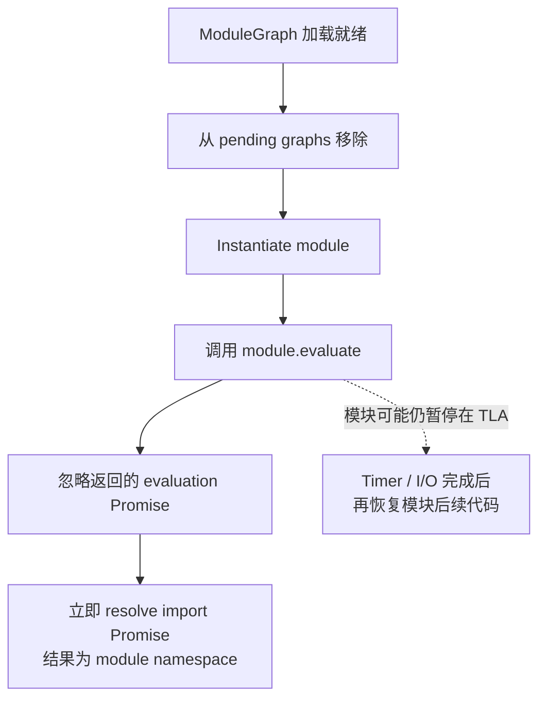

来源：[evaluate 与 namespace resolution][code-149]。

因此，当前快照的 import Promise 可以在 TLA 完成前 resolve；缓存路径也没有另行等待 pending evaluation。Namespace 的 live bindings 不会消除这个交付时机差异，用户可能先观察到尚未完成异步初始化的导出值。

Loading 阶段由 pending graph 和 crabuv resources 保活；进入 evaluation 后，该 graph 已移出 pending。TLA 内部若创建了 timer/文件任务，仍能依靠这些 native work 继续执行；裸 pending Promise 则没有同等保活。下面的两个案例分别验证这两种情况。

#### 6.4.4 Deno：独立 module 管线，显式区分 loading 与 evaluation

Deno 的动态模块不通过普通 async-op 的 `promiseRing` 来关联结果。V8 host callback 创建 `Global<PromiseResolver>`，交给 `ModuleMap::load_dynamic_import()`；后者用 load ID 在 `dynamic_import_map` 保存 resolver。新加载还会通知 event-loop Waker。来源：[host callback][code-150]、[module registry][code-152]、[唤醒入口][code-158]。

一般路径包含三类独立的待处理状态：

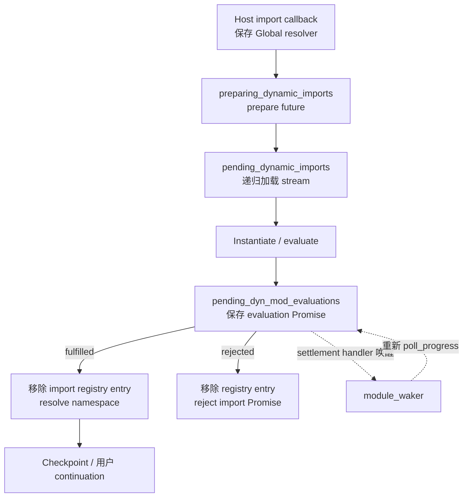

`poll_progress(cx, scope)` 推进准备与加载 futures/streams、注册模块，并检查 evaluation Promise；它直接由 JS event-loop tick 调用，不等于每个 import 都单独 spawn 一个 Tokio task。底层 `ModuleLoader` 可返回 `Sync` 或 `Async` source；CLI 也有自己的准备、缓存和 async loading 路径。来源：[module progress][code-155]、[loader 接口][code-156]、[CLI loading][code-157]。

求值时，Deno 持有内部 evaluation Promise，并安装 fulfilled/rejected handler 来唤醒 module driver；只有观察到该 Promise fulfilled，才 resolve 用户 import Promise，rejected 则转交异常。来源：[evaluation 跟踪][code-153]、[namespace 交付][code-154]。

缓存命中也不能只看“模块已经存在”：在已加载模块的 fast path 中，本快照还会检查该 module 是否仍列在 `pending_dyn_mod_evaluations` 中；若是，就把新的 resolver 放入 `pending_tla_waiters`，而不是过早交付 namespace。来源：[缓存与 TLA waiters][code-151]。

这些 loading/evaluation 状态独立进入 `EventLoopPendingState`。所以即便 `pending_ops.len() == 0`，仍可能因为动态模块而保持运行；若没有可推进工作，则进入 stalled-TLA 检测。它与普通 pending Promise 的处理不同，也与“Tokio 当前还有几个 tasks”不是一个计数。

#### 6.4.5 LLRT：import 走 QuickJS loader，而非 `Async(read_file)` 管线

LLRT 的 QuickJS 也先创建 import capability、enqueue dynamic-import job，再由 job 驱动加载与求值；evaluation Promise fulfilled 后，内部 handler 才 resolve namespace。这里使用的是 rquickjs-sys 固定的另一个 QuickJS commit，来源见 [LLRT 的 QuickJS import 路径][code-143]。

Rquickjs `Loader::load()` 是同步返回 `Result<Module>` 的接口。LLRT 普通 ESM `PackageLoader` 查询 module cache，未命中时使用 `std::fs::read()` 读取源码，并 `Module::declare()`；它没有调用前面 `fs/promises.readFile` 的 Tokio future binding。来源：[loader 接口与挂接][code-144]、[LLRT 本地 ESM loader][code-145]。

因此同一份 LLRT 程序中可以同时存在：

- `readFile()`：native Rust future → rquickjs scheduler → resolver。
- `import()` 的本地源码读取：QuickJS job → 同步 Rust loader → module evaluation Promise。
- 模块 TLA 内部的 timer/readFile：重新产生 rquickjs-owned futures，推动 evaluation Promise 完成。

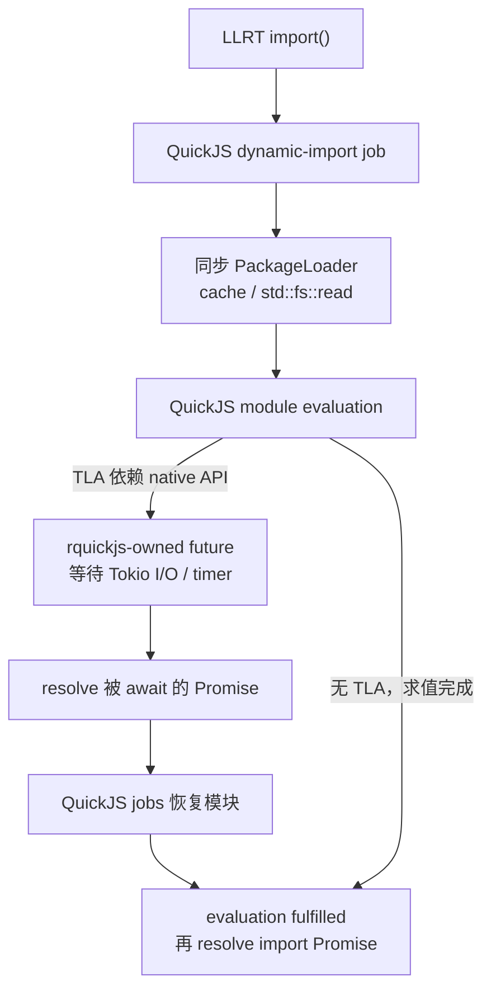

CLI 最后的 `idle()` 检查 jobs 与 scheduler futures。**引擎正确等待 TLA 后再 settle import，不代表 CLI 会为了没有 native work 的 pending evaluation Promise 一直等待。** Lambda 等把 JS Promise 纳入 Rust root future 的宿主模式另当别论，见第 5.5.6 节。

#### 6.4.6 用两个案例分离“等待求值”与“进程保活”

案例 A：调用方不 await import，但被导入模块含有可推进的 timer TLA。

```js
// main-timer.mjs
console.log('main:start');
import('./dep-timer.mjs').then(ns => console.log('import:resolved', ns.phase));
console.log('main:end');
```

```js
// dep-timer.mjs
export let phase = 'before';
console.log('module:start');
await new Promise(resolve => setTimeout(resolve, 30));
phase = 'after';
console.log('module:end');
```

案例 B：把 import 目标换成 `dep-never.mjs`，模块只有一个无法推进的 Promise：

```js
// main-never.mjs
console.log('main:start');
import('./dep-never.mjs').then(ns => console.log('import:resolved', ns.phase));
console.log('main:end');
```

```js
// dep-never.mjs
export const phase = 'before';
console.log('module:start');
await new Promise(() => {});
console.log('module:end');
```

两个案例中，四个实测二进制都先打印 `main:start,main:end,module:start`。后续结果为：

| Runtime | 案例 A 的后续输出 | A 退出码 | 案例 B 的后续结果 | B 退出码 |
|---|---|---|---|---|
| Node* | `module:end` → `import:resolved after` | 0 | 不运行 import continuation | 0 |
| Deno | `module:end` → `import:resolved after` | 0 | `Top-level await promise never resolved` | 1 |
| Dune | `import:resolved before` → `module:end` | 0 | `import:resolved before`；模块仍未执行 await 后代码 | 0 |
| LLRT | `module:end` → `import:resolved after` | 0 | 不运行 import continuation | 0 |

每次运行单独进程，并设置 10 秒外部超时；这些案例均自行结束，没有超时。Node* 仍是系统 v24.14.0 参照，txiki.js 不列实测。

可按以下形式复现，替换主文件即可：

```sh
node main-timer.mjs
./deno/target/debug/deno run --no-config --no-lock --allow-read main-timer.mjs
./dune/target/debug/dune run main-timer.mjs
./llrt/target/debug/llrt main-timer.mjs
```

核心差异是：

- **Node / txiki.js / LLRT** 的 import Promise 可以等待模块求值，但没有进展来源的普通 pending import 不自动等价于必须保活的 native work；入口 TLA / embedder root future 需要另外分析。
- **Deno** 显式把 dynamic loading 与 evaluation 计入宿主状态，并检测无进展的求值。
- **Dune** 跟踪的是加载图；当前快照还存在 namespace 早于 TLA 完成交付的行为。

这既说明 `import()` 的异步结果不保证内部加载是非阻塞 I/O，也说明 **pending import Promise、pending module evaluation、pending native operation 不能用同一个“pending jobs”计数来替代**。

## 7. 行为实验

### 7.1 结果汇总

`Node*` 为系统 Node v24.14.0 参照。所有样例为 ESM；nextTick 样例在 timer callback 内运行，排除了顶层 ESM 自身的调度差异。

下表保留基础 42 组实验的汇总；20 组场景扩展的代码与结果已放在第 6.2、6.3、6.4 节，分别对应 `queueMicrotask()` 的顺序/异常、混合 nextTick 队列和两个 dynamic-import 案例。内容复核补充的 2 组 LLRT job 错误分支样例见第 6.2.6 节。

| 实验 | Node* | Deno | Dune | LLRT |
|---|---|---|---|---|
| 全局保存 pending Promise，普通 async function await 它 | 退出 0；不执行 await 后代码 | 同左 | 同左 | 同左 |
| 只排 `.then` 与 `queueMicrotask` | 全部执行后退出 0 | 同左 | 同左 | 同左 |
| 普通 async function await 30ms timer | continuation 执行后退出 0 | 同左 | 同左 | 同左 |
| 读文件，不 await，只附加 `.then` | 输出 `READ 5`，退出 0 | 同左 | 同左 | 同左 |
| `await new Promise(() => {})` 作为 TLA | 退出 13，诊断 unsettled TLA | 退出 1，诊断 never resolved | 退出 0，无该诊断 | 退出 0，无该诊断 |
| `resolve(thenable)` getter | 同步 getter，异步 then/reaction | 同左 | 同左 | 同左 |
| 纯 `Promise.reject(new Error(...))`，无 handler | 退出 1，报告错误 | 退出 1，报告错误 | 退出 1，报告错误 | 退出 0，未报告该 rejection |
| 递归 nextTick 与 Promise 的顺序 | `tick-1,tick-2,promise` | `tick-1,tick-2,promise` | `tick-1,promise,tick-2` | `promise,tick-1,tick-2` |
| 两个 timers，首个排 `.then` | `timer-1,then-1,timer-2` | 同左 | 同左 | 同左 |
| 无限 Promise chain + 10ms timer | 2 秒内 timer 未运行；外部超时终止 | 同左 | 同左 | 同左 |
| 只剩 60 秒 unref timer | 立即正常退出；timer 未执行 | 同左 | 无同等 timer API，未运行 | 无同等 timer API，未运行 |

前三种“全部退出”的结论说明：**保活看可推进的 host/native 工作，不看 pending Promise 对象是否仍可达。**

LLRT 的 raw rejection 实验也不能泛化为“所有异常都被忽略”：module-load rejection、被 await 的 Promise rejection、spawn error handler、JS job 本身抛错，是不同错误路径。

### 7.2 关键复现代码

#### A. Pending Promise 不保活

```js
globalThis.pending = new Promise(() => {});
globalThis.pending.then(() => console.log('unexpected reaction'));
(async () => {
  console.log('async-start');
  await globalThis.pending;
  console.log('unexpected resumed');
})();
console.log('sync-end');
```

#### B. 相同代码下的 nextTick 差异

```js
// Deno 文件开头另外添加：import process from 'node:process';
setTimeout(() => {
  const order = [];
  Promise.resolve().then(() => order.push('promise'));
  process.nextTick(() => {
    order.push('tick-1');
    process.nextTick(() => order.push('tick-2'));
  });
  setTimeout(() => console.log(order.join(',')), 30);
}, 1);
```

这个差异来自 **host queue design**：Node / Deno drain 到空；Dune drain snapshot；LLRT 放入普通 engine job queue。

#### C. `ShouldYield` 无法抢占 JS job drain

```js
console.log('started');
setTimeout(() => console.log('timer-fired'), 10);
function spin() { Promise.resolve().then(spin); }
spin();
```

必须从外部设置 timeout。该实验验证“timer 没有机会运行”，不以进程持续存在本身作为 fairness 证明。

复现命令形式（从本目录执行）：

```sh
./deno/target/debug/deno run --no-config --no-lock example.mjs
./dune/target/debug/dune run example.mjs
./llrt/target/debug/llrt example.mjs
node example.mjs
```

## 8. 退出判定的统一理解

### 8.1 三个独立维度

| 状态 | 宿主应做什么 |
|---|---|
| 有 ready JS / host work | 立即推进，或安排下一次调度；避免无通知地睡眠 |
| 无 ready work，但有 referenced pending native work | 等待 I/O / timer / Waker |
| 只有 unrefed work | 可进入结束流程；unrefed work 仍可能在其他工作保活时执行 |
| 只有普通 pending Promise，没有 native work | 通常可以结束；不从 Promise 对象数推导 liveness |
| 有必须完成的 module evaluation / host root future | 按宿主策略等待或报告无法推进；不同于普通 Promise |

下面把这些状态连成一个抽象流程。它表示宿主需要做出的决策，而非规定五个 runtime 采用相同的 queue priority 或退出 hooks。

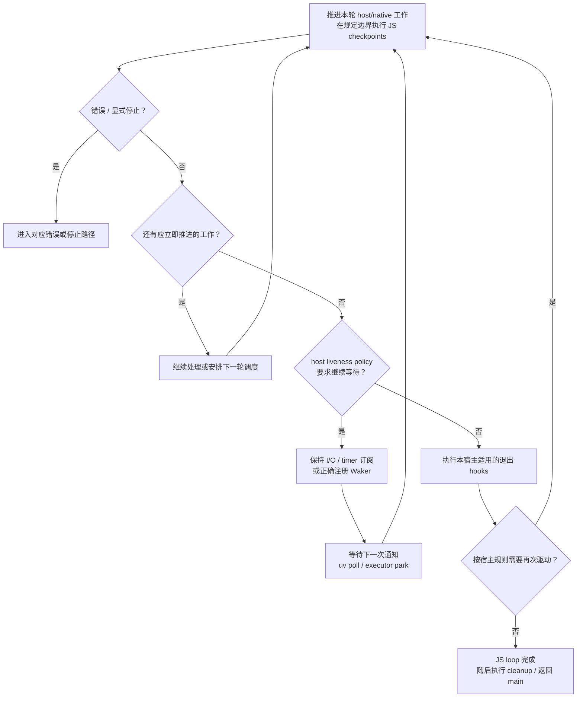

`Pending` 对应的是继续等待或重新调度的阶段，不能代替 liveness 判断。若宿主要求完成 TLA / root evaluation，还需要在“推进本轮工作”时检查是否存在进展来源；Deno 的 stalled-TLA 检测就是这样的额外政策。退出 hook 也可能产生新的工作，是否续跑及如何避免空转由宿主决定。

### 8.2 各项目的政策

| Runtime | 主要 liveness 状态 | idle 后的额外处理 |
|---|---|---|
| Node | referenced active handles、active requests、pending / closing native work | platform tasks、beforeExit、exit、unsettled-TLA 检查 |
| txiki.js | libuv liveness；ready jobs / deferred rejections 经 idle handle 接入 | beforeunload；worker 特有保活；异常停止 |
| Dune | crabuv resources / requests / threadpool + imports / nextTick / rejections / V8 background tasks | 已追踪路径中 same-tick completion drain；无 Node-style stalled-TLA 检查 |
| Deno | refed ops / timers / tasks + module state + nextTick / rejection events + external ops + uv-compatible handles | stalled TLA、可选 inspector waiting、CLI exit hooks、Tokio shutdown |
| LLRT CLI | 正常路径检查 QuickJS jobs + rquickjs-owned futures | `idle()` 后继续退出流程；job 执行错误可能使它提前返回，见第 6.2.6 节；Lambda 使用不同 host root future |

**End of JS event loop、runtime cleanup、OS process exit 是三个阶段，不应混为一个 API。** 显式 `process.exit()` / `Deno.exit()` / `tjs.exit()`、异常退出和外部信号还会走其他分支。

退出前 drain 当前 runnable jobs 很重要，因为它们可能产生新 I/O。但不存在所有 runtime 必须照搬的唯一“先 microtasks、再 nextTick、再 beforeExit”公式；Node 的队列优先级、txiki.js 的 beforeunload 和 LLRT 的 `idle()` 已经展示了不同政策。

## 9. 对实现新 runtime 的启示

1. **Separate waiting from runnable work**：pending Promise reactions、ready JS jobs、pending native operations 分开建模。
2. **Define completion ownership**：native operation 持有 resolver，或持有 correlation ID 都可行；由 engine API 与生命周期设计决定，不由 Tokio 名字决定。
3. **Preserve completion handoff liveness**：结果已经 ready、但尚未交给 JS 时，必须仍由某个 registry / runnable queue / control-flow invariant 覆盖。
4. **Define checkpoints explicitly**：标明哪些 native callbacks、host batches、module transitions 后 drain jobs；测试 reentrancy 和递归调度。
5. **Keep liveness separate from wake-up**：保活计数正确但没有 wake，会挂起；wake 正确但保活遗漏，会过早退出。
6. **Specify unref and TLA policies**：它们是 host lifecycle 合约，既不等于 Promise 状态，也不等于取消 Rust future。
7. **Check fairness at each layer**：Rust scheduler 的 yield budget 不会抢占 JS 正在执行的代码或无限 microtask drain；libuv callback loop 同样需要考虑 starvation。

最终可以用一句话概括：**libuv-based runtime 通常把 native work 表达为 handles/requests 与 callbacks；Tokio-based runtime 通常把它表达为 futures 与 Wakers。Promise/await 的执行仍由 JS engine 完成，checkpoint 时机与退出策略由宿主定义。**

<!-- Source permalinks: exact local revision and line ranges. -->
[code-001]: https://github.com/nodejs/node/blob/fd204481115fe32277beb86ccc726976deb61f79/deps/v8/src/builtins/promise-abstract-operations.tq#L469-L505
[code-002]: https://github.com/quickjs-ng/quickjs/blob/0fdea21ff1090084e91dad812b343d92e79ba9d9/quickjs.c#L2494-L2554
[code-003]: https://github.com/nodejs/node/blob/fd204481115fe32277beb86ccc726976deb61f79/src/node.h#L473
[code-004]: https://github.com/denoland/deno/blob/7e4306fbe8587dc7d4c103deb8a95af56cca00cb/libs/core/runtime/setup.rs#L284
[code-005]: https://github.com/aalykiot/dune/blob/5958b6460d4a567a41e6194f637a86a45b265f95/src/runtime.rs#L148
[code-006]: https://github.com/nodejs/node/blob/fd204481115fe32277beb86ccc726976deb61f79/deps/v8/src/builtins/promise-resolve.tq#L160-L186
[code-007]: https://github.com/quickjs-ng/quickjs/blob/0fdea21ff1090084e91dad812b343d92e79ba9d9/quickjs.c#L55766-L55819
[code-008]: https://github.com/nodejs/node/blob/fd204481115fe32277beb86ccc726976deb61f79/deps/uv/src/unix/core.c#L393-L398
[code-009]: https://github.com/nodejs/node/blob/fd204481115fe32277beb86ccc726976deb61f79/deps/uv/src/uv-common.h#L243-L323
[code-010]: https://github.com/nodejs/node/blob/fd204481115fe32277beb86ccc726976deb61f79/deps/uv/src/unix/async.c#L93-L109
[code-011]: https://github.com/tokio-rs/tokio/blob/a85c3f5baa298a6b554fd3700daf0342289881af/tokio/src/runtime/runtime.rs#L30-L54
[code-012]: https://github.com/tokio-rs/tokio/blob/a85c3f5baa298a6b554fd3700daf0342289881af/tokio/src/runtime/runtime.rs#L283-L314
[code-013]: https://github.com/nodejs/node/blob/fd204481115fe32277beb86ccc726976deb61f79/src/node_file-inl.h#L193-L207
[code-014]: https://github.com/nodejs/node/blob/fd204481115fe32277beb86ccc726976deb61f79/src/node_file-inl.h#L226-L256
[code-015]: https://github.com/nodejs/node/blob/fd204481115fe32277beb86ccc726976deb61f79/src/node_file-inl.h#L282-L292
[code-016]: https://github.com/nodejs/node/blob/fd204481115fe32277beb86ccc726976deb61f79/src/api/callback.cc#L140-L215
[code-017]: https://github.com/nodejs/node/blob/fd204481115fe32277beb86ccc726976deb61f79/lib/internal/process/task_queues.js#L63-L109
[code-018]: https://github.com/nodejs/node/blob/fd204481115fe32277beb86ccc726976deb61f79/src/env.cc#L1771-L1794
[code-019]: https://github.com/nodejs/node/blob/fd204481115fe32277beb86ccc726976deb61f79/lib/internal/timers.js#L518-L637
[code-020]: https://github.com/nodejs/node/blob/fd204481115fe32277beb86ccc726976deb61f79/src/env.cc#L1832-L1868
[code-021]: https://github.com/nodejs/node/blob/fd204481115fe32277beb86ccc726976deb61f79/src/api/embed_helpers.cc#L23-L77
[code-022]: https://github.com/nodejs/node/blob/fd204481115fe32277beb86ccc726976deb61f79/src/api/hooks.cc#L52-L83
[code-023]: https://github.com/nodejs/node/blob/fd204481115fe32277beb86ccc726976deb61f79/src/node_exit_code.h#L30
[code-024]: https://github.com/saghul/txiki.js/blob/fc2b5f3b2d09e6db739eb619cfb1acca37d6bdf0/src/mod_fs.c#L106-L123
[code-025]: https://github.com/saghul/txiki.js/blob/fc2b5f3b2d09e6db739eb619cfb1acca37d6bdf0/src/mod_fs.c#L273-L282
[code-026]: https://github.com/saghul/txiki.js/blob/fc2b5f3b2d09e6db739eb619cfb1acca37d6bdf0/src/mod_fs.c#L400-L408
[code-027]: https://github.com/saghul/txiki.js/blob/fc2b5f3b2d09e6db739eb619cfb1acca37d6bdf0/src/utils.c#L208-L230
[code-028]: https://github.com/saghul/txiki.js/blob/fc2b5f3b2d09e6db739eb619cfb1acca37d6bdf0/src/timers.c#L78-L95
[code-029]: https://github.com/saghul/txiki.js/blob/fc2b5f3b2d09e6db739eb619cfb1acca37d6bdf0/src/utils.c#L185-L230
[code-030]: https://github.com/saghul/txiki.js/blob/fc2b5f3b2d09e6db739eb619cfb1acca37d6bdf0/src/vm.c#L957-L1065
[code-031]: https://github.com/saghul/txiki.js/blob/fc2b5f3b2d09e6db739eb619cfb1acca37d6bdf0/src/js/polyfills/event-target.js#L640-L657
[code-032]: https://github.com/saghul/txiki.js/blob/fc2b5f3b2d09e6db739eb619cfb1acca37d6bdf0/src/vm.c#L942-L947
[code-033]: https://github.com/saghul/txiki.js/blob/fc2b5f3b2d09e6db739eb619cfb1acca37d6bdf0/src/vm.c#L1089-L1139
[code-034]: https://github.com/saghul/txiki.js/blob/fc2b5f3b2d09e6db739eb619cfb1acca37d6bdf0/src/js/run-main/index.js#L160
[code-035]: https://github.com/saghul/txiki.js/blob/fc2b5f3b2d09e6db739eb619cfb1acca37d6bdf0/src/js/run-main/index.js#L307
[code-036]: https://github.com/saghul/txiki.js/blob/fc2b5f3b2d09e6db739eb619cfb1acca37d6bdf0/src/eval.c#L44-L64
[code-037]: https://github.com/saghul/txiki.js/blob/fc2b5f3b2d09e6db739eb619cfb1acca37d6bdf0/src/mod_os.c#L31-L38
[code-038]: https://github.com/saghul/txiki.js/blob/fc2b5f3b2d09e6db739eb619cfb1acca37d6bdf0/src/vm.c#L436
[code-039]: https://github.com/saghul/txiki.js/blob/fc2b5f3b2d09e6db739eb619cfb1acca37d6bdf0/src/vm.c#L1149-L1152
[code-040]: https://github.com/aalykiot/dune/blob/5958b6460d4a567a41e6194f637a86a45b265f95/src/runtime.rs#L44-L48
[code-041]: https://github.com/aalykiot/dune/blob/5958b6460d4a567a41e6194f637a86a45b265f95/src/file.rs#L187-L272
[code-042]: https://github.com/aalykiot/crabuv/blob/2fda099a374bccf6d928bd59aa576be944ed2b39/src/event_loop.rs#L273-L284
[code-043]: https://github.com/aalykiot/crabuv/blob/2fda099a374bccf6d928bd59aa576be944ed2b39/src/event_loop.rs#L350-L358
[code-044]: https://github.com/aalykiot/crabuv/blob/2fda099a374bccf6d928bd59aa576be944ed2b39/src/event_loop.rs#L445-L466
[code-045]: https://github.com/aalykiot/crabuv/blob/2fda099a374bccf6d928bd59aa576be944ed2b39/src/event_loop.rs#L732-L770
[code-046]: https://github.com/aalykiot/dune/blob/5958b6460d4a567a41e6194f637a86a45b265f95/src/runtime.rs#L427-L432
[code-047]: https://github.com/aalykiot/dune/blob/5958b6460d4a567a41e6194f637a86a45b265f95/src/runtime.rs#L479-L504
[code-048]: https://github.com/aalykiot/dune/blob/5958b6460d4a567a41e6194f637a86a45b265f95/src/runtime.rs#L685-L718
[code-049]: https://github.com/aalykiot/dune/blob/5958b6460d4a567a41e6194f637a86a45b265f95/src/timers.rs#L88-L104
[code-050]: https://github.com/aalykiot/crabuv/blob/2fda099a374bccf6d928bd59aa576be944ed2b39/src/event_loop.rs#L169-L180
[code-051]: https://github.com/aalykiot/crabuv/blob/2fda099a374bccf6d928bd59aa576be944ed2b39/src/event_loop.rs#L235-L284
[code-052]: https://github.com/aalykiot/crabuv/blob/2fda099a374bccf6d928bd59aa576be944ed2b39/src/event_loop.rs#L657-L661
[code-053]: https://github.com/aalykiot/dune/blob/5958b6460d4a567a41e6194f637a86a45b265f95/src/runtime.rs#L442-L465
[code-054]: https://github.com/aalykiot/dune/blob/5958b6460d4a567a41e6194f637a86a45b265f95/src/modules.rs#L120-L123
[code-055]: https://github.com/aalykiot/dune/blob/5958b6460d4a567a41e6194f637a86a45b265f95/src/runtime.rs#L522-L579
[code-056]: https://github.com/aalykiot/dune/blob/5958b6460d4a567a41e6194f637a86a45b265f95/src/process.rs#L121-L127
[code-057]: https://github.com/denoland/deno/blob/7e4306fbe8587dc7d4c103deb8a95af56cca00cb/libs/core/00_infra.js#L32-L41
[code-058]: https://github.com/denoland/deno/blob/7e4306fbe8587dc7d4c103deb8a95af56cca00cb/libs/core/00_infra.js#L146-L196
[code-059]: https://github.com/denoland/deno/blob/7e4306fbe8587dc7d4c103deb8a95af56cca00cb/libs/core/runtime/op_driver/futures_unordered_driver.rs#L33-L68
[code-060]: https://github.com/denoland/deno/blob/7e4306fbe8587dc7d4c103deb8a95af56cca00cb/libs/core/runtime/op_driver/futures_unordered_driver.rs#L100-L124
[code-061]: https://github.com/denoland/deno/blob/7e4306fbe8587dc7d4c103deb8a95af56cca00cb/libs/core/runtime/op_driver/futures_unordered_driver.rs#L212-L231
[code-062]: https://github.com/denoland/deno/blob/7e4306fbe8587dc7d4c103deb8a95af56cca00cb/libs/core/runtime/jsruntime.rs#L3551-L3618
[code-063]: https://github.com/denoland/deno/blob/7e4306fbe8587dc7d4c103deb8a95af56cca00cb/libs/core/runtime/op_driver/futures_unordered_driver.rs#L128-L209
[code-064]: https://github.com/denoland/deno/blob/7e4306fbe8587dc7d4c103deb8a95af56cca00cb/libs/core/00_infra.js#L218-L235
[code-065]: https://github.com/denoland/deno/blob/7e4306fbe8587dc7d4c103deb8a95af56cca00cb/libs/core/runtime/op_driver/mod.rs#L56-L98
[code-066]: https://github.com/denoland/deno_unsync/blob/eefd38ef5a1d51f97666f2ced1476a7244ba90c7/src/tokio/task.rs#L49-L64
[code-067]: https://github.com/denoland/deno/blob/7e4306fbe8587dc7d4c103deb8a95af56cca00cb/libs/core/runtime/exception_state.rs#L17-L25
[code-068]: https://github.com/denoland/deno/blob/7e4306fbe8587dc7d4c103deb8a95af56cca00cb/libs/core/modules/map/dynamic.rs#L33-L38
[code-069]: https://github.com/denoland/deno/blob/7e4306fbe8587dc7d4c103deb8a95af56cca00cb/libs/core/runtime/jsruntime.rs#L2425-L2643
[code-070]: https://github.com/denoland/deno/blob/7e4306fbe8587dc7d4c103deb8a95af56cca00cb/libs/core/01_core.js#L358-L474
[code-071]: https://github.com/denoland/deno/blob/7e4306fbe8587dc7d4c103deb8a95af56cca00cb/libs/core/02_timers.js#L285-L289
[code-072]: https://github.com/denoland/deno/blob/7e4306fbe8587dc7d4c103deb8a95af56cca00cb/libs/core/uv_compat.rs#L359-L427
[code-073]: https://github.com/denoland/deno/blob/7e4306fbe8587dc7d4c103deb8a95af56cca00cb/libs/core/uv_compat.rs#L577
[code-074]: https://github.com/denoland/deno/blob/7e4306fbe8587dc7d4c103deb8a95af56cca00cb/libs/core/uv_compat.rs#L1380-L1441
[code-075]: https://github.com/denoland/deno/blob/7e4306fbe8587dc7d4c103deb8a95af56cca00cb/libs/core/runtime/jsruntime.rs#L2709-L2724
[code-076]: https://github.com/denoland/deno/blob/7e4306fbe8587dc7d4c103deb8a95af56cca00cb/libs/core/runtime/jsruntime.rs#L3050-L3137
[code-077]: https://github.com/denoland/deno/blob/7e4306fbe8587dc7d4c103deb8a95af56cca00cb/libs/core/02_timers.js#L198-L207
[code-078]: https://github.com/denoland/deno/blob/7e4306fbe8587dc7d4c103deb8a95af56cca00cb/libs/core/02_timers.js#L396-L407
[code-079]: https://github.com/denoland/deno/blob/7e4306fbe8587dc7d4c103deb8a95af56cca00cb/libs/core/ops_builtin_v8.rs#L55-L64
[code-080]: https://github.com/denoland/deno/blob/7e4306fbe8587dc7d4c103deb8a95af56cca00cb/libs/core/ops_builtin_v8.rs#L127-L143
[code-081]: https://github.com/denoland/deno/blob/7e4306fbe8587dc7d4c103deb8a95af56cca00cb/libs/core/ops.rs#L366-L389
[code-082]: https://github.com/denoland/deno/blob/7e4306fbe8587dc7d4c103deb8a95af56cca00cb/ext/napi/uv.rs#L240-L253
[code-083]: https://github.com/denoland/deno/blob/7e4306fbe8587dc7d4c103deb8a95af56cca00cb/ext/process/ipc.rs#L40-L104
[code-084]: https://github.com/denoland/deno/blob/7e4306fbe8587dc7d4c103deb8a95af56cca00cb/libs/core/runtime/jsruntime.rs#L2727-L2827
[code-085]: https://github.com/denoland/deno/blob/7e4306fbe8587dc7d4c103deb8a95af56cca00cb/cli/lib/worker.rs#L1021-L1043
[code-086]: https://github.com/denoland/deno/blob/7e4306fbe8587dc7d4c103deb8a95af56cca00cb/runtime/tokio_util.rs#L124-L130
[code-087]: https://github.com/awslabs/llrt/blob/bd60ee68f337e120c9cbb7816c9409eb701d691d/modules/llrt_fs/src/lib.rs#L150-L153
[code-088]: https://github.com/DelSkayn/rquickjs/blob/d7ef5eeae702fea24c03643064de454f1c1dd4b0/core/src/value/function/into_func.rs#L35-L54
[code-089]: https://github.com/DelSkayn/rquickjs/blob/d7ef5eeae702fea24c03643064de454f1c1dd4b0/core/src/value/promise.rs#L48-L79
[code-090]: https://github.com/DelSkayn/rquickjs/blob/d7ef5eeae702fea24c03643064de454f1c1dd4b0/core/src/value/promise.rs#L243-L250
[code-091]: https://github.com/DelSkayn/rquickjs/blob/d7ef5eeae702fea24c03643064de454f1c1dd4b0/core/src/runtime/schedular.rs#L37-L85
[code-092]: https://github.com/DelSkayn/rquickjs/blob/d7ef5eeae702fea24c03643064de454f1c1dd4b0/core/src/runtime/schedular.rs#L130-L210
[code-093]: https://github.com/DelSkayn/rquickjs/blob/d7ef5eeae702fea24c03643064de454f1c1dd4b0/core/src/runtime/spawner.rs#L15-L47
[code-094]: https://github.com/DelSkayn/rquickjs/blob/d7ef5eeae702fea24c03643064de454f1c1dd4b0/core/src/runtime/async.rs#L301-L347
[code-095]: https://github.com/DelSkayn/rquickjs/blob/d7ef5eeae702fea24c03643064de454f1c1dd4b0/core/src/runtime/async.rs#L331-L339
[code-096]: https://github.com/DelSkayn/rquickjs/blob/d7ef5eeae702fea24c03643064de454f1c1dd4b0/core/src/runtime/schedular.rs#L193-L206
[code-097]: https://github.com/awslabs/llrt/blob/bd60ee68f337e120c9cbb7816c9409eb701d691d/llrt_core/Cargo.toml#L61-L65
[code-098]: https://github.com/DelSkayn/rquickjs/blob/d7ef5eeae702fea24c03643064de454f1c1dd4b0/core/src/runtime/async.rs#L59-L80
[code-099]: https://github.com/awslabs/llrt/blob/bd60ee68f337e120c9cbb7816c9409eb701d691d/llrt/src/main.rs#L115-L133
[code-100]: https://github.com/DelSkayn/rquickjs/blob/d7ef5eeae702fea24c03643064de454f1c1dd4b0/core/src/context/async/future.rs#L106-L149
[code-101]: https://github.com/awslabs/llrt/blob/bd60ee68f337e120c9cbb7816c9409eb701d691d/modules/llrt_timers/src/lib.rs#L363-L385
[code-102]: https://github.com/awslabs/llrt/blob/bd60ee68f337e120c9cbb7816c9409eb701d691d/modules/llrt_timers/src/lib.rs#L35-L41
[code-103]: https://github.com/awslabs/llrt/blob/bd60ee68f337e120c9cbb7816c9409eb701d691d/modules/llrt_timers/src/lib.rs#L138-L152
[code-104]: https://github.com/awslabs/llrt/blob/bd60ee68f337e120c9cbb7816c9409eb701d691d/modules/llrt_timers/src/lib.rs#L270-L295
[code-105]: https://github.com/awslabs/llrt/blob/bd60ee68f337e120c9cbb7816c9409eb701d691d/modules/llrt_timers/src/lib.rs#L80-L90
[code-106]: https://github.com/awslabs/llrt/blob/bd60ee68f337e120c9cbb7816c9409eb701d691d/modules/llrt_process/src/lib.rs#L30-L36
[code-107]: https://github.com/DelSkayn/rquickjs/blob/d7ef5eeae702fea24c03643064de454f1c1dd4b0/core/src/value/function/args.rs#L149-L165
[code-108]: https://github.com/awslabs/llrt/blob/bd60ee68f337e120c9cbb7816c9409eb701d691d/modules/llrt_process/src/lib.rs#L85-L90
[code-109]: https://github.com/awslabs/llrt/blob/bd60ee68f337e120c9cbb7816c9409eb701d691d/llrt_core/src/vm.rs#L158-L196
[code-110]: https://github.com/awslabs/llrt/blob/bd60ee68f337e120c9cbb7816c9409eb701d691d/llrt/src/main.rs#L125-L133
[code-111]: https://github.com/awslabs/llrt/blob/bd60ee68f337e120c9cbb7816c9409eb701d691d/llrt_core/src/runtime_client.rs#L408-L441
[code-112]: https://github.com/awslabs/llrt/blob/bd60ee68f337e120c9cbb7816c9409eb701d691d/llrt_core/src/runtime_client.rs#L464-L477
[code-113]: https://github.com/awslabs/llrt/blob/bd60ee68f337e120c9cbb7816c9409eb701d691d/modules/llrt_dgram/src/socket.rs#L527-L538
[code-114]: https://github.com/DelSkayn/rquickjs/blob/d7ef5eeae702fea24c03643064de454f1c1dd4b0/core/src/runtime/async.rs#L252-L260
[code-115]: https://github.com/nodejs/node/blob/fd204481115fe32277beb86ccc726976deb61f79/lib/fs.js#L421-L515
[code-116]: https://github.com/nodejs/node/blob/fd204481115fe32277beb86ccc726976deb61f79/lib/internal/fs/promises.js#L2291-L2347
[code-117]: https://github.com/nodejs/node/blob/fd204481115fe32277beb86ccc726976deb61f79/src/node_file.cc#L3629-L3794
[code-118]: https://github.com/nodejs/node/blob/fd204481115fe32277beb86ccc726976deb61f79/src/threadpoolwork-inl.h#L33-L59
[code-119]: https://github.com/nodejs/node/blob/fd204481115fe32277beb86ccc726976deb61f79/lib/internal/fs/promises.js#L1315-L1413
[code-120]: https://github.com/saghul/txiki.js/blob/fc2b5f3b2d09e6db739eb619cfb1acca37d6bdf0/src/mod_fs.c#L1290-L1373
[code-121]: https://github.com/saghul/txiki.js/blob/fc2b5f3b2d09e6db739eb619cfb1acca37d6bdf0/src/vm.c#L1158-L1190
[code-122]: https://github.com/aalykiot/dune/blob/5958b6460d4a567a41e6194f637a86a45b265f95/src/js/fs.js#L409-L437
[code-123]: https://github.com/denoland/deno/blob/7e4306fbe8587dc7d4c103deb8a95af56cca00cb/ext/fs/30_fs.js#L831-L855
[code-124]: https://github.com/denoland/deno/blob/7e4306fbe8587dc7d4c103deb8a95af56cca00cb/ext/fs/ops.rs#L1557-L1603
[code-125]: https://github.com/denoland/deno/blob/7e4306fbe8587dc7d4c103deb8a95af56cca00cb/ext/fs/std_fs.rs#L489-L503
[code-126]: https://github.com/awslabs/llrt/blob/bd60ee68f337e120c9cbb7816c9409eb701d691d/modules/llrt_fs/src/read_file.rs#L9-L19
[code-127]: https://github.com/nodejs/node/blob/fd204481115fe32277beb86ccc726976deb61f79/src/node_task_queue.cc#L131-L143
[code-128]: https://github.com/denoland/deno/blob/7e4306fbe8587dc7d4c103deb8a95af56cca00cb/libs/core/01_core.js#L561-L595
[code-129]: https://github.com/aalykiot/dune/blob/5958b6460d4a567a41e6194f637a86a45b265f95/src/bindings.rs#L90-L102
[code-130]: https://github.com/aalykiot/dune/blob/5958b6460d4a567a41e6194f637a86a45b265f95/src/js/main.js#L18-L36
[code-131]: https://github.com/quickjs-ng/quickjs/blob/10b99693cdc3f37cdf05114bc2d5225de495c4a3/quickjs.c#L41036-L41049
[code-132]: https://github.com/denoland/deno/blob/7e4306fbe8587dc7d4c103deb8a95af56cca00cb/ext/node/polyfills/_next_tick.ts#L48-L100
[code-133]: https://github.com/aalykiot/dune/blob/5958b6460d4a567a41e6194f637a86a45b265f95/src/process.rs#L152-L175
[code-134]: https://github.com/nodejs/node/blob/fd204481115fe32277beb86ccc726976deb61f79/lib/internal/process/task_queues.js#L126-L151
[code-135]: https://github.com/denoland/deno/blob/7e4306fbe8587dc7d4c103deb8a95af56cca00cb/libs/core/01_core.js#L300-L326
[code-136]: https://github.com/nodejs/node/blob/fd204481115fe32277beb86ccc726976deb61f79/lib/internal/modules/esm/loader.js#L568-L668
[code-137]: https://github.com/nodejs/node/blob/fd204481115fe32277beb86ccc726976deb61f79/lib/internal/modules/esm/loader.js#L682-L705
[code-138]: https://github.com/nodejs/node/blob/fd204481115fe32277beb86ccc726976deb61f79/lib/internal/modules/esm/load.js#L29-L50
[code-139]: https://github.com/nodejs/node/blob/fd204481115fe32277beb86ccc726976deb61f79/lib/internal/modules/esm/module_job.js#L643-L693
[code-140]: https://github.com/nodejs/node/blob/fd204481115fe32277beb86ccc726976deb61f79/src/env.cc#L1600-L1632
[code-141]: https://github.com/saghul/txiki.js/blob/fc2b5f3b2d09e6db739eb619cfb1acca37d6bdf0/src/modules.c#L136-L206
[code-142]: https://github.com/quickjs-ng/quickjs/blob/10b99693cdc3f37cdf05114bc2d5225de495c4a3/quickjs.c#L31818-L32029
[code-143]: https://github.com/quickjs-ng/quickjs/blob/0fdea21ff1090084e91dad812b343d92e79ba9d9/quickjs.c#L31798-L32009
[code-144]: https://github.com/DelSkayn/rquickjs/blob/d7ef5eeae702fea24c03643064de454f1c1dd4b0/core/src/loader.rs#L94-L144
[code-145]: https://github.com/awslabs/llrt/blob/bd60ee68f337e120c9cbb7816c9409eb701d691d/llrt_modules/src/package/loader.rs#L119-L167
[code-146]: https://github.com/aalykiot/dune/blob/5958b6460d4a567a41e6194f637a86a45b265f95/src/hooks.rs#L148-L242
[code-147]: https://github.com/aalykiot/dune/blob/5958b6460d4a567a41e6194f637a86a45b265f95/src/modules.rs#L292-L340
[code-148]: https://github.com/aalykiot/dune/blob/5958b6460d4a567a41e6194f637a86a45b265f95/src/modules.rs#L349-L418
[code-149]: https://github.com/aalykiot/dune/blob/5958b6460d4a567a41e6194f637a86a45b265f95/src/runtime.rs#L522-L615
[code-150]: https://github.com/denoland/deno/blob/7e4306fbe8587dc7d4c103deb8a95af56cca00cb/libs/core/runtime/bindings.rs#L1244-L1303
[code-151]: https://github.com/denoland/deno/blob/7e4306fbe8587dc7d4c103deb8a95af56cca00cb/libs/core/modules/map/dynamic.rs#L46-L105
[code-152]: https://github.com/denoland/deno/blob/7e4306fbe8587dc7d4c103deb8a95af56cca00cb/libs/core/modules/map/dynamic.rs#L164-L201
[code-153]: https://github.com/denoland/deno/blob/7e4306fbe8587dc7d4c103deb8a95af56cca00cb/libs/core/modules/map/dynamic.rs#L203-L328
[code-154]: https://github.com/denoland/deno/blob/7e4306fbe8587dc7d4c103deb8a95af56cca00cb/libs/core/modules/map/dynamic.rs#L394-L427
[code-155]: https://github.com/denoland/deno/blob/7e4306fbe8587dc7d4c103deb8a95af56cca00cb/libs/core/modules/map/dynamic.rs#L429-L577
[code-156]: https://github.com/denoland/deno/blob/7e4306fbe8587dc7d4c103deb8a95af56cca00cb/libs/core/modules/loaders.rs#L33-L43
[code-157]: https://github.com/denoland/deno/blob/7e4306fbe8587dc7d4c103deb8a95af56cca00cb/cli/module_loader.rs#L1548-L1604
[code-158]: https://github.com/denoland/deno/blob/7e4306fbe8587dc7d4c103deb8a95af56cca00cb/libs/core/runtime/jsruntime.rs#L3159-L3164
[code-159]: https://github.com/nodejs/node/blob/fd204481115fe32277beb86ccc726976deb61f79/lib/internal/process/task_queues.js#L167-L181
[code-160]: https://github.com/aalykiot/dune/blob/5958b6460d4a567a41e6194f637a86a45b265f95/src/bindings.rs#L71-L88
[code-161]: https://github.com/DelSkayn/rquickjs/blob/d7ef5eeae702fea24c03643064de454f1c1dd4b0/core/src/context/ctx.rs#L395-L413

<!-- Programming-model sources, pinned to the same analyzed revisions. -->
[model-001]: https://github.com/nodejs/node/blob/fd204481115fe32277beb86ccc726976deb61f79/deps/uv/docs/src/design.rst#L24-L78
[model-002]: https://github.com/tokio-rs/mio/blob/ce39a6be2cc739165daaeb10cce609b9b77242ac/src/poll.rs#L93-L133
[model-003]: https://github.com/nodejs/node/blob/fd204481115fe32277beb86ccc726976deb61f79/deps/uv/src/unix/core.c#L427-L491
[model-004]: https://github.com/nodejs/node/blob/fd204481115fe32277beb86ccc726976deb61f79/deps/uv/src/unix/core.c#L401-L418
[model-005]: https://github.com/nodejs/node/blob/fd204481115fe32277beb86ccc726976deb61f79/deps/uv/src/threadpool.c#L110-L130
[model-006]: https://github.com/nodejs/node/blob/fd204481115fe32277beb86ccc726976deb61f79/deps/uv/src/threadpool.c#L319-L395
[model-007]: https://github.com/tokio-rs/tokio/blob/a85c3f5baa298a6b554fd3700daf0342289881af/tokio/src/task/mod.rs#L5-L68
[model-008]: https://github.com/tokio-rs/tokio/blob/a85c3f5baa298a6b554fd3700daf0342289881af/tokio/src/runtime/io/driver.rs#L180-L220
[model-009]: https://github.com/tokio-rs/tokio/blob/a85c3f5baa298a6b554fd3700daf0342289881af/tokio/src/runtime/io/registration.rs#L162-L180
[model-010]: https://github.com/tokio-rs/tokio/blob/a85c3f5baa298a6b554fd3700daf0342289881af/tokio/src/runtime/io/scheduled_io.rs#L303-L347
[model-011]: https://github.com/tokio-rs/tokio/blob/a85c3f5baa298a6b554fd3700daf0342289881af/tokio/src/runtime/task/harness.rs#L93-L108
[model-012]: https://github.com/tokio-rs/tokio/blob/a85c3f5baa298a6b554fd3700daf0342289881af/tokio/src/fs/read.rs#L33-L94
[model-013]: https://github.com/tokio-rs/tokio/blob/a85c3f5baa298a6b554fd3700daf0342289881af/tokio/src/fs/mod.rs#L306-L324
[model-014]: https://github.com/nodejs/node/blob/fd204481115fe32277beb86ccc726976deb61f79/deps/uv/docs/src/fs.rst#L7-L22
[model-015]: https://github.com/tokio-rs/mio/blob/ce39a6be2cc739165daaeb10cce609b9b77242ac/src/poll.rs#L233-L260
[model-016]: https://github.com/nodejs/node/blob/fd204481115fe32277beb86ccc726976deb61f79/deps/uv/src/win/core.c#L466-L498
[model-017]: https://github.com/nodejs/node/blob/fd204481115fe32277beb86ccc726976deb61f79/deps/uv/src/win/tcp.c#L549-L579
[model-018]: https://github.com/nodejs/node/blob/fd204481115fe32277beb86ccc726976deb61f79/deps/uv/src/win/tcp.c#L1098-L1136
[model-019]: https://github.com/nodejs/node/blob/fd204481115fe32277beb86ccc726976deb61f79/src/node_file-inl.h#L333-L349
[model-020]: https://github.com/tokio-rs/tokio/blob/a85c3f5baa298a6b554fd3700daf0342289881af/tokio/src/task/spawn.rs#L173-L185
[model-021]: https://github.com/tokio-rs/tokio/blob/a85c3f5baa298a6b554fd3700daf0342289881af/tokio/src/task/spawn.rs#L8-L33
[model-022]: https://github.com/tokio-rs/tokio/blob/a85c3f5baa298a6b554fd3700daf0342289881af/tokio/src/runtime/task/join.rs#L11-L36
[model-023]: https://github.com/tokio-rs/tokio/blob/a85c3f5baa298a6b554fd3700daf0342289881af/tokio/src/task/mod.rs#L119-L150
[model-024]: https://github.com/tokio-rs/tokio/blob/a85c3f5baa298a6b554fd3700daf0342289881af/tokio/src/runtime/mod.rs#L263-L337

