# JS Runtime Module Management

## dune vs. LLRT vs. txiki.js vs. Deno vs. Node.js

> 从 **数据结构、依赖图、引擎 API** 三个角度，分析五种 JavaScript runtime 如何解析、加载、链接和执行 module。
>
> 本文是在原有架构分析基础上的扩展：新增每个 runtime 的 module 注册表/缓存/树节点定义、V8/QuickJS 内置 API 调用清单、依赖库（crabuv / tokio / libuv）在 module 加载中的实际角色，以及可直接复现的运行验证。
>
> 分析日期：2026-10-24。

---

## 目录

- [0. 分析范围、源码快照与验证方法](#0-分析范围源码快照与验证方法)
- [1. 统一生命周期与三层责任](#1-统一生命周期与三层责任)
- [2. 引擎 API 合约：V8 与 QuickJS](#2-引擎-api-合约v8-与-quickjs)
- [3. 数据结构与树形结构总览](#3-数据结构与树形结构总览)
- [4. dune：host 自己维护显式 module 树](#4-dunehost-自己维护显式-module-树)
- [5. LLRT：QuickJS 拥有图，host 提供 resolver/loader 链](#5-llrtquickjs-拥有图host-提供-resolverloader-链)
- [6. txiki.js：一个 normalizer/loader，图完全在 QuickJS](#6-txikijs一个-normalizerloader图完全在-quickjs)
- [7. Deno：deno_graph + deno_core ModuleMap 双层图](#7-denodeno_graph--deno_core-modulemap-双层图)
- [8. Node.js：JS 层 ESM loader + 独立 CJS loader](#8-nodejsjs-层-esm-loader--独立-cjs-loader)
- [9. 横向对比](#9-横向对比)
- [10. 行为验证：编译并运行五个 runtime](#10-行为验证编译并运行五个-runtime)
- [11. 对 rsvim 的映射](#11-对-rsvim-的映射)
- [12. 证据索引](#12-证据索引)
- [13. 结论](#13-结论)

### 阅读路线

| 想了解 | 建议阅读 |
|---|---|
| 五个 runtime 的核心数据结构 | §3.1，然后 §4.2 / §5.2 / §6.2 / §7.2 / §8.2 |
| module 之间的树/图怎么长出来 | §3.2，然后 §4.3 / §5.3 / §6.4 / §7.3 / §8.3 / §8.4 |
| V8 / QuickJS 用了哪些内置 API | §2（总合约），然后 §4.6 / §5.6 / §6.4 / §7.4 / §8.5 |
| 依赖库（crabuv/tokio/libuv）做了什么 | §4.7 / §5.7 / §6.6 / §7.8 / §8.8，汇总在 §9.8 |
| 示意图/流程图 | 全文 16 个 Mermaid 图 + 每个 runtime 的 ASCII 结构图 |
| 实际跑起来是什么行为 | §10 |

---

## 0. 分析范围、源码快照与验证方法

### 0.1 源码快照

| Runtime | Repo | HEAD | Date | Engine | Host language |
|---|---|---|---|---|---|
| **dune** | `aalykiot/dune` | `5958b64` (v0.11.4) | 2026-10-15 | V8 (`rusty_v8` 150.2.0) | Rust |
| **LLRT** | `awslabs/llrt` | `d2ae1d9` (v0.9.0-beta) | 2026-10-20 | QuickJS-NG 0.16.2 via `rquickjs` 0.14.0 | Rust |
| **txiki.js** | `saghul/txiki.js` | `fc2b5f3b` | 2026-10-21 | QuickJS-NG (`10b9969`) | C |
| **Deno** | `denoland/deno` | `d7205acbed` | 2026-10-22 | V8 via `deno_core` | Rust |
| **Node.js** | `nodejs/node` | `a232998e0` | 2026-10-22 | V8 | C++ / JavaScript |

依赖库源码：

| 依赖 | 快照 | 在本文中的角色 |
|---|---|---|
| `crabuv` | `aalykiot/crabuv@2fda099` | dune 的 libuv-shaped event loop + rayon 线程池 |
| `tokio` | Deno `Cargo.lock` 锁定版本 | Deno CLI 的异步运行时；模块装载本身主要用 `FuturesUnordered` |
| `libuv` | txiki `deps/libuv` / Node `deps/uv` | txiki 的 event loop 与同步 fs；Node 的同步 fs 封装与 loader hook worker 消息通道 |
| `rquickjs` | 0.14.0 | LLRT 对 QuickJS module loader 的 Rust 封装 |
| `deno_graph` | 0.111.1 | Deno CLI 的静态依赖图 |

> 行号会随上游提交漂移，证据索引优先按函数名/结构名搜索。本文对 2026 快照中的命名变化做了复核，例如 Deno 的 `ModuleMap` 已不再是 `modules/by_id/by_specifier` 三件套，Node 主线程 ESM 入口已统一走 `ModuleJobSync`。

### 0.2 运行验证环境

除源码阅读外，本文实际编译/运行了这些 runtime 来做行为对照：

| Runtime | 运行方式 | 版本/备注 |
|---|---|---|
| dune | 本地 `target/debug/dune` | `dune 0.11.4` |
| LLRT | 本地 `target/debug/llrt` | `LLRT v0.9.0-beta` |
| txiki.js | 从源码 clone + submodule + CMake 构建 | `tjs v26.6.0`，QuickJS-NG 子模块 |
| Deno | 已安装二进制 | `deno 2.9.7` |
| Node.js | 已安装二进制 | `node v26.12.1` |

验证脚本与输出见 [§10](#10-行为验证编译并运行五个-runtime)。运行版本不一定与源码 HEAD 完全一致，因此**架构结论以源码为准，行为结论只用于交叉验证**。

### 0.3 相关文档

| Document | 本文使用的内容 |
|---|---|
| `JS_RUNTIME_EVENT_LOOP_ANALYSIS.md` | libuv/Tokio 编程模型、module work 与事件循环 liveness、dynamic import 的端到端路径 |
| 本文 §2、§3 | 新增：V8/QuickJS module API 合约、五套数据结构与树模型总览 |
| 本文 §4–§8 | 新增：逐 runtime 的结构定义、字段关系、加载/链接/求值流程图 |
| 本文 §10 | 新增：可复现的运行实验与输出 |

### 0.4 永久源码链接

正文和证据表中的 `path:line` 均已替换为带 **完整 commit ID** 的 GitHub 永久链接，格式为：

```text
https://github.com/<owner>/<repo>/blob/<full-sha>/<path>#L<start>-L<end>
```

commit ID 直接取自 `~/github` 下各仓库的 `git rev-parse HEAD`，确保链接内容与分析时读到的源码一致：

| 仓库 | Commit | 根链接 |
|---|---|---|
| dune | `5958b6460d4a567a41e6194f637a86a45b265f95` | https://github.com/aalykiot/dune/tree/5958b6460d4a567a41e6194f637a86a45b265f95 |
| LLRT | `d2ae1d90f3740d7c397c47f6469a3fe5e330aa51` | https://github.com/awslabs/llrt/tree/d2ae1d90f3740d7c397c47f6469a3fe5e330aa51 |
| txiki.js | `fc2b5f3b2d09e6db739eb619cfb1acca37d6bdf0` | https://github.com/saghul/txiki.js/tree/fc2b5f3b2d09e6db739eb619cfb1acca37d6bdf0 |
| Deno | `d7205acbed60f68414d1485407a5b50bc867131e` | https://github.com/denoland/deno/tree/d7205acbed60f68414d1485407a5b50bc867131e |
| Node.js | `a232998e0de60db23769571dcf981beb4fd4f176` | https://github.com/nodejs/node/tree/a232998e0de60db23769571dcf981beb4fd4f176 |
| crabuv | `2fda099a374bccf6d928bd59aa576be944ed2b39` | https://github.com/aalykiot/crabuv/tree/2fda099a374bccf6d928bd59aa576be944ed2b39 |
| rquickjs | `d7ef5eeae702fea24c03643064de454f1c1dd4b0` | https://github.com/DelSkayn/rquickjs/tree/d7ef5eeae702fea24c03643064de454f1c1dd4b0 |
| QuickJS-NG（txiki 子模块，v0.16.0） | `10b99693cdc3f37cdf05114bc2d5225de495c4a3` | https://github.com/quickjs-ng/quickjs/tree/10b99693cdc3f37cdf05114bc2d5225de495c4a3 |
| QuickJS-NG（LLRT 内嵌，v0.16.2） | `1ab8676f4b6d6d669baeb5f21790fb9734636a20` | https://github.com/quickjs-ng/quickjs/tree/1ab8676f4b6d6d669baeb5f21790fb9734636a20 |
| deno_graph 0.111.1 | `c8786dc541753ffd12222890d3be24c4113a0102` | https://github.com/denoland/deno_graph/tree/c8786dc541753ffd12222890d3be24c4113a0102 |

几点说明：

- **txiki.js 的 `deps/quickjs`** 是 git submodule，固定到 QuickJS-NG 的 `10b9969`（v0.16.0）；文中 [`deps/quickjs/quickjs.c`](https://github.com/quickjs-ng/quickjs/blob/10b99693cdc3f37cdf05114bc2d5225de495c4a3/quickjs.c) 的链接指向 QuickJS-NG 仓库，而不是 txiki 仓库。
- **LLRT 的 QuickJS** 由 `rquickjs-sys 0.14.0` 内嵌 v0.16.2（`1ab8676`）；§12 的 QuickJS 通用行号按 v0.16.0 整理，若在 v0.16.2 上有少量偏移，按函数名搜索即可。
- **rquickjs** 的 crate 目录是 `core/`，因此 `rquickjs-core/src/...` 的链接路径写作 `core/src/...`。
- **rsvim** 的本地 HEAD `b8725a95...` 尚未推送到 `origin/main`（远端为 `ef9a345`），直接外链会 404，因此 §11 保留本地路径，不做外链。
- 代码块中的注释性路径（如 `// libs/core/modules/map.rs`）保持原样：Markdown 代码块内不能渲染链接，可按本表根链接手工定位；正文与证据表中的位置均可点击。

---

## 1. 统一生命周期与三层责任

### 1.1 一条流水线

不管 runtime 用什么 engine，一个 module 基本都走同一条流水线：

```text
specifier
  -> resolve        解析为 canonical URL / path / builtin id
  -> load           获取源码：文件、HTTP、native module、bytecode、snapshot
  -> compile        解析 JS / TS / JSON / WASM / CJS，生成 engine module
  -> link/instantiate
                    建立依赖图，绑定 import/export
  -> evaluate       执行模块；可能遇到 top-level await
  -> namespace/cache
```

但“谁拥有这条流水线”差异极大。可以分成三层：

```text
┌─────────────────────────────────────────────────────────────┐
│ 策略层（policy）                                             │
│   resolve / load / format detection / permissions / hooks    │
│   dune: Rust loader    Deno: CLI+deno_core                   │
│   Node: JS loader      LLRT/txiki: QuickJS loader 回调       │
├─────────────────────────────────────────────────────────────┤
│ 图与状态层（graph & state）                                  │
│   module registry / cache / status / pending futures         │
│   dune: ModuleMap+EsModule    Deno: ModuleMap                │
│   Node: ModuleLoader+ModuleJob                               │
│   LLRT/txiki: QuickJS ctx->loaded_modules                    │
├─────────────────────────────────────────────────────────────┤
│ 引擎层（engine）                                             │
│   V8: 只给回调，图归 embedder                                │
│   QuickJS: 自己 resolve/link/evaluate/cache                  │
└─────────────────────────────────────────────────────────────┘
```

### 1.2 真正决定架构的五个问题

1. **谁拥有 module graph？**
   - host/embedder（dune）
   - engine/runtime core（QuickJS；Deno 的 `deno_core`）
   - JavaScript 层（Node ESM）

2. **resolution 和 load 的策略放在哪？**
   - 只支持 import map / URL / file
   - 支持 Node 的 `node_modules` 和 `package.json#exports`
   - 支持 npm / JSR / `node:` / permissions

3. **builtin 以什么形式存在？**
   - JS ESM 源文件（dune）
   - native module（LLRT 的 `ModuleDef`、txiki 的 C module）
   - 预编译 bytecode（LLRT、txiki）
   - snapshot / lazy extension（Deno、Node）

4. **link/evaluate 的语义由谁负责？**
   - V8 host 自己 `instantiate_module` / `evaluate`（dune）
   - QuickJS engine 自己递归（LLRT、txiki）
   - `deno_core` 的 `ModuleMap`（Deno）
   - Node 的 JS `ModuleJob` + V8 `ModuleWrap`

5. **dynamic import / TLA 的 Promise 由谁创建和结算？**
   - host 创建 resolver（dune、Deno）
   - engine 创建 Promise（QuickJS）
   - JS loader 创建 job、C++ 再包一层 Promise（Node）

### 1.3 三条架构主线

```text
host/embedder-owned              engine/core-owned                 JS-owned

dune                             QuickJS: LLRT / txiki             Node ESM
                                 deno_core: Deno
```

- **dune** 把 module 状态机完整写在 Rust host 里，V8 只负责编译和提供回调；
- **LLRT / txiki** 只实现 normalizer/loader，图、链接、求值、缓存都由 QuickJS 负责；
- **Deno** 把运行时图放进 `deno_core::ModuleMap`，把解析/构建策略放进 CLI 的 `deno_graph`；
- **Node** 把 ESM 状态机放进 JavaScript，C++ 只做 V8 的薄适配；CJS 是另一套同步 loader。

---

## 2. 引擎 API 合约：V8 与 QuickJS

理解 module 数据结构之前，先要理解引擎暴露的 API 边界。V8 和 QuickJS 在这件事上的哲学几乎相反。

### 2.1 V8：embedder 必须自己实现 module 生命周期

V8 原生支持 ES module 的**编译、实例化、求值原语**，但不提供 module registry、resolver、loader。embedder 必须提供以下回调/调用：

| API | 调用者 | 作用 |
|---|---|---|
| `v8::ScriptCompiler::CompileModule(scope, &source)` | embedder | 把源码编译成 `v8::Module`，不执行 |
| `v8::Module::GetModuleRequests()` | embedder | 取静态 import 边，返回 `FixedArray` |
| `v8::ModuleRequest::GetSpecifier()` | embedder | 取原始说明符 |
| `v8::ModuleRequest::GetImportAttributes()` / `GetPhase()` | embedder | 取 import attributes / phase |
| `v8::Module::InstantiateModule(context, resolve_cb)` | embedder | 实例化；每条 import 边回调 `resolve_cb` 要求返回 `v8::Module` |
| `v8::Module::Evaluate(context)` | embedder | 求值，返回 `v8::Promise`（TLA 时 pending） |
| `v8::Module::GetStatus()` | embedder | `Uninstantiated / Instantiating / Instantiated / Evaluating / Evaluated / Errored` |
| `v8::Module::GetException()` | embedder | 取求值/链接异常 |
| `v8::Module::GetModuleNamespace()` | embedder | 取 namespace object，用于 `import()` 的 resolve 值 |
| `v8::Module::GetIdentityHash()` | embedder | 取 module 身份哈希，常被当作 map 的辅助 key |
| `v8::Module::CreateSyntheticModule(...)` | embedder | 创建 synthetic module（Node CJS/JSON/builtin、Deno synthetic ESM） |
| `v8::Module::SetSyntheticModuleExport(...)` | embedder | 设置 synthetic export |
| `v8::Module::IsGraphAsync()` | embedder | 判断图里是否有 TLA（Node `hasAsyncGraph` 底层） |
| `v8::PromiseResolver::New/Resolve/Reject` | embedder | dynamic import 的 Promise、TLA 的桥接 |
| `Isolate::SetHostImportModuleDynamicallyCallback(cb)` | embedder | 注册 `import()` 回调，必须返回一个 Promise |
| `Isolate::SetHostInitializeImportMetaObjectCallback(cb)` | embedder | 第一次访问 `import.meta` 时填充对象 |
| `Module::InstantiateModule` 的 `ResolveModuleCallback` | V8 → embedder | 参数含 `specifier`、`import_attributes`、`referrer`，返回被依赖的 `v8::Module` |

一个 V8 module 的状态机如下：

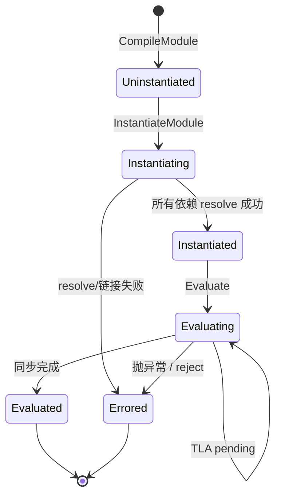

静态 import 的完整调用链（以 dune 为例，Deno/Node 形状相同）：

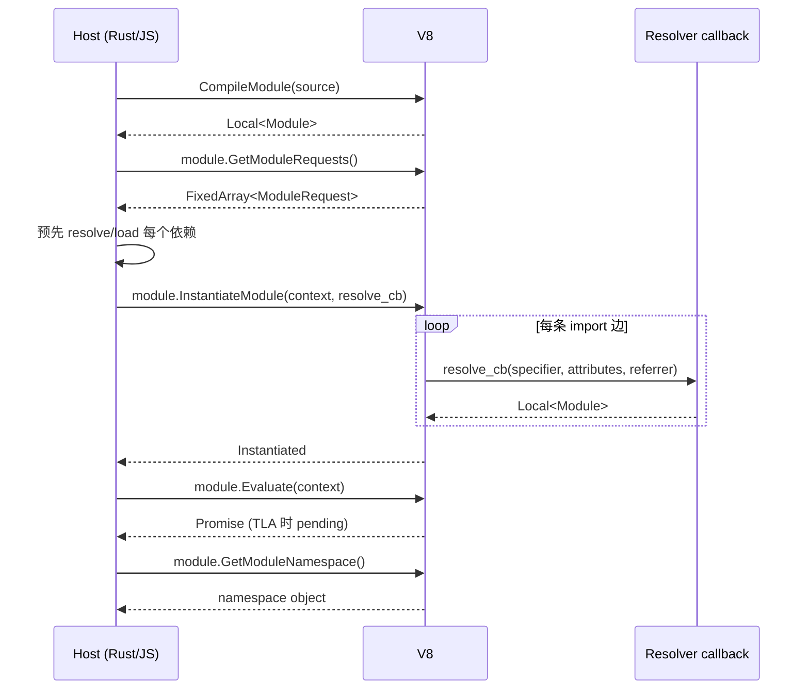

dynamic import 的契约略有不同：V8 调用 host callback，host 必须**立即返回一个 Promise**；Promise 的 resolve 值必须是 namespace object（不是 evaluation 结果）。

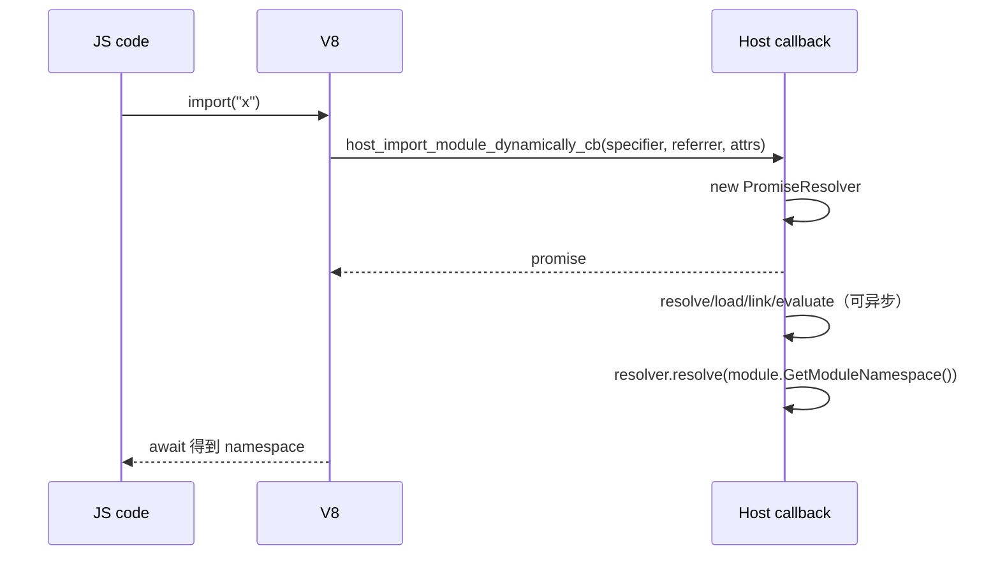

关键点：

- V8 **不**缓存 module；同一 specifier 是否复用同一个 `v8::Module` 完全由 embedder 决定。
- V8 **不**替 host 做 cycle 处理；循环依赖由 host 的 `resolve_cb` 返回已存在的 module 来闭合。
- V8 的 `Evaluate` 返回 Promise；host 如果丢弃它，就等价于“不等待 TLA”。dune 正是这样。
- `import.meta` 也是 host 回调；V8 只负责在第一次访问时调用它。

### 2.2 QuickJS：engine 自己拥有 module 图

QuickJS 的 host 接口小得多：注册 normalizer、loader、attribute checker，剩下交给 engine。

| API | 调用者 | 作用 |
|---|---|---|
| `JS_SetModuleLoaderFunc2(rt, normalize, load, check_attrs, opaque)` | host | 一次性注册模块 loader 三件套 |
| `JS_SetModuleNormalizeFunc2(rt, normalize)` | host（可选） | 单独注册带 attributes 的 normalizer |
| `normalize(ctx, base_name, name, opaque)` | QuickJS → host | 把 `(base, specifier)` 转成 canonical module name |
| `load(ctx, name, opaque, attributes)` | QuickJS → host | 返回 `JSModuleDef *` |
| `JS_Eval(ctx, src, len, filename, JS_EVAL_TYPE_MODULE \| JS_EVAL_FLAG_COMPILE_ONLY)` | host | 源码编译为 module，不执行 |
| `JS_ReadObject(ctx, buf, len, JS_READ_OBJ_BYTECODE)` | host | 字节码反序列化为 module |
| `JS_ResolveModule(ctx, obj)` | host（可选） | 递归解析依赖；`JS_Eval`/`JS_ReadObject` 之后可用 |
| `JS_EvalFunction(ctx, module_val)` | host | 内部完成 link + evaluate，返回 evaluation Promise |
| `JS_GetModuleNamespace(ctx, m)` | host | 取 namespace |
| `JS_GetImportMeta(ctx, m)` | host | 取/建 `import.meta` 对象 |
| `JS_NewCModule` / `JS_AddModuleExport` / `JS_SetModuleExport` | host | 创建 C/native module 并声明/设置导出 |
| `JS_SetModulePrivateValue` / `JS_GetModulePrivateValue` | host | 给 C module 绑定私有数据 |
| `JS_NewPromiseCapability` | host/engine | 创建 dynamic import / TLA 的 Promise |
| `JS_ExecutePendingJob(rt, &ctx)` | host | 驱动 QuickJS job queue（dynamic import job 也在这里） |
| `JS_LoadModule(ctx, base, filename)` | host | 加载并求值一个模块，返回 Promise |
| `JS_GetScriptOrModuleName(ctx, level)` | host | 取当前模块名（LLRT CJS 用它索引 exports） |

`JSModuleDef` 是 QuickJS 的 module 节点，也是“树/图”真正所在：

```c
struct JSModuleDef {
    JSAtom module_name;
    struct list_head link;              /* ctx->loaded_modules 链表 */

    JSReqModuleEntry *req_module_entries;   /* 静态依赖边 */
    int req_module_entries_count, ..._size;

    JSExportEntry *export_entries;          /* 本模块导出 */
    JSStarExportEntry *star_export_entries; /* export * */
    JSImportEntry *import_entries;          /* import 绑定 */

    JSValue attributes;                 /* import attributes，缓存键的一部分 */
    JSValue module_ns;                  /* namespace */
    JSValue func_obj;                   /* JS module 的编译产物 */
    JSModuleInitFunc *init_func;        /* C module 的初始化函数 */
    bool has_tla;
    bool resolved, func_created;
    JSModuleStatus status;              /* UNLINKED..EVALUATED */

    int dfs_index, dfs_ancestor_index;  /* link/eval 的 Tarjan SCC */
    JSModuleDef *stack_prev;

    JSModuleDef **async_parent_modules; /* TLA 反向边 */
    int pending_async_dependencies;
    bool async_evaluation;
    JSModuleDef *cycle_root;            /* 环的根 */
    JSValue promise;
    JSValue resolving_funcs[2];

    bool eval_has_exception;
    JSValue eval_exception;
    JSValue meta_obj;                  /* import.meta */
    JSValue private_value;              /* C module 私有数据 */
};
```

依赖边：

```c
typedef struct JSReqModuleEntry {
    JSAtom module_name;
    JSModuleDef *module;   /* resolve 后指向被依赖模块 */
    JSValue attributes;
} JSReqModuleEntry;
```

模块缓存不是 host 的 hash map，而是每个 `JSContext` 的 `ctx->loaded_modules` 双向链表；查找 `js_find_loaded_module()` 线性扫描，key = `module_name` atom + import attributes。

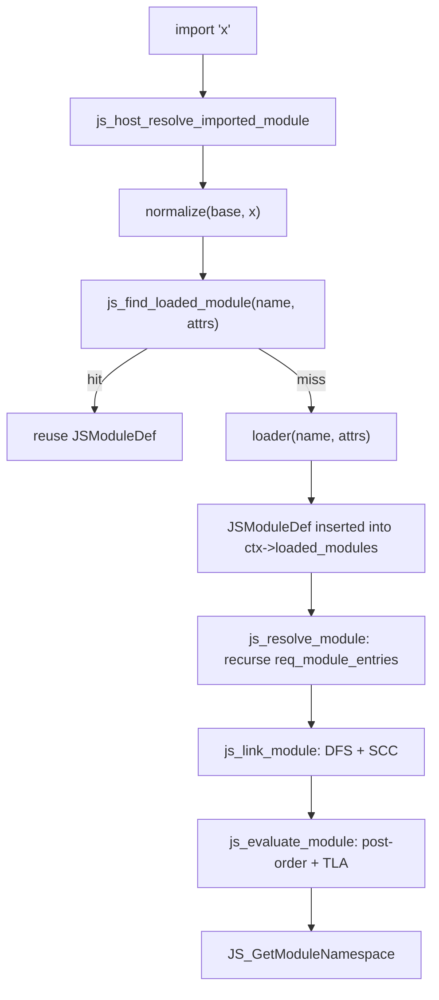

QuickJS 的链接和求值都使用 Tarjan 式 DFS：

- **link**：`js_inner_module_linking()` 标记 `LINKING`，记录 `dfs_index/dfs_ancestor_index`，递归依赖，绑定 import/export，最后在 SCC 根出栈时统一置 `LINKED`；
- **evaluate**：`js_inner_module_evaluation()` 后序遍历，依赖先于依赖者；TLA 模块进入 `EVALUATING_ASYNC`，通过 `async_parent_modules` 延迟父模块；
- **cycle**：每个 SCC 只有一个 `cycle_root`，环内共享同一个 evaluation Promise。

对应的 `JSModuleStatus` 状态机：

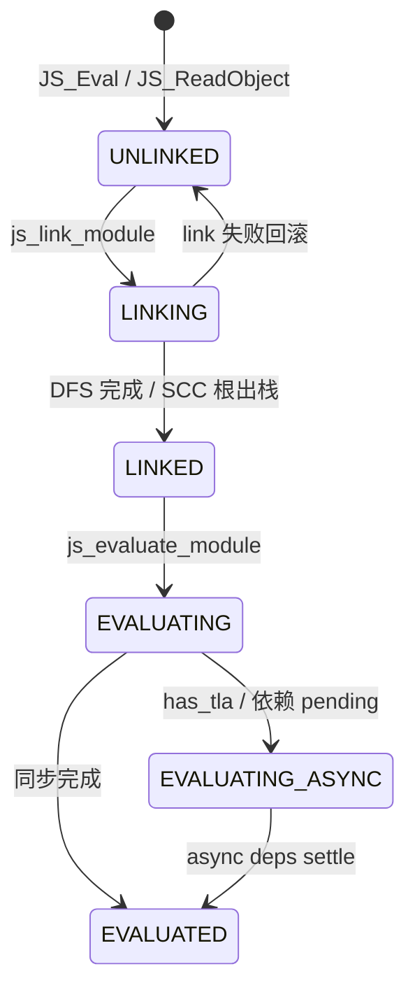

注意：这个状态机在 **engine 内部**，host 只看到 `JSModuleDef*` 和 `JS_EvalFunction` 返回的 Promise；LLRT/txiki 不能直接读 `status`，只能通过 QuickJS API 间接观察。

### 2.3 两种合约的对照

| 维度 | V8 | QuickJS |
|---|---|---|
| module 对象 | `v8::Module`，host 持有 `Global` | `JSModuleDef *`，engine 持有 |
| module cache | 无，host 自建 | `ctx->loaded_modules` 链表 |
| resolve | `module_resolve_cb` | normalizer |
| load | host 自己读文件/HTTP/native | loader 回调 |
| link/instantiate | host 调 `InstantiateModule` + resolve 回调 | `js_link_module`（`JS_EvalFunction` 内部） |
| evaluate | host 调 `Evaluate`，拿 Promise | `js_evaluate_module`（`JS_EvalFunction` 内部） |
| dynamic import Promise | host 创建并 resolve | engine 创建，host 只负责加载 |
| TLA | host 决定是否等待 Promise | engine 原生跟踪 |
| synthetic/native module | `CreateSyntheticModule` | `JS_NewCModule` |
| host 代码量 | 大（dune / Deno / Node 都要自建状态机） | 小（LLRT / txiki 只写 loader） |

这解释了一个常见现象：**V8 runtime 的 module 代码量通常远大于 QuickJS runtime**，因为 V8 把图的所有权留给了 embedder。

---

## 3. 数据结构与树形结构总览

### 3.1 五套核心结构

| Runtime | 全局注册表/缓存 | 树/图节点 | 依赖边 | 状态/并发 |
|---|---|---|---|---|
| **dune** | `ModuleMap`：`by_path: HashMap<path, Global<Module>>`、`by_id: HashMap<i32, Vec<(path, Global<Module>)>>`、`seen: HashMap<path, ModuleStatus>`、`pending: Vec<Rc<RefCell<ModuleGraph>>>` | `EsModule { path, status, dependencies: Vec<Rc<RefCell<EsModule>>>, exception, is_dynamic_import }` | `EsModule.dependencies`（`Rc` 树） | `ModuleStatus::{Fetching,Resolving,Duplicate,Ready}`；`EsModuleFuture` 在 event loop 中推进 |
| **LLRT** | QuickJS `ctx->loaded_modules`；host 侧 `ModuleResolver.modules: HashSet`、`ModuleLoader.modules: HashMap<name, fn>`、`BYTECODE_CACHE: phf::Map`、`NODE_MODULES_PATHS_CACHE` | `JSModuleDef`（engine） | `JSReqModuleEntry[]`（engine） | QuickJS `JSModuleStatus`；`RequireState{cache,exports,progress}` 处理 CJS 环 |
| **txiki.js** | QuickJS `ctx->loaded_modules`；host 只有 `builtins[]` 和 `qrt->builtins.import_map_resolver` | `JSModuleDef`（engine） | `JSReqModuleEntry[]`（engine） | QuickJS 状态机；import map 是 JS 闭包 |
| **Deno** | `ModuleMap`：`data: ModuleMapData { handles, handles_inverted, info, by_name, main_module_id, lazy_esm_sources, ... }` + `dynamic_import_map` + 三组 `TrackedFutures/TrackedVec` | `ModuleInfo { id, main, name, requests, module_type, is_internal }`；`v8::Global<Module>` 单独存 `handles[id]` | `ModuleInfo.requests: Vec<ModuleRequest>`；运行时再经 V8 resolve 回调映射回 handle | `ModuleId = usize`；`RecursiveModuleLoad{state,pending,visited,visited_as_alias}`；`pending_tla_waiters` |
| **Node.js** | `ModuleLoader.loadCache: LoadCache`（`url → {type → ModuleJobBase}`）、`#resolveCache`；CJS `Module._cache: filename → Module`、`_pathCache`、`_extensions`；`BuiltinModule.map` | ESM `ModuleJobBase/ModuleJob/ModuleJobSync` + C++ `ModuleWrap`；CJS `Module { id, path, exports, filename, loaded, children, paths }` | `ModuleJob` 通过 `ModuleWrap.getModuleRequests()` 递归 `getOrCreateModuleJob`；CJS `module.children` 只是观察树 | V8 `ModuleStatus` + job 状态；CJS `loaded`、环依赖占位 exports |

### 3.2 四种“树”的形状

ES module 图在语义上是 **DAG + 环**，不是严格的树。这里的“树”指 loader 的遍历视角：

- dune 把它真的建成一棵 `EsModule` 树，用 `Duplicate` 叶子表示“这个 path 已经出现过”；
- QuickJS 在 `JSModuleDef.req_module_entries` 里存图边，遍历时看起来像 DFS 树；
- Deno 存 `ModuleInfo.requests` 边 + `by_name` 索引，树是 resolve 时临时展开的；
- Node 存 `ModuleJob` 对象图，`ModuleWrap` 只持有 V8 侧的绑定关系。

**(a) dune：host 手写的 `Rc<RefCell<EsModule>>` 树 + 全局 `seen` 表**

```text
ModuleMap
 ├─ by_path: "main.js" -> v8::Global<Module>
 ├─ seen:    "main.js" -> Resolving, "a.js" -> Ready, ...
 └─ pending: [ ModuleGraph{kind: Static, root_rc} ]

ModuleGraph.root_rc
   EsModule(main)
     ├─ EsModule(a)  ── Rc ──> EsModule(shared)
     └─ EsModule(b)  ── Rc ──> EsModule(shared)   // 两个 Rc 节点，同一个 path
```

注意：`EsModule` 节点**不做去重**，相同 path 可能出现多个 `Rc` 节点；去重发生在 `seen` 表，依赖节点用 `ModuleStatus::Duplicate` 表示“路径已被别人加载”。

**(b) QuickJS：engine 内的 DAG，host 只看到 `JSModuleDef*`**

```text
ctx->loaded_modules (双向链表)
  [main] <-> [a] <-> [b] <-> [shared] <-> ...

main.req_module_entries
  ├─ { name:"a", module:*a }
  └─ { name:"b", module:*b }
a.req_module_entries -> *shared
b.req_module_entries -> *shared       // 同一个 JSModuleDef
```

引擎在 `resolve` 阶段就按 `(name, attributes)` 去重，因此图是 DAG；环在 host resolve 返回已存在模块时闭合。

**(c) Deno：索引表 + 独立 handle 数组**

```text
ModuleMap
 ├─ data.handles: Vec<Global<Module>>           // 按 ModuleId 下标
 ├─ data.info:    Vec<ModuleInfo>               // 同一下标
 ├─ data.by_name: ModuleNameTypeMap<SymbolicModule>
 │      "file:///main.js" -> Mod(0)
 │      "file:///a.js"    -> Mod(1)
 │      "npm:foo"         -> Alias("file:///.../foo.js")
 ├─ data.handles_inverted: HashMap<Global<Module>, usize>
 ├─ dynamic_import_map: HashMap<ModuleLoadId, DynImportState>
 └─ pending_dynamic_imports: TrackedFutures<StreamFuture<RecursiveModuleLoad>>
```

`ModuleId` 是 `handles.len()` 分配的**注册下标**，不是内容哈希；字符串到 id 的映射在 `by_name`，V8 handle 到 id 的反查在 `handles_inverted`。

**(d) Node：两套图**

```text
ESM:
 ModuleLoader.loadCache
   "file:///main.mjs" -> { "javascript": ModuleJobSync }
   "file:///a.json"   -> { "json": ModuleJobSync }
        │
        └─ ModuleJobSync.module: ModuleWrap
              └─ C++ kModuleSlot -> v8::Global<v8::Module>

CJS:
 Module._cache
   "/abs/a.js" -> Module { id, exports, loaded, children:[...] }
 Module._pathCache
   "a\0/abs/node_modules\0..." -> "/abs/a.js"
```

Node 的 ESM 图由 `ModuleJob` 对象和 V8 `ModuleWrap` 共同表达；CJS 图由 `Module` 对象和 `children` 数组表达，但真正决定复用/环处理的是 `Module._cache`。

### 3.3 模块身份、缓存 key 与去重

| Runtime | 模块身份 | 缓存 key | 并发 import 去重 |
|---|---|---|---|
| **dune** | 解析后的 path 字符串 | `ModuleMap.by_path[path]`；`seen[path]` | `ModuleGraph.same_origin` 合并同一 root 的 resolver；`Duplicate` 状态避免重复加载 |
| **LLRT** | QuickJS 规范化后的 module name + attributes | `ctx->loaded_modules`（线性扫描 `module_name` atom + attributes） | QuickJS 在调用 loader 前查已加载表；`ModuleLoader.modules.remove(name)` 保证 native 只声明一次 |
| **txiki.js** | normalizer 返回的字符串 + attributes | `ctx->loaded_modules` | 同上；import map 在 normalizer 中同步解析 |
| **Deno** | `ModuleId`；字符串侧是 `(ModuleName, RequestedModuleType)` | `handles[id]` + `by_name`；重定向用 `SymbolicModule::Alias` | `RecursiveModuleLoad.visited: HashSet<ModuleReference>` + `visited_as_alias` |
| **Node ESM** | URL + import type | `loadCache[url][type]`；`#resolveCache[parentURL][specifier+attrs]` | `ModuleJob` 在 `syncLink` 中**先把自己写进 loadCache**，再递归 link |
| **Node CJS** | 绝对 filename | `Module._cache[filename]`；`Module._pathCache[request+paths]` | 先 `new Module` 并立即入 cache，再执行 |

一个容易被忽略的差异：

- **dune 用 path 字符串**，不做 URL 归一化（HTTP 除外）；
- **Deno 用 `ModuleSpecifier` + `RequestedModuleType`**，重定向是 alias；
- **Node ESM 用 URL + type 两级 key**，`import './a.json' with {type:'json'}` 与普通 JS 不会互相覆盖；
- **QuickJS 用 name + attributes**，同名不同 `type` 会得到两个 `JSModuleDef`。

---

## 4. dune：host 自己维护显式 module 树

### 4.1 定位

dune 是 V8 + Rust + 自己的 libuv-shaped event loop（`crabuv`）。V8 只提供两个关键回调：

- `module_resolve_cb`：`instantiate_module` 时，embedder 必须为每条静态 import 返回一个 `v8::Module`；
- `host_import_module_dynamically_cb`：`import()` 时，embedder 必须返回一个 Promise。

dune 选择把整个 module 状态机放在 Rust host 里：module cache、依赖树、加载状态、并发去重都由 [`src/modules.rs`](https://github.com/aalykiot/dune/blob/5958b6460d4a567a41e6194f637a86a45b265f95/src/modules.rs) 和 [`src/runtime.rs`](https://github.com/aalykiot/dune/blob/5958b6460d4a567a41e6194f637a86a45b265f95/src/runtime.rs) 维护。它是本文五个 runtime 中最“手工”的一个，也是最接近 rsvim 当前实现的参考。

### 4.2 核心数据结构

[`src/modules.rs`](https://github.com/aalykiot/dune/blob/5958b6460d4a567a41e6194f637a86a45b265f95/src/modules.rs)：

```rust
pub struct ModuleMap {
    pub main: Option<ModulePath>,
    pub by_path: HashMap<ModulePath, ModuleRef>,
    pub by_id: HashMap<i32, Vec<(ModulePath, ModuleRef)>>,
    pub seen: HashMap<ModulePath, ModuleStatus>,
    pub pending: Vec<Rc<RefCell<ModuleGraph>>>,
}

pub type ModuleRef = v8::Global<v8::Module>;
```

| 字段 | 类型 | 作用 |
|---|---|---|
| `main` | `Option<String>` | 入口模块路径；`insert()` 时若为空且路径是存在的文件或 http(s) URL 则赋值。`import.meta.main` 用它比较 |
| `by_path` | `HashMap<path, Global<Module>>` | path → 已编译的 V8 module；`module_resolve_cb` 的最终查找表 |
| `by_id` | `HashMap<i32, Vec<(path, Global<Module>)>>` | V8 `identity_hash` → module；V8 不保证 hash 唯一，所以用 `Vec` 处理碰撞 |
| `seen` | `HashMap<path, ModuleStatus>` | 全局加载状态；静态/动态图共享，用于判重 |
| `pending` | `Vec<Rc<RefCell<ModuleGraph>>>` | 尚未 ready 的静态/动态 import 图；事件循环每 tick 扫描 |

`ModuleStatus`：

```rust
pub enum ModuleStatus {
    Fetching,   // 正在读取/编译该模块
    Resolving,  // 已编译，正在等待/解析依赖
    Duplicate,  // 该 path 已被其他图加载，本节点只是引用
    Ready,      // 依赖全部 ready，可以 instantiate/evaluate
}
```

依赖树节点：

```rust
pub struct EsModule {
    pub path: ModulePath,
    pub status: ModuleStatus,
    pub dependencies: Vec<Rc<RefCell<EsModule>>>,
    pub exception: Rc<RefCell<Option<String>>>,
    pub is_dynamic_import: bool,
}
```

图对象：

```rust
pub struct ModuleGraph {
    pub kind: ImportKind,                 // Static | Dynamic(Global<PromiseResolver>)
    pub root_rc: Rc<RefCell<EsModule>>,
    pub same_origin: LinkedList<Global<PromiseResolver>>,
}
```

异步加载任务：

```rust
pub struct EsModuleFuture {
    pub path: ModulePath,
    pub module: Rc<RefCell<EsModule>>,
    pub result: Result<ModuleSource>,
}
```

关系图：

```text
JsRuntimeState
 ├─ module_map: ModuleMap
 │    ├─ by_path: path ──────────────► v8::Global<v8::Module>
 │    ├─ by_id:   identity_hash ─────► Vec<(path, module)>
 │    ├─ seen:    path ──────────────► ModuleStatus
 │    └─ pending: Vec<Rc<RefCell<ModuleGraph>>>
 │                         │
 │                         ▼
 │                    ModuleGraph
 │                     ├─ kind: Static | Dynamic(resolver)
 │                     ├─ root_rc ──► EsModule
 │                     │                ├─ path
 │                     │                ├─ status
 │                     │                └─ dependencies: Vec<Rc<RefCell<EsModule>>>
 │                     └─ same_origin: LinkedList<Global<PromiseResolver>>
 │
 └─ pending_futures: Vec<Box<dyn JsFuture>>
      └─ EsModuleFuture { path, module, result }   // 源码已到手，待编译
```

### 4.3 静态加载：两套入口，一棵树

dune 有两条静态加载路径：

1. **`fetch_module_tree()`**：同步递归，用于启动时的 builtin 环境（`dune:environment/main`）和 REPL；
2. **`execute_module()` + `EsModuleFuture`**：异步，用于用户入口脚本；源码读取通过 crabuv 线程池，编译回到 loop 线程。

`execute_module()` 先创建图并登记：

```rust
let graph = ModuleGraph::static_import(&path);
let graph_rc = Rc::new(RefCell::new(graph));
state.module_map.pending.push(Rc::clone(&graph_rc));
state.module_map.seen.insert(path.clone(), ModuleStatus::Fetching);

state.handle.spawn(
    move || load_import(&specifier, true),       // 在 rayon 线程读文件/HTTP
    Some(move |_, result| {                      // 回到 loop 线程
        state.pending_futures.push(Box::new(EsModuleFuture { ... }));
    }),
);
```

`EsModuleFuture::run()` 在事件循环 tick 中执行，流程是：

```text
EsModuleFuture::run(scope)
  ├─ 若 module.exception 已被设置：清理 seen，return
  ├─ 取源码 result
  ├─ create_origin(path, is_module=true)
  ├─ v8::script_compiler::compile_module
  ├─ ModuleMap.insert(path, identity_hash, Global<Module>)
  ├─ seen[path] = Resolving
  ├─ for each request in module.get_module_requests():
  │    ├─ resolve_import(base=path, specifier, import_map)
  │    ├─ match seen[specifier]:
  │    │    Ready    -> continue（不再建节点）
  │    │    Some(_)  -> status = Duplicate
  │    │    None     -> status = Fetching
  │    ├─ new EsModule { path, status, deps: [], ... }
  │    ├─ dependencies.push(Rc<...>)
  │    └─ if unseen: seen.insert(specifier, Fetching); handle.spawn(load, cb)
  └─ self.module.status = Resolving
     self.module.dependencies = dependencies
```

`fast_forward_imports()` 每 tick 扫描 `pending`，对根调用 `fast_forward()`；当整棵树都 `Ready` 时，把图从 `pending` 移出，执行：

```rust
module.instantiate_module(tc_scope, module_resolve_cb)
let _ = module.evaluate(tc_scope);
```

如果是动态 import，则再用 `module.get_module_namespace()` resolve 所有等待的 Promise。

树展开过程：

```text
t0: root(main) Fetching ──compile──► Resolving
      request "./a.js" 未见 -> 建节点 a(Fetching), seen[a]=Fetching, spawn load
      request "./b.js" 未见 -> 建节点 b(Fetching), seen[b]=Fetching, spawn load

t1: a 编译完成 -> insert, seen[a]=Resolving
      request "./shared.js" 未见 -> 建 shared(Fetching), spawn

t2: b 编译完成 -> insert, seen[b]=Resolving
      request "./shared.js" 已见(Resolving) -> 建 Duplicate 节点 shared(Duplicate)
      （不重复 load）

t3: shared 编译完成 -> insert, seen[shared]=Resolving
      无依赖 -> 在 fast_forward 中变 Ready

t4: fast_forward(root)
      a -> shared Ready -> a Ready
      b -> shared Duplicate, seen[shared]=Ready -> b Ready
      root 所有 dep Ready -> root Ready
      -> instantiate_module + evaluate
```

`fetch_module_tree()` 则是同步版本：编译当前模块、插入 `ModuleMap`、遍历 request 递归调用自己。它没有 `ModuleGraph`/`pending`，也不维护 `ModuleStatus`，只靠 `by_path.contains_key()` 判重。dune 的 builtin 入口 [`src/js/main.js`](https://github.com/aalykiot/dune/blob/5958b6460d4a567a41e6194f637a86a45b265f95/src/js/main.js) 就是用它拉起来的。

### 4.3.1 builtin：19 个 JS ESM 模块构成真实依赖图

dune 的 builtin 不是 native module，而是 `include_str!` 进二进制的 JS ESM 源文件：

```rust
CORE_MODULES: HashMap<&str, &str> = [
  "console", "events", "process", "timers", "assert", "util",
  "fs", "perf_hooks", "colors", "dns", "net", "test",
  "stream", "http", "sqlite",
  "@web/abort", "@web/text_encoding", "@web/clone", "@web/fetch",
]
```

入口 [`src/js/main.js`](https://github.com/aalykiot/dune/blob/5958b6460d4a567a41e6194f637a86a45b265f95/src/js/main.js)：

```js
import process from 'process';
import timers from 'timers';
import fetch from '@web/fetch';
import structuredClone from '@web/clone';
import { Console, prompt, wrapConsole } from 'console';
import { AbortController, AbortSignal } from '@web/abort';
import { TextEncoder, TextDecoder } from '@web/text_encoding';
```

这些 import 是真实的 ESM 依赖：

```text
main
 ├─ process -> events, util
 ├─ timers -> assert
 ├─ @web/fetch -> http -> net -> dns
 │                    -> assert, events
 ├─ console -> perf_hooks, colors
 ├─ @web/abort -> events
 ├─ @web/text_encoding
 └─ @web/clone

test -> fs, perf_hooks, colors
stream -> assert, events
```

因此 dune 的 builtin 是一张**真实的 builtin 依赖图**，不是“独立小模块的集合”。`fetch_module_tree()` 递归加载依赖，正是为了让 `instantiate_module` 时 `module_resolve_cb` 能在 `module_map` 里找到所有子模块。没有 CJS、没有 npm；bare specifier 只有命中 `CORE_MODULES` 或被 import map 改写后才能解析。

### 4.3.2 resolver 与 loader

`resolve_import()` 按 specifier 选择 loader：

```text
resolve_import(base, specifier, import_map)
  ├─ import map lookup（可选）
  ├─ is_core_module_import = CORE_MODULES.contains_key(specifier)
  ├─ is_url_import = URL_REGEX(specifier) || URL_REGEX(base)
  └─ match (core, url):
       (true, _) -> CoreModuleLoader
       (_, true) -> UrlModuleLoader
       _         -> FsModuleLoader
```

三个 loader：

| Loader | resolve | load |
|---|---|---|
| `CoreModuleLoader` | 只认 `CORE_MODULES` 的 19 个名字 | `include_str!` 的源码 |
| `FsModuleLoader` | 绝对路径 / 相对 `./` `../` / CWD；尝试 `js/jsx/ts/tsx/json/wasm` 扩展名和 `index.*` | `fs::read_to_string`，JSON 包成 `export default JSON.parse(...)`，TS/JSX/WASM 交给 SWC/Wasm 转译 |
| `UrlModuleLoader` | `Url::parse` / 以 base URL 解析相对路径 | `ureq` 下载；SHA-1 哈希后缓存到 `.cache`（debug）或 `~/.dune/cache`（release） |

`ImportMap` 是 WICG 子集：

```rust
pub struct ImportMap { map: Vec<(String, String)> }
```

- 解析 `imports` 对象；
- 按 key 长度降序排序，以支持 trailing slash 的包前缀；
- `lookup()` 用 `starts_with` 做前缀匹配；
- 支持 extensionless specifier；
- 没有 scopes、没有 `node_modules`、没有 CJS。

所以 dune 的 bare specifier 只有两种归宿：命中 `CORE_MODULES`，或被 import map 改写；否则 `FsModuleLoader` 会报 `Module not found`。

### 4.4 动态 import：`ModuleGraph` + `same_origin`


`host_import_module_dynamically_cb()` 的步骤：

```text
import("x")
  ├─ resolve_import(base, "x", import_map)       // 失败：resolver.reject(exception)
  ├─ 若 by_path 已有 x 且没有同 root 的 pending 图：
  │     resolver.resolve(x.get_module_namespace())   // 已加载，直接给 namespace
  ├─ 若 pending 中已有 root.path == x：
  │     graph.same_origin.push_back(resolver)        // 合并到同一图
  ├─ 否则：
  │     graph = ModuleGraph::dynamic_import(x, resolver)
  │     pending.push(graph)
  │     seen[x] = Fetching
  │     handle.spawn(load_import(x), cb -> EsModuleFuture)
  └─ 返回 resolver 的 Promise
```

`same_origin` 的存在是为了处理“同一个模块被并发 `import()` 多次”的情况：只加载一次，所有 resolver 在根图 ready 后一起 resolve。失败时 `fast_forward_imports()` 会遍历 `kind` 里的 main promise 和 `same_origin`，逐个 reject。

关键语义差异：

- 动态 import 的 graph 在 `evaluate()` 之后**立即** resolve namespace，不等待 evaluation Promise；
- 因此如果模块有 TLA，`await import()` 可能在模块执行完成前就返回；
- 如果访问尚未初始化的 `default`，会得到 `ReferenceError: Cannot access 'default' before initialization`。

这正是 §10 中 dune 的实测结果。

### 4.5 `fast_forward()`：自底向上的状态收敛

```rust
pub fn fast_forward(&mut self, seen_modules: &mut HashMap<ModulePath, ModuleStatus>) {
    if self.status == ModuleStatus::Ready { return; }

    if self.status == ModuleStatus::Duplicate {
        let status_ref = seen_modules.get(&self.path).unwrap();
        if status_ref == &ModuleStatus::Ready {
            self.status = ModuleStatus::Ready;
        }
        return;
    }

    self.dependencies.iter_mut()
        .for_each(|dep| dep.borrow_mut().fast_forward(seen_modules));

    if self.dependencies.is_empty() && self.status == ModuleStatus::Resolving {
        self.status = ModuleStatus::Ready;
        seen_modules.insert(self.path.clone(), self.status);
        return;
    }

    if self.dependencies.is_empty() { return; }

    if !self.dependencies.iter_mut()
        .map(|m| m.borrow().status)
        .any(|status| status != ModuleStatus::Ready)
    {
        self.status = ModuleStatus::Ready;
        seen_modules.insert(self.path.clone(), self.status);
    }
}
```

算法本身是后序遍历：先把所有孩子推进到 `Ready`，再判断自己。`Duplicate` 节点不递归，只查 `seen` 表。

但它有一个结构性缺陷：**环依赖会死锁**。

```text
c1 -> c2 -> c1

c1: Resolving, deps=[c2]
c2: Resolving, deps=[c1(Duplicate)]
seen[c1] = Resolving
seen[c2] = Resolving

fast_forward(c1):
  fast_forward(c2):
    c2.deps = [c1(Duplicate)] -> seen[c1] = Resolving
    -> c2 保持 Resolving
  c1.deps 不全是 Ready -> c1 保持 Resolving
```

结果 `pending` 永远非空，`run_event_loop()` 的 `while ... || self.has_pending_imports()` 永远为真，进程空转。实测 `dune run main7.js`（静态环）10 秒超时；这不是“慢”，而是状态机没有 SCC/环检测。

另一个缺陷是 TLA：

```rust
let _ = module.evaluate(tc_scope);
```

evaluation Promise 被丢弃，`has_pending_imports()` 只检查 `pending` 里是否还有图，不检查 evaluation Promise。因此 TLA 模块的后续执行不会被宿主保活，`import()` 也会在求值完成前 resolve namespace。

dune 的 `ModuleStatus` 收敛图（正常路径与环）：

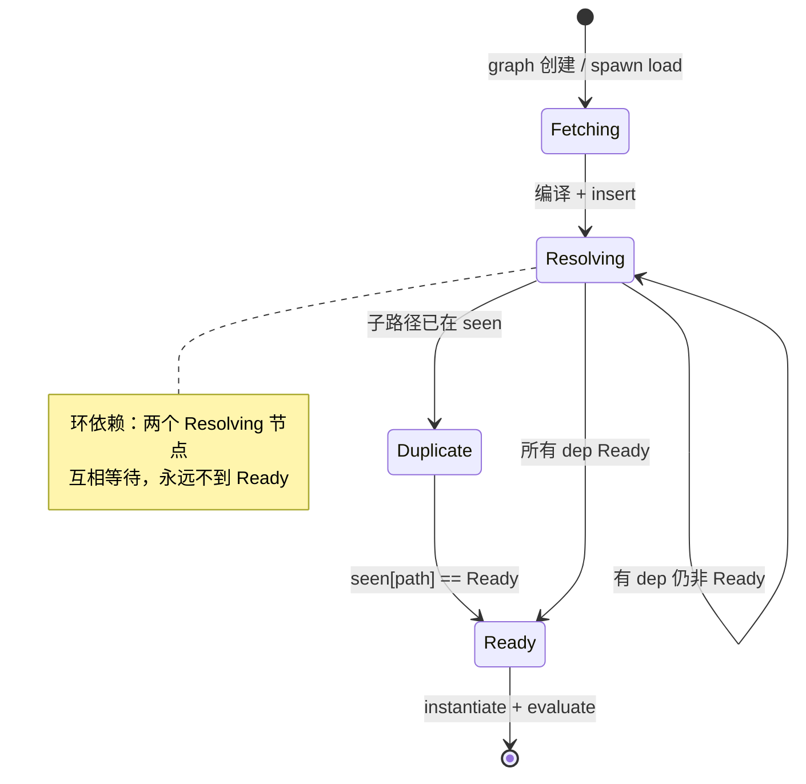

`fast_forward()` 只做“孩子 Ready 则父亲 Ready”，没有 SCC 归并；这就是环会空转的根因。

### 4.6 V8 API 调用清单

| 位置 | API | 用途 |
|---|---|---|
| [`runtime.rs:151`](https://github.com/aalykiot/dune/blob/5958b6460d4a567a41e6194f637a86a45b265f95/src/runtime.rs#L151) | `isolate.set_host_import_module_dynamically_callback` | 注册 `import()` |
| [`runtime.rs:154`](https://github.com/aalykiot/dune/blob/5958b6460d4a567a41e6194f637a86a45b265f95/src/runtime.rs#L154) | `set_host_initialize_import_meta_object_callback` | 注册 `import.meta` 初始化 |
| [`modules.rs:320`](https://github.com/aalykiot/dune/blob/5958b6460d4a567a41e6194f637a86a45b265f95/src/modules.rs#L320) / [`561`](https://github.com/aalykiot/dune/blob/5958b6460d4a567a41e6194f637a86a45b265f95/src/modules.rs#L561) | `v8::script_compiler::compile_module` | 编译源码为 module（动态图 / 静态树） |
| [`modules.rs:334`](https://github.com/aalykiot/dune/blob/5958b6460d4a567a41e6194f637a86a45b265f95/src/modules.rs#L334) / [`581`](https://github.com/aalykiot/dune/blob/5958b6460d4a567a41e6194f637a86a45b265f95/src/modules.rs#L581) | `module.get_identity_hash()` | module id，用于 `by_id` |
| [`modules.rs:335`](https://github.com/aalykiot/dune/blob/5958b6460d4a567a41e6194f637a86a45b265f95/src/modules.rs#L335) / [`582`](https://github.com/aalykiot/dune/blob/5958b6460d4a567a41e6194f637a86a45b265f95/src/modules.rs#L582) | `v8::Global::new(scope, module)` | 长期持有 module |
| [`modules.rs:351`](https://github.com/aalykiot/dune/blob/5958b6460d4a567a41e6194f637a86a45b265f95/src/modules.rs#L351) / [`588`](https://github.com/aalykiot/dune/blob/5958b6460d4a567a41e6194f637a86a45b265f95/src/modules.rs#L588) | `module.get_module_requests()` | 静态 import 边 |
| [`modules.rs:361`](https://github.com/aalykiot/dune/blob/5958b6460d4a567a41e6194f637a86a45b265f95/src/modules.rs#L361) / [`596`](https://github.com/aalykiot/dune/blob/5958b6460d4a567a41e6194f637a86a45b265f95/src/modules.rs#L596) | `ModuleRequest::get_specifier()` | 原始说明符 |
| [`runtime.rs:242`](https://github.com/aalykiot/dune/blob/5958b6460d4a567a41e6194f637a86a45b265f95/src/runtime.rs#L242) / [`570`](https://github.com/aalykiot/dune/blob/5958b6460d4a567a41e6194f637a86a45b265f95/src/runtime.rs#L570) | `module.instantiate_module(scope, module_resolve_cb)` | 实例化 + resolve 回调 |
| [`hooks.rs:30`](https://github.com/aalykiot/dune/blob/5958b6460d4a567a41e6194f637a86a45b265f95/src/hooks.rs#L30) | `referrer.get_identity_hash()` | 由 referrer module 反查 path |
| [`hooks.rs:65`](https://github.com/aalykiot/dune/blob/5958b6460d4a567a41e6194f637a86a45b265f95/src/hooks.rs#L65) | `ModuleMap.get_module_path(identity_hash, module)` | 由 referrer module 反查 path（`import.meta`） |
| [`runtime.rs:251`](https://github.com/aalykiot/dune/blob/5958b6460d4a567a41e6194f637a86a45b265f95/src/runtime.rs#L251) | `module.evaluate(scope)` | 求值，丢弃 Promise（环境模块） |
| [`runtime.rs:579`](https://github.com/aalykiot/dune/blob/5958b6460d4a567a41e6194f637a86a45b265f95/src/runtime.rs#L579) | `module.evaluate(tc_scope)` | 动态图求值，丢弃 Promise |
| [`runtime.rs:603`](https://github.com/aalykiot/dune/blob/5958b6460d4a567a41e6194f637a86a45b265f95/src/runtime.rs#L603) | `module.get_module_namespace()` | 动态 import resolve 值 |
| [`hooks.rs:160`](https://github.com/aalykiot/dune/blob/5958b6460d4a567a41e6194f637a86a45b265f95/src/hooks.rs#L160) | `v8::PromiseResolver::new` | dynamic import Promise |
| [`hooks.rs:194`](https://github.com/aalykiot/dune/blob/5958b6460d4a567a41e6194f637a86a45b265f95/src/hooks.rs#L194) | `resolver.resolve(namespace)` | 已加载模块直接 resolve |
| [`hooks.rs:175`](https://github.com/aalykiot/dune/blob/5958b6460d4a567a41e6194f637a86a45b265f95/src/hooks.rs#L175) | `resolver.reject(exception)` | resolve 失败 |
| [`runtime.rs:253`](https://github.com/aalykiot/dune/blob/5958b6460d4a567a41e6194f637a86a45b265f95/src/runtime.rs#L253) | `module.get_status()` | 判断 `Errored` |
| [`runtime.rs:254`](https://github.com/aalykiot/dune/blob/5958b6460d4a567a41e6194f637a86a45b265f95/src/runtime.rs#L254) | `module.get_exception()` | 取异常 |
| [`hooks.rs:71/76`](https://github.com/aalykiot/dune/blob/5958b6460d4a567a41e6194f637a86a45b265f95/src/hooks.rs#L71) | `meta.create_data_property("url"/"main")` | 填充 `import.meta` |

一个容易忽略的点：dune 用 `get_identity_hash()` 而不是自增 id。V8 不保证 hash 唯一，所以 `by_id` 的值是 `Vec`，`get_module_path()` 在碰撞时需要线性比较 `Global<Module>` 是否相等。

### 4.7 依赖库角色：crabuv 的 `spawn` 与 rayon 线程池

dune 的模块加载之所以是异步的，不是因为 V8 或 JS，而是因为它把“读源码”当成另一种 libuv resource：

```text
handle.spawn(work, callback)
  └─ crabuv::LoopHandle::spawn
       ├─ 把 work 包成 WorkFn
       ├─ 分配 Task 资源，发送 Request::TaskSpawn 到 loop
       ├─ loop 把 work 投递到 rayon ThreadPool
       ├─ work 在 worker 线程执行：fs::read_to_string / ureq
       ├─ 完成后把 TaskOutput 放回 loop 的完成队列
       └─ loop 线程执行 callback：把 EsModuleFuture 推入 pending_futures
```

对应源码：[`crabuv/src/event_loop.rs:732`](https://github.com/aalykiot/crabuv/blob/2fda099a374bccf6d928bd59aa576be944ed2b39/src/event_loop.rs#L732) 的 `spawn`、[`crabuv/src/thread_pool.rs:33`](https://github.com/aalykiot/crabuv/blob/2fda099a374bccf6d928bd59aa576be944ed2b39/src/thread_pool.rs#L33) 的 rayon `spawn`、[`crabuv/src/task.rs`](https://github.com/aalykiot/crabuv/blob/2fda099a374bccf6d928bd59aa576be944ed2b39/src/task.rs) 的 `Task { id, on_complete, cancel_tx }`。

时序：

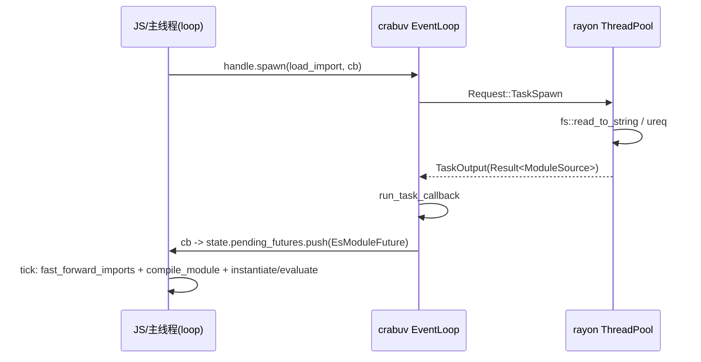

因此 dune 的 module loading 和 `fs`、`dns`、`net` 共用同一套 async 基础设施；这也解释了为什么它的 loader 可以在 Rust 侧直接调用同步 `fs::read_to_string`，而不会阻塞 JS 线程。

但注意：**QuickJS 的 LLRT/txiki loader 是同步的，Node 主线程 ESM 也是同步的**；dune 是五者中唯一把“读 module 源码”放到线程池的（Deno 的 CLI 侧也有异步装载，但 deno_core 本身用 futures）。

### 4.8 运行验证

```bash
# 命名空间身份 / 去重
dune run main1.js
# A same-namespace: true true 1 1

# 动态 import + TLA
dune run main2.js
# Uncaught (in promise) ReferenceError: Cannot access 'default' before initialization

# 静态环
timeout 10 dune run main7.js
# exit=124（空转，不是报错）

# import.meta
dune run main4.js
# D meta: /abs/main4.js false
```

结论：

- `by_path` + `seen` 能正确去重普通菱形依赖；
- `Duplicate` + `fast_forward` 不能处理环，环会空转；
- `evaluate()` 的 Promise 被丢弃，TLA 语义不完整；
- `import.meta.main` 在 0.11.4 中实测为 `false`，源码里它只依赖 `ModuleMap.main` 的“首次插入且路径存在”规则，实测不能可靠标识入口。

架构特征与代价：

- **优点**：module loading 与 fs/dns/net 共用 crabuv 异步基础设施；不依赖 engine 的 module 生命周期，容易插入自定义错误、日志、缓存；import map/URL/FS 策略集中在一个 Rust 文件里。
- **代价**：TLA 不被等待，dynamic import 会提前交付 namespace；环依赖会死锁；import attributes、phases、evaluation error、code cache 等语义都要自己补；没有 CJS/npm。

---

## 5. LLRT：QuickJS 拥有图，host 提供 resolver/loader 链

### 5.1 定位与装配

LLRT 是 QuickJS-NG + `rquickjs`，面向 AWS Lambda 冷启动。QuickJS 本身有 module loader 机制，所以 LLRT 不手写依赖树；它提供两条**独立的链**：

```rust
// llrt_core/src/vm.rs
let resolver = (module_resolver, EmbeddedResolver, PackageResolver, file_resolver);
let loader   = (module_loader, EmbeddedLoader, PackageLoader);
runtime.set_loader(resolver, loader).await;
```

`rquickjs` 把这组 trait 对象塞进 `LoaderHolder`，注册到 QuickJS：

```rust
// rquickjs-core/src/loader.rs
JS_SetModuleLoaderFunc2(rt, None, Some(Self::load_raw), None, self.0 as _);
JS_SetModuleNormalizeFunc2(rt, Some(Self::normalize_raw));
```

注意：

- `module_check_attrs = None`，LLRT 不校验 import attributes 的键；
- resolver 和 loader 是**两次独立回调**，各自独立 fallthrough；
- QuickJS 在调用 loader 之前会先 `js_find_loaded_module(name, attributes)`，命中则直接复用 `JSModuleDef`。

### 5.2 核心数据结构

LLRT 的 host 侧没有 module 图，只有“名字 → 加载函数/字节码”的映射和 CJS 兼容状态。

**(1) 原生模块表**

```rust
// llrt_modules/src/module/resolver.rs
#[derive(Debug, Default)]
pub struct ModuleResolver { modules: HashSet<String> }

// llrt_modules/src/module/loader.rs
type LoadFn = for<'js> fn(Ctx<'js>, Vec<u8>) -> Result<Module<'js>>;
#[derive(Debug, Default)]
pub struct ModuleLoader { modules: HashMap<String, LoadFn> }
```

`ModuleBuilder::with_module::<N, M: ModuleDef>()` 一次做三件事：

```text
module_resolver.add_name(name)          // resolver 认这个名字
module_loader.with_module(name, M)      // loader 能声明这个 native module
global_attachment.add_name(name)        // 用户可见 builtin 列表
```

`ModuleLoader::load()` 用 `self.modules.remove(name)` 取出函数指针，再调用 `Module::declare_def::<M, _>()`。用 `remove` 而不是 `get` 意味着**同一个 runtime 内第二次 load 同名原生模块会失败**；实际由 QuickJS 的已加载表保证只调用一次。

**(2) 字节码缓存**

```rust
// llrt_core/src/modules/embedded/mod.rs
pub static BYTECODE_CACHE: phf::Map<&'static str, &'static [u8]>;
```

构建期 [`llrt_core/build.rs`](https://github.com/awslabs/llrt/blob/d2ae1d90f3740d7c397c47f6469a3fe5e330aa51/llrt_core/build.rs) 遍历 `bundle/js`：

```text
esbuild bundle/js/*.js
  -> QuickJS Module::declare + module.write()
  -> OUT_DIR/<name>.lrt（zstd 压缩，带 6 字节头）
  -> 生成 bytecode_cache.rs：
       pub static BYTECODE_CACHE: phf::Map<&'static str, &'static [u8]> =
         phf::phf_map! { "llrt:test/index" => include_bytes!("...lrt"), ... };
```

`.lrt` 头格式：

| 偏移 | 长度 | 内容 |
|---|---|---|
| 0 | 5 | `"lrt01"` |
| 5 | 1 | `b'c'` 压缩 / `b'u'` 未压缩 |
| 6 | 4 | 压缩时：原始长度 u32 LE |
| 6/10 | n | zstd frame / QuickJS bytecode |

运行时 `EmbeddedLoader` 命中 phf 后，用 `zstd::bulk::Decompressor::with_prepared_dictionary(&DECOMPRESSOR_DICT)` 解压，再 `Module::load` → `JS_ReadObject(..., JS_READ_OBJ_BYTECODE)`。

**(3) Node 风格包解析缓存**

```rust
// llrt_modules/src/package/resolver.rs
type NodePathListValues = Rc<RefCell<Vec<Rc<str>>>>;
type NodeModulePaths = HashMap<Box<str>, Option<NodePathList>>;
static NODE_MODULES_PATHS_CACHE: Lazy<Mutex<NodeModulePaths>>;
static HOME_NODE_MODULES: Lazy<Vec<Box<str>>>;
```

`require_resolve()` 是 Node CJS 解析算法的逐条移植：`LOAD_AS_FILE`、`LOAD_AS_DIRECTORY`、`LOAD_NODE_MODULES`、`package.json#exports` 条件匹配、self-reference、`#imports`。

**(4) CJS 状态（Ctx userdata）**

```rust
// llrt_modules/src/module/mod.rs
pub struct RequireState<'js> {
    pub cache:    HashMap<Rc<str>, Value<'js>>,   // require 结果缓存
    pub exports:  HashMap<Rc<str>, Value<'js>>,   // CJS module.exports
    pub progress: HashMap<Rc<str>, Object<'js>>,  // 循环 require 占位
}

pub(crate) struct ModuleCache<'js> {
    pub(crate) esm: HashMap<Rc<str>, Module<'js>>,
}

pub struct ModuleHookState<'js> { hooks: Vec<Hook<'js>> }
```

这些状态是 **per-Context** 的，由 `module::init` 通过 `ctx.store_userdata(RefCell::new(...))` 安装，不是 per-Runtime。

对象关系：

```text
Vm { runtime: AsyncRuntime, ctx: AsyncContext }
 ├─ runtime.raw.loader: LoaderHolder
 │    └─ LoaderOpaque {
 │         resolver: (ModuleResolver, EmbeddedResolver, PackageResolver, FileResolver)
 │         loader:   (ModuleLoader, EmbeddedLoader, PackageLoader)
 │       }
 └─ ctx userdata
      ├─ ModuleNames { list: HashSet<String> }        // isBuiltin/builtinModules
      ├─ ModuleHookState { hooks: Vec<Hook> }         // registerHooks
      ├─ ModuleCache { esm: HashMap<name, Module> }
      └─ RequireState { cache, exports, progress }    // CJS
```

LLRT 的“模块树”因此是**混合节点**的 DAG：同一个 `main.js` 的依赖里，可能同时有 native、bytecode、文件 ESM、CJS 包装器。

```text
main.js (PackageLoader -> Module::declare)
  ├─ node:fs        (ModuleResolver + ModuleLoader -> JS_NewCModule)
  ├─ node:path      (ModuleResolver + ModuleLoader -> JS_NewCModule)
  ├─ node:stream    (EmbeddedResolver + EmbeddedLoader -> JS_ReadObject)
  │    ├─ node:events (native)
  │    └─ node:util   (native)
  ├─ ./cjs.cjs      (PackageResolver + PackageLoader -> 合成 ESM wrapper)
  │    └─ require("__cjs:...") -> RequireState.exports
  └─ ./local.js     (PackageResolver + PackageLoader -> ModuleCache -> Module::declare)
       └─ 与 main 共享同一个 JSModuleDef（若再次 import）
```

所有边最终都落在 `ctx->loaded_modules` 里的 `JSModuleDef.req_module_entries`；host 侧没有额外的边容器。

调用时序：

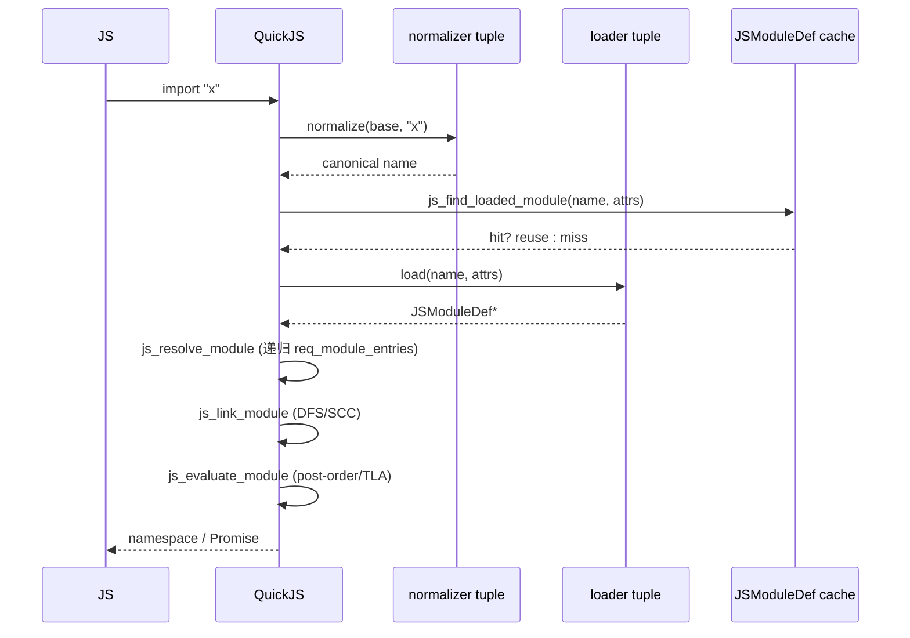

### 5.3 resolver / loader 链

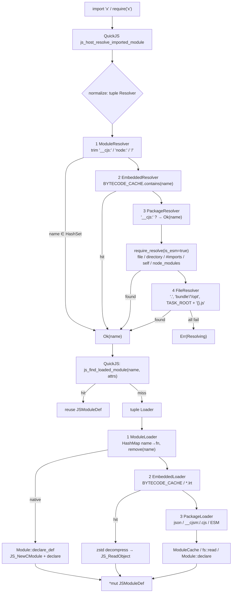

rquickjs 的 tuple fallthrough 语义很关键：

- 只有 `Err(Resolving { .. })` / `Err(Loading { .. })` 才会继续下一个 resolver/loader；
- `Ok` 立即返回；
- 其它错误直接冒泡；
- 全部失败时，把各层 message 用 `\n` join。

因此 resolver 成功**不代表** loader 成功，两条链必须各自能兜住。

### 5.4 native module 与 JS bytecode

LLRT 的 builtin 分两类：

**(1) native `ModuleDef`**

```rust
impl ModuleDef for FsModule {
    fn declare(declare: &Declarations) -> Result<()> {
        declare.declare("readFile")?;
        declare.declare("default")?;
        Ok(())
    }
    fn evaluate<'js>(ctx: &Ctx<'js>, exports: &Exports<'js>) -> Result<()> {
        export_default(ctx, exports, |default| {
            default.set("readFile", Func::from(...))?;
            Ok(())
        })
    }
}
```

注册路径：

```text
ModuleLoader::load_func::<D>
  -> Module::declare_def::<D, _>
       -> JS_NewCModule(ctx, name, eval_fn)
       -> D::declare(&Declarations)
            -> JS_AddModuleExport
       -> QuickJS 实例化时回调 eval_fn
            -> D::evaluate(&Ctx, &Exports)
                 -> JS_SetModuleExport
```

所以 native module 对 QuickJS 来说就是 C module：不需要源码，不需要 ESM 解析，导出在链接阶段由 engine 绑定。

**(2) JS builtin + bytecode**

少部分 builtin 是 JS（`node:stream`、`@llrt/test` 等）：

```ts
// llrt_core/src/modules/js/stream.ts
import { EventEmitter as EE } from "node:events";
import { inherits } from "node:util";
```

构建期 esbuild 打成 `bundle/js/*.js`，[`llrt_core/build.rs`](https://github.com/awslabs/llrt/blob/d2ae1d90f3740d7c397c47f6469a3fe5e330aa51/llrt_core/build.rs) 用 QuickJS 编译成 `.lrt` bytecode，按模块名放进 `BYTECODE_CACHE`。运行时首次 import 时解压、`JS_ReadObject`，依赖仍由 QuickJS 通过 loader 解析。

### 5.5 CJS 兼容：`__cjs:` / `__cjsm:` 与 `RequireState`

LLRT 用两个 magic prefix 把 CJS 塞进 ESM loader：

| 前缀 | 生成方 | 语义 |
|---|---|---|
| `__cjs:` | `require()` | 这次导入来自 CJS；`PackageResolver` 直接放行（不查文件系统），`PackageLoader` 按 ESM 声明，CJS 顶层代码直接执行 |
| `__cjsm:` | ESM 解析到 CJS 包时 | 强制按 CJS 处理；`PackageLoader` 生成合成 ESM 包装器，内部再 `require("__cjs:...")` |

`require()` 的关键流程：

```text
require(x)
  ├─ 取 globalThis.__require_hook（内嵌字节码的 embedded_resolve）
  ├─ 原生名直接命中 ModuleNames
  ├─ 否则以当前模块绝对路径为 base，require_resolve(..., is_esm=false)
  ├─ 非 .json/.lrt 结果加 __cjs: 前缀
  ├─ state.cache[x] 命中 -> 返回
  ├─ .json -> fs::read_to_string + json_parse
  ├─ state.progress[x] 命中 -> 返回占位对象（循环 require）
  ├─ 建占位 Object，放入 progress
  ├─ Module::import(ctx, "__cjs:/abs/x.cjs")   // JS_LoadModule
  ├─ 手动泵：
  │    loop {
  │      if promise.result::<Object>() { break }
  │      poll_timers(...)
  │      ctx.execute_pending_job()
  │    }
  └─ 从 state.exports[x] 取 CJS 写出的值，合并到占位对象
```

`globalThis.exports` / `globalThis.module.exports` 是一对 Accessor：

```text
get/set exports
  -> ctx.get_script_or_module_name()       // JS_GetScriptOrModuleName
  -> trim "__cjs:"
  -> RequireState.exports[name]
```

因此 `.cjs` 文件被当作 ESM 执行时，`module.exports = ...` 不会写入真正的 CommonJS 包装函数，而是写入按模块名索引的全局存储。这是 LLRT 能用 ESM loader 承载 CJS 语义的核心技巧。

`import` 一个 CJS 文件时，`PackageLoader::load_cjs_module()` 生成：

```js
const value = require("<name>");
export default value.default || value;
const { a, b } = value;
export { a, b };
```

具名导出来自 `Object.keys(value)`，不是静态分析，因此不是 live binding。

### 5.6 QuickJS API 调用清单

| API | LLRT 调用点 | 用途 |
|---|---|---|
| `JS_SetModuleLoaderFunc2` | rquickjs `LoaderHolder::set_to_runtime` | 注册 loader |
| `JS_SetModuleNormalizeFunc2` | 同上 | 注册 normalizer |
| `JS_Eval(..., MODULE \| COMPILE_ONLY)` | `Module::declare` | 源码 → module |
| `JS_ReadObject(..., BYTECODE)` | `Module::load` | 字节码 → module |
| `JS_NewCModule` | `Module::declare_def` | native module |
| `JS_AddModuleExport` | `Declarations::declare` | 声明 native 导出 |
| `JS_SetModuleExport` | `Exports::export` | 设置 native 导出 |
| `JS_EvalFunction` | `Module::eval` | link + evaluate |
| `JS_LoadModule` | `Module::import` | `require()` / dynamic import |
| `JS_GetImportMeta` | `Module::meta` | `import.meta.url` |
| `JS_ExecutePendingJob` | `Ctx::execute_pending_job` | 泵 Job queue |
| `JS_GetScriptOrModuleName` | `module::init` 的 exports accessor | 当前模块名 |
| `JS_WriteObject` | build.rs `module.write` | 生成 `.lrt` |
| `JS_GetModuleNamespace` | `Module::namespace` | namespace |

`require()` 的泵只推进 QuickJS job queue，不推进 Tokio I/O future。这是同步 CJS 与异步 API 之间的一个真实边界：如果 CJS 模块内部依赖一个 Tokio 驱动的 future，`require()` 期间它不会前进。

### 5.7 异步模型

- **模块加载路径完全同步**：`Loader::load` 是 C ABI 回调，内部 `std::fs::read` / `fs::read_to_string`；
- `AsyncRuntime` 只是包一层 `async_lock::Mutex<InnerRuntime>`；
- future 由 rquickjs 自己的 `Spawner`/`Schedular` 驱动，`AsyncRuntime::idle()` 循环 `JS_ExecutePendingJob` 并 poll spawner；
- LLRT 的 `#[tokio::main]` 提供 Tokio 给网络/定时器等应用 API；
- `Ctx::spawn` 把 future 推入 rquickjs 调度器，`spawn_exit` 负责把结果回传/错误上报。

所以 LLRT 的“异步”在 module 层几乎不存在：`import` 的 I/O 是阻塞的，`require()` 的泵是同步的；只有模块内的 TLA 和 JS 层 Promise 由 QuickJS job queue 推进。

### 5.8 运行验证

```bash
llrt main1.js        # A same-namespace: true true 1 1
llrt main2.js        # B tla: slow-done true eval:slow:start,eval:slow:end
llrt main3.js        # C cycle error: ReferenceError c1v is not initialized
llrt main4.js        # D meta: file:///abs/main4.js undefined（无 import.meta.main）
llrt llrt1.js        # require("node:fs") === import fs -> true
llrt llrt_bridge.js  # cjs eval count: 1；c === m.default -> true
llrt cjsesm.cjs      # require(esm) 可用，esm eval count: 1
```

结论：

- 模块树完全在 QuickJS，host 只维护“名字 → 加载器”的映射；
- native builtin 与 `require` 命中的是同一份 exports；
- CJS 由两个前缀 + `RequireState` 桥接，`import` CJS 与 `require` CJS 复用同一模块实例；
- `import.meta` 只有 `url`，没有 `main`/`resolve`。

---

## 6. txiki.js：一个 normalizer/loader，图完全在 QuickJS

### 6.1 定位

txiki.js 是 C + QuickJS-NG + libuv，目标是 Web 平台 API + 系统能力，明确不做 Node 兼容。它只注册一组 module 回调：

```c
/* src/vm.c:550 */
JS_SetModuleLoaderFunc2(rt,
                        tjs_module_normalizer,
                        tjs_module_loader,
                        tjs_module_attr_checker,
                        qrt);
```

注册位置：[`src/vm.c:550`](https://github.com/saghul/txiki.js/blob/fc2b5f3b2d09e6db739eb619cfb1acca37d6bdf0/src/vm.c#L550)。

和 LLRT 一样，txiki **没有自己的 module 注册表/图**；`ctx->loaded_modules` 就是缓存，`JSModuleDef` 就是节点。host 侧只有：

```c
/* src/private.h */
typedef struct TJSRuntime {
    ...
    struct {
        JSValue promise_event_ctor;
        JSValue dispatch_event_func;
        JSValue import_map_resolver;     /* JS 闭包，不是 C 解析器 */
        JSValue internal_core;           /* tjs:internal/core 的 default */
        JSValue internal_message_pipe;   /* tjs:internal/worker 的 default */
        JSValue error_event_ctor;
    } builtins;
} TJSRuntime;
```

以及一个静态的 builtin 表：

```c
/* src/builtins.c */
typedef struct {
    const char *name;
    const uint8_t *data;
    uint32_t data_size;
} tjs_builtin_t;

static tjs_builtin_t builtins[] = {
    { "tjs:assert", tjs__assert, sizeof(tjs__assert) },
    { "tjs:getopts", tjs__getopts, sizeof(tjs__getopts) },
    { "tjs:hashing", tjs__hashing, sizeof(tjs__hashing) },
    { "tjs:internal/home", tjs__internal_home, sizeof(tjs__internal_home) },
    { "tjs:internal/path", tjs__internal_path, sizeof(tjs__internal_path) },
    { "tjs:path", tjs__path, sizeof(tjs__path) },
    ...
    { NULL, NULL, 0 },
};
```

`tjs__load_builtin()` 线性 `strcmp` 查找，命中后 `JS_ReadObject(..., JS_READ_OBJ_BYTECODE)`，取出 `JSModuleDef*` 并释放 JSValue。

### 6.2 normalizer：名字规范化 + import map + internal 闸门

```c
char *tjs_module_normalizer(JSContext *ctx,
                            const char *base_name,
                            const char *name,
                            void *opaque);
```

算法：

```text
1. 若 name 以 "tjs:internal/" 开头：
      且 base_name 不以 "tjs:" 开头
      -> throw ReferenceError("module ... is not exposed to user code")
2. 若 name[0] != '.'：
      a. 若 qrt->builtins.import_map_resolver 是函数：
           调用 resolver(name, base_name)
           字符串 -> 返回映射结果
           null   -> throw "blocked by import map"
           undefined -> 继续
      b. 原样返回 name
3. 若 name 以 '.' 开头：
      - 取 base_name 的 dirname
      - 只折叠开头的 "./" / "../"
      - 拼接，统一平台路径分隔符
      - 返回文本规范化路径（不做 URL 解析、不 realpath、不查文件）
```

要点：

- import map 完全在 JS 侧实现（[`src/js/core/import-map.js`](https://github.com/saghul/txiki.js/blob/fc2b5f3b2d09e6db739eb619cfb1acca37d6bdf0/src/js/core/import-map.js)）：`imports`/`scopes` 是 null-prototype 对象，键按长度降序排序后做线性前缀匹配；C 侧只持有 resolver 函数。
- `tjs:internal/*` 的隔离是**名字前缀策略**，不是权限系统；它只看原始 `name`/`base_name`，不复查 import map 的结果。
- normalizer 拿不到 attributes：`JS_SetModuleLoaderFunc2` 的 `module_normalize_has_attr` 为 false，attributes 只传给 loader 和 attr checker。

### 6.3 loader：按协议/模块类型分派

```c
JSModuleDef *tjs_module_loader(JSContext *ctx,
                               const char *module_name,
                               void *opaque,
                               JSValueConst attributes);
```

分派：

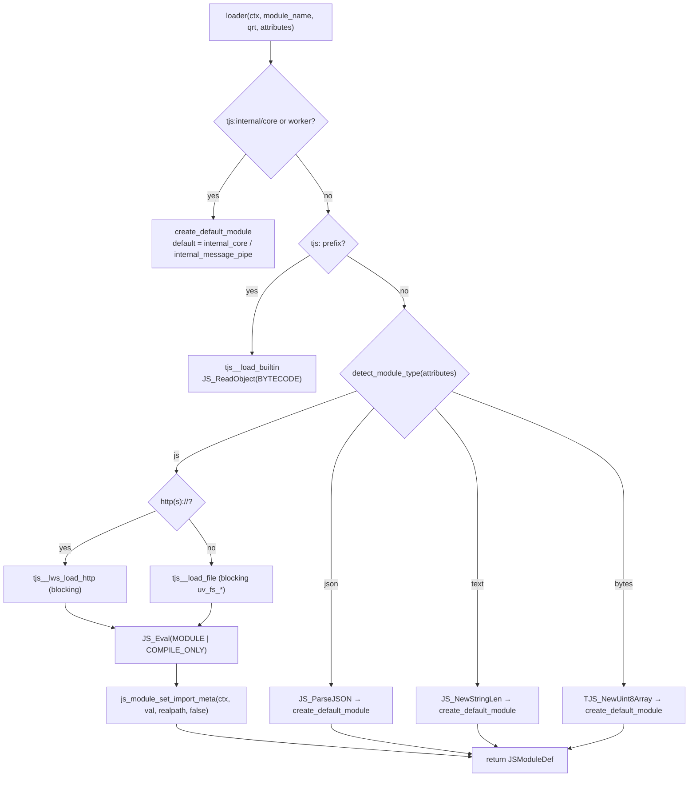

注意：

- `import './x.json'` 不带 `with { type: 'json' }` 会走 JS 编译并失败；JSON 必须显式 attributes。
- `tjs_module_attr_checker` 只允许键 `type`，值不校验。
- 文件/HTTP 都是同步阻塞；loader 回调返回 `JSModuleDef*`，本身无法 await。

### 6.4 QuickJS 的 DAG、链接与求值

txiki 的“树”就是 QuickJS 的图：

```text
ctx->loaded_modules (双向链表)
  [main] <-> [a] <-> [b] <-> [shared] <-> [util] ...

main.req_module_entries:
  { name:"a", module:*a }
  { name:"b", module:*b }
a.req_module_entries -> *shared
b.req_module_entries -> *shared     // 同一个 JSModuleDef
shared.req_module_entries -> *util
```

解析：

```text
js_resolve_module(m)
  if m->resolved: return
  for each rme in m->req_module_entries:
      rme->module = js_host_resolve_imported_module_atom(m->name, rme->name, rme->attrs)
      js_resolve_module(rme->module)
  m->resolved = true
```

`js_host_resolve_imported_module` 的顺序是：normalize → 查 `ctx->loaded_modules` → 未命中才调 loader。模块在解析依赖前已经插入 `loaded_modules`，所以环在 resolve 阶段自然闭合。

链接（`JS_EvalFunction` 内部）：

```text
js_create_module_function(m)     // 为每个模块创建 func_obj / 变量槽
js_link_module(m)
  js_inner_module_linking(m, stack, index)
    - status = LINKING
    - dfs_index = dfs_ancestor_index = index++
    - 递归每个 req_module_entries
    - 若孩子仍在 LINKING，更新 dfs_ancestor_index（SCC）
    - 绑定 import/export
    - SCC 根出栈时统一 status = LINKED
js_evaluate_module(m)
  js_inner_module_evaluation(m)
    - status = EVALUATING
    - 后序递归依赖
    - C module: m->init_func(ctx, m)
    - JS module: 调用 func_obj；若返回 pending promise：
         has_tla / EVALUATING_ASYNC，登记 async_parent_modules
    - SCC 根出栈时 status = EVALUATED 或 EVALUATING_ASYNC
```

`JSModuleStatus`：

```text
UNLINKED → LINKING → LINKED → EVALUATING → EVALUATING_ASYNC → EVALUATED
```

cycle 由 `cycle_root` 统一持有 evaluation Promise；TLA 通过 `async_parent_modules` / `pending_async_dependencies` 延迟父模块。

动态 import：

```text
js_dynamic_import(specifier)
  -> JS_NewPromiseCapability
  -> 把 [resolve, reject, basename, specifier, attributes] 入 QuickJS job queue
  -> 返回 promise
job: js_dynamic_import_job
  -> JS_LoadModuleInternal
       -> host resolve
       -> js_resolve_module
       -> JS_EvalFunction（link + evaluate）
       -> evaluation promise.then -> resolve(namespace)
```

所以 `import()` 的“异步”只是**调度点**异步（job queue），I/O 仍然同步。

QuickJS API 使用清单：

| API | txiki 调用点 | 用途 |
|---|---|---|
| `JS_SetModuleLoaderFunc2` | [`src/vm.c:550`](https://github.com/saghul/txiki.js/blob/fc2b5f3b2d09e6db739eb619cfb1acca37d6bdf0/src/vm.c#L550) | 注册 normalizer/loader/attr checker |
| `JS_Eval(..., MODULE \| COMPILE_ONLY)` | [`src/modules.c:202-206`](https://github.com/saghul/txiki.js/blob/fc2b5f3b2d09e6db739eb619cfb1acca37d6bdf0/src/modules.c#L202-L206) | 文件/HTTP 源码 → module |
| `JS_ReadObject(..., BYTECODE)` | [`src/builtins.c:93`](https://github.com/saghul/txiki.js/blob/fc2b5f3b2d09e6db739eb619cfb1acca37d6bdf0/src/builtins.c#L93)、[`src/eval.c:29`](https://github.com/saghul/txiki.js/blob/fc2b5f3b2d09e6db739eb619cfb1acca37d6bdf0/src/eval.c#L29) | builtin/core 字节码 → module |
| `JS_ResolveModule` | [`src/eval.c:36`](https://github.com/saghul/txiki.js/blob/fc2b5f3b2d09e6db739eb619cfb1acca37d6bdf0/src/eval.c#L36) | 递归解析字节码模块依赖 |
| `JS_EvalFunction` | [`src/eval.c:44`](https://github.com/saghul/txiki.js/blob/fc2b5f3b2d09e6db739eb619cfb1acca37d6bdf0/src/eval.c#L44)、[`src/vm.c:1203`](https://github.com/saghul/txiki.js/blob/fc2b5f3b2d09e6db739eb619cfb1acca37d6bdf0/src/vm.c#L1203) | link + evaluate |
| `JS_GetImportMeta` | [`src/modules.c:309`](https://github.com/saghul/txiki.js/blob/fc2b5f3b2d09e6db739eb619cfb1acca37d6bdf0/src/modules.c#L309) | 设置 `import.meta` |
| `JS_GetModuleName` | [`src/modules.c:270`](https://github.com/saghul/txiki.js/blob/fc2b5f3b2d09e6db739eb619cfb1acca37d6bdf0/src/modules.c#L270) | `import.meta.url` 的来源 |
| `JS_NewCModule` / `JS_AddModuleExport` / `JS_SetModulePrivateValue` | [`src/modules.c:48/54/55`](https://github.com/saghul/txiki.js/blob/fc2b5f3b2d09e6db739eb619cfb1acca37d6bdf0/src/modules.c#L48) | `tjs:internal/core`、`worker` 的 default C module |
| `JS_ParseJSON` | [`src/modules.c:209`](https://github.com/saghul/txiki.js/blob/fc2b5f3b2d09e6db739eb619cfb1acca37d6bdf0/src/modules.c#L209) | JSON 模块 |
| `JS_NewStringLen` / `TJS_NewUint8Array` | [`src/modules.c:212/215`](https://github.com/saghul/txiki.js/blob/fc2b5f3b2d09e6db739eb619cfb1acca37d6bdf0/src/modules.c#L212) | text / bytes 模块 |
| `JS_ExecutePendingJob` | [`src/vm.c:962`](https://github.com/saghul/txiki.js/blob/fc2b5f3b2d09e6db739eb619cfb1acca37d6bdf0/src/vm.c#L962) | job drain（dynamic import/microtask） |
| `JS_GetModuleNamespace` | 未直接调用 | 动态 import 内部使用（[`quickjs.c`](https://github.com/quickjs-ng/quickjs/blob/10b99693cdc3f37cdf05114bc2d5225de495c4a3/quickjs.c)） |

注意：txiki 没有 `JS_SetImportMetaCallback`（该版本不存在），也没有导出的 `JS_LinkModule`/`JS_EvaluateModule`；link/evaluate 都封装在 `JS_EvalFunction` 内部。

### 6.5 builtin 交付：esbuild → tjsc → C 数组


| 层 | 构建 | 加载时机 |
|---|---|---|
| polyfills | esbuild [`src/js/polyfills/index.js`](https://github.com/saghul/txiki.js/blob/fc2b5f3b2d09e6db739eb619cfb1acca37d6bdf0/src/js/polyfills/index.js) → `tjsc -n tjs:internal/polyfills` | 启动时 eager（[`vm.c:567`](https://github.com/saghul/txiki.js/blob/fc2b5f3b2d09e6db739eb619cfb1acca37d6bdf0/src/vm.c#L567)） |
| core | esbuild [`src/js/core/index.js`](https://github.com/saghul/txiki.js/blob/fc2b5f3b2d09e6db739eb619cfb1acca37d6bdf0/src/js/core/index.js) → `tjsc -n tjs:internal/bootstrap` | 启动时 eager（[`vm.c:568`](https://github.com/saghul/txiki.js/blob/fc2b5f3b2d09e6db739eb619cfb1acca37d6bdf0/src/vm.c#L568)） |
| `tjs:internal/core` | 不是字节码；`create_default_module` 绑定 `qrt->builtins.internal_core` | 首次 import（core bundle 立即 import） |
| `tjs:internal/worker` | 同上，绑定 `internal_message_pipe` | worker bootstrap |
| stdlib `tjs:*` | 每个文件 `qjsc/tjsc` 成 bytecode，进 `builtins[]` | 首次 import（lazy） |
| `tjs:internal/home` / `tjs:internal/path` | 同样在 `builtins[]` | 首次 import |

构建流水线：

```text
src/js/core/index.js
  --esbuild --bundle --external:tjs:*--> src/bundles/js/core/core.js
  --tjsc -m -s -n "tjs:internal/bootstrap" -p tjs__--> src/bundles/c/core/core.c
  --#include in src/builtins.c? 不，core.c 直接编进 tjs 静态库
```

[`src/builtins.c`](https://github.com/saghul/txiki.js/blob/fc2b5f3b2d09e6db739eb619cfb1acca37d6bdf0/src/builtins.c) 只 include stdlib 和 `internal/{home,path}` 的生成 C；core/polyfills/run-main/run-repl/worker-bootstrap 由 CMake 直接编进 `tjs`，通过 `tjs__eval_bytecode` 从内嵌缓冲区执行。

`tjs__eval_bytecode()` 对 module 做：

```c
JS_ResolveModule(ctx, obj);                  // 递归解析依赖
js_module_set_import_meta(ctx, obj, false, false);
JS_EvalFunction(ctx, obj);                   // link + evaluate
// 只检查 promise 是否已 rejected；pending 的 TLA 不等待
```

### 6.6 libuv 的角色：同步 loader，异步 job queue

txiki 的 loader 是同步的，但这不意味着它绕过了 libuv：

- `tjs__load_file()` 调用 `uv_fs_open/read/close`，且 `loop = NULL`，即 libuv 的**同步封装**，在调用线程直接执行 syscall；
- HTTP 加载用 libwebsockets，`while (!done) lws_service(lws_ctx, 250)` 轮询，最多 10 秒；
- `TJS_Run()` 主循环是 `uv_run(UV_RUN_DEFAULT)`；QuickJS job 由 `uv_check` 回调里的 `tjs__execute_jobs()` 排空；
- dynamic import job 就在这个 drain 中执行；
- TLA evaluation Promise 由 QuickJS job queue 推进；宿主没有额外的 liveness 跟踪。

```mermaid
sequenceDiagram
  participant JS as JS
  participant QJS as QuickJS
  participant L as tjs_module_loader
  participant UV as libuv
  participant Loop as TJS_Run
  JS->>QJS: import "x"
  QJS->>L: loader(name)
  L->>UV: uv_fs_open/read (loop=NULL, blocking)
  UV-->>L: source
  L->>QJS: JS_Eval(COMPILE_ONLY)
  QJS->>QJS: js_resolve_module → 递归 loader
  QJS->>QJS: JS_EvalFunction → link + evaluate
  QJS-->>JS: namespace / promise
  Loop->>UV: uv_run(UV_RUN_DEFAULT)
  UV->>Loop: check callback
  Loop->>QJS: JS_ExecutePendingJob (dynamic import / microtasks)
```

### 6.7 运行验证

```bash
tjs run main1.js     # A same-namespace: true true 1 1
tjs run main2.js     # B tla: slow-done true eval:slow:start,eval:slow:end
tjs run main3.js     # C cycle error: ReferenceError c1v is not initialized
tjs run main4.js     # D meta: file:///abs/main4.js true
tjs run internal.js  # internal blocked: ReferenceError module 'tjs:internal/core' is not exposed to user code
tjs run stdlib.js    # tjs:path a/b function
tjs run --import-map importmap.json map.js  # mapped ok 1
```

结论：

- host 没有 module 图，只有名字规范化和字节码/源码加载；
- `tjs:internal/*` 的可见性由 normalizer 的前缀检查控制；
- import map 是 JS 闭包，C 侧只调用；
- 文件/HTTP 加载同步，`import()` 只是 job 化调度。

---

## 7. Deno：deno_graph + deno_core ModuleMap 双层图

### 7.1 两层分工

Deno 同时支持 Web API、npm、JSR、Node compat、TypeScript、permissions 和 snapshot，因此它不是一张图，而是两张：

```text
┌─────────────────────────────────────────────────────────────────────┐
│ CLI 层（deno_graph）                                                 │
│   resolve: import map / npm / JSR / node: / file / http              │
│   graph: ModuleSpecifier → ModuleSlot { Module | Err | Pending }     │
│   依赖边: Dependency { maybe_code, maybe_type, is_dynamic, ... }     │
│   产物: 源码 + 转译结果 + 缓存信息                                    │
└──────────────────────────────┬──────────────────────────────────────┘
                               │ ModuleLoader::load()
                               ▼
┌─────────────────────────────────────────────────────────────────────┐
│ 运行时层（deno_core::ModuleMap）                                     │
│   ModuleId(usize) → handles[id] (v8::Global<Module>) + info[id]      │
│   by_name: (ModuleName, RequestedModuleType) → SymbolicModule        │
│   RecursiveModuleLoad: FuturesUnordered + visited                    │
│   dynamic import: dynamic_import_map + pending_* + module_waker      │
└─────────────────────────────────────────────────────────────────────┘
```

`deno_graph` 是 CLI 的静态/构建图，`ModuleMap` 是运行时图；两者在 `ModuleLoader` 的 `resolve/load` 边界交接，不共享数据结构。

### 7.2 `deno_core::ModuleMap` 的数据结构

```rust
// libs/core/modules/map.rs
pub(crate) struct ModuleMap {
    pub(crate) loader: RefCell<Rc<dyn ModuleLoader>>,
    pub(crate) source_mapper: Rc<RefCell<SourceMapper>>,
    exception_state: Rc<ExceptionState>,

    dynamic_import_map: RefCell<HashMap<ModuleLoadId, DynImportState>>,
    preparing_dynamic_imports: TrackedFutures<Pin<Box<PrepareLoadFuture>>>,
    pending_dynamic_imports: TrackedFutures<StreamFuture<RecursiveModuleLoad>>,
    pending_dyn_mod_evaluations: TrackedVec<DynImportModEvaluate>,
    pending_tla_waiters:
        RefCell<HashMap<ModuleId, Vec<v8::Global<v8::PromiseResolver>>>>,

    pending_mod_evaluation: Cell<bool>,
    evaluating_top_level: Cell<bool>,
    code_cache_ready_futs: TrackedFutures<Pin<Box<CodeCacheReadyFuture>>>,
    module_waker: AtomicWaker,

    data: RefCell<ModuleMapData>,
    will_snapshot: bool,
    loading_internal_modules: Cell<bool>,
    pub(crate) dyn_module_evaluate_idle_counter: Cell<u32>,
    pub(crate) import_sync_eval_stack: RefCell<Vec<ModuleId>>,
}
```

真正存节点的是 `ModuleMapData`：

```rust
// libs/core/modules/module_map_data.rs
pub(crate) struct ModuleMapData {
    /// V8 handle → index
    pub(crate) handles_inverted: HashMap<v8::Global<v8::Module>, usize>,
    /// index → V8 handle
    pub(crate) handles: Vec<v8::Global<v8::Module>>,
    pub(crate) main_module_callbacks: Vec<v8::Global<v8::Function>>,
    /// index → metadata
    pub(crate) info: Vec<ModuleInfo>,

    /// (ModuleName, RequestedModuleType) → Mod(id) | Alias(name)
    by_name: ModuleNameTypeMap<SymbolicModule>,
    pub(crate) next_load_id: ModuleLoadId,
    pub(crate) main_module_id: Option<ModuleId>,

    pub(crate) synthetic_module_exports_store: SyntheticModuleExportsStore,
    pub(crate) lazy_esm_sources: Rc<RefCell<HashMap<ModuleName, ModuleCodeString>>>,
    pub(crate) residual_lazy_esm_sources: &'static [(&'static str, &'static str)],
    pub(crate) known_lazy_esm: RefCell<HashSet<Cow<'static, str>>>,
    pub(crate) lazy_script_sources: ...,
    pub(crate) loaded_script_results: ...,
    pub(crate) synthetic_esm_modules: ...,
    pub(crate) sources: HashMap<ModuleSourceKey, v8::Global<v8::Object>>,
    ...
}

pub(crate) struct ModuleInfo {
    pub id: ModuleId,
    pub main: bool,
    pub name: ModuleName,                 // FastString
    pub requests: Vec<ModuleRequest>,
    pub module_type: ModuleType,
    pub is_internal: bool,
}
```

`ModuleId` 的分配方式很关键：

```rust
let id = data.handles.len();
data.handles_inverted.insert(handle.clone(), id);
data.handles.push(handle);
data.by_name.insert(&RequestedModuleType::from(module_type),
                    name,
                    SymbolicModule::Mod(id));
data.info.push(ModuleInfo { id, ... });
```

所以：

- `ModuleId` 是**注册顺序下标**，不是内容哈希；
- `handles[id]` 和 `info[id]` 必须用同一个 id 访问；
- 字符串到 id 的映射在 `by_name`；
- 重定向用 `SymbolicModule::Alias(ModuleName)`，`get_id()` 会沿 alias 链追到 `Mod(id)`；
- `next_load_id` 只用于动态加载批次（`ModuleLoadId`），与 `ModuleId` 无关。

```text
ModuleMap
 ├─ data
 │   ├─ handles[0] = Global<v8::Module>(main)
 │   ├─ handles[1] = Global<v8::Module>(a)
 │   ├─ handles[2] = Global<v8::Module>(b)
 │   ├─ info[0] = { id:0, main:true,  name:"file:///main.js", requests:[a,b], ... }
 │   ├─ info[1] = { id:1, main:false, name:"file:///a.js",    requests:[shared], ... }
 │   ├─ info[2] = { id:2, main:false, name:"file:///b.js",    requests:[shared], ... }
 │   ├─ by_name["file:///main.js"] -> Mod(0)
 │   ├─ by_name["file:///a.js"]    -> Mod(1)
 │   ├─ by_name["npm:foo"]         -> Alias("file:///.../foo.js")
 │   └─ handles_inverted[Global(main)] -> 0
 ├─ dynamic_import_map: load_id -> DynImportState { resolver, cped, phase }
 ├─ preparing_dynamic_imports: FuturesUnordered<PrepareLoadFuture>
 ├─ pending_dynamic_imports: FuturesUnordered<StreamFuture<RecursiveModuleLoad>>
 ├─ pending_dyn_mod_evaluations: Vec<DynImportModEvaluate>
 ├─ pending_tla_waiters: ModuleId -> Vec<Global<PromiseResolver>>
 └─ module_waker: AtomicWaker
```

### 7.3 `RecursiveModuleLoad`：并行装载 + 两级去重

```rust
pub(crate) struct RecursiveModuleLoad {
    id: ModuleLoadId,
    root_module_id: Option<ModuleId>,
    init: LoadInit,                    // Main | Side | DynamicImport
    state: LoadState,                  // Init | LoadingRoot | LoadingImports | Done
    pub(crate) module_map_rc: Rc<ModuleMap>,
    pending: FuturesUnordered<Pin<Box<ModuleLoadFuture>>>,
    visited: HashSet<ModuleReference>,
    visited_as_alias: Rc<RefCell<HashSet<String>>>,
    root_module_reference: Option<ModuleReference>,
    resolved_specifier: Option<Result<ModuleSpecifier, CoreError>>,
    loader: Rc<dyn ModuleLoader>,
}
```

状态机：

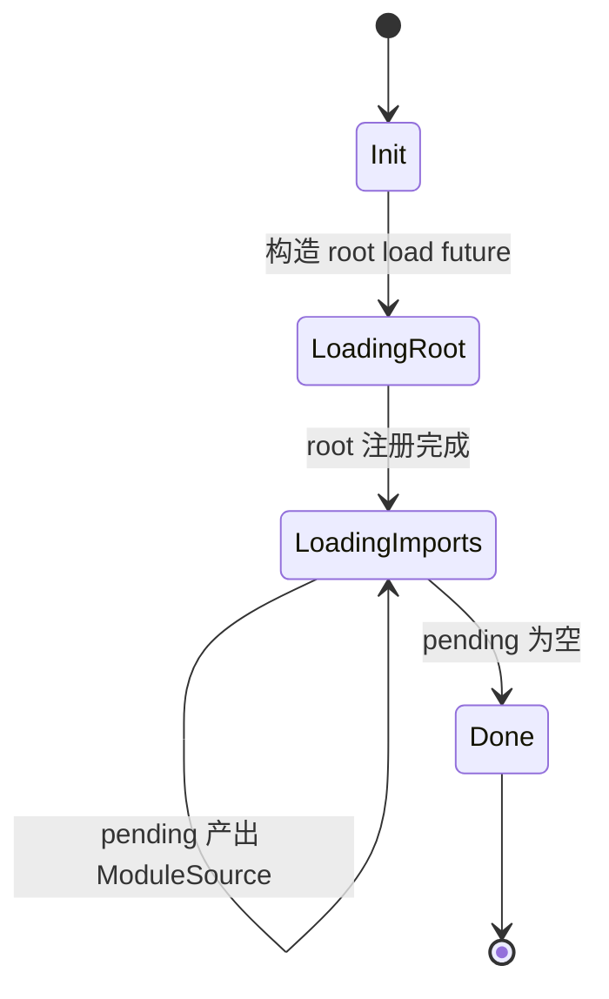

装载过程：

```text
poll_next()
  ├─ Init: resolve_root_from_init()
  │        Main -> ResolutionKind::MainModule, referrer "."
  │        Side -> Import
  │        DynamicImport -> DynamicImport
  │        loader.prepare_load()（lazy/synthetic 跳过）
  │        构造 root future 推入 pending
  ├─ LoadingRoot/LoadingImports:
  │        pending.try_poll_next_unpin()
  │        Some(ModuleSource) -> register_and_recurse()
  │        None -> Done
  └─ Done -> Ready(None)

register_and_recurse(source)
  ├─ check redirect / get_id() 去重
  ├─ v8::script_compiler::compile_module2 / compile_module
  ├─ module.get_module_requests()
  ├─ 每条 request:
  │    ├─ loader.resolve_with_scope(...)
  │    ├─ 构造 ModuleReference
  │    ├─ visited / visited_as_alias 命中 -> skip
  │    ├─ get_id() 已注册 -> already_registered 队列
  │    └─ 否则 needs_load -> 包装 future 推入 pending
  └─ create_module_info(id = handles.len())
```

去重键是 `(specifier, requested_module_type)`，不是原始字符串：

- `visited: HashSet<ModuleReference>` 处理正常边；
- `visited_as_alias: HashSet<String>` 处理“重定向后同一个 found URL”；
- `already_registered` 是同步队列，避免对已在 `ModuleMap` 的模块重复 `load()`。

### 7.4 V8 API：link 与 evaluate

Deno 的运行时注册/链接流程：

```text
compile:
  v8::script_compiler::compile_module2(scope, &mut source, ...)
  -> module.get_module_requests()
  -> 为每条 request 预解析 ModuleRequest { reference, specifier_key, phase, ... }
  -> create_module_info(...)

instantiate:
  tc_scope.set_slot(self as *const ModuleMap)
  module.instantiate_module2(scope,
                             ModuleMap::module_resolve_callback,
                             ModuleMap::module_source_callback)
  -> V8 对每条边回调 module_resolve_callback
       -> 用 (specifier_key, requested_module_type) 找预解析的 reference
       -> resolve_callback: synthetic_esm → loader.resolve → get_id → lazy ESM
       -> 返回 handles[id]
  -> drop_instantiated_requests(...) 释放已链接图的边

evaluate:
  module.evaluate(scope) -> Promise
  -> then2(on_fulfilled, on_rejected)
  -> tokio::sync::oneshot 把 V8 promise 桥回 Rust future
  -> pending_mod_evaluation = true
```

V8 API 清单：

| API | 位置 | 用途 |
|---|---|---|
| `v8::script_compiler::compile_module2` | [`map.rs:865`](https://github.com/denoland/deno/blob/d7205acbed60f68414d1485407a5b50bc867131e/libs/core/modules/map.rs#L865) | 编译 + import attributes |
| `module.get_module_requests()` | [`map.rs:965`](https://github.com/denoland/deno/blob/d7205acbed60f68414d1485407a5b50bc867131e/libs/core/modules/map.rs#L965) | 收集静态边 |
| `module.instantiate_module2` | [`map.rs:1207`](https://github.com/denoland/deno/blob/d7205acbed60f68414d1485407a5b50bc867131e/libs/core/modules/map.rs#L1207) | link + resolve/source 回调 |
| `module.get_module_namespace()` | [`map.rs`](https://github.com/denoland/deno/blob/d7205acbed60f68414d1485407a5b50bc867131e/libs/core/modules/map.rs) | 取 namespace |
| `module.evaluate()` | [`evaluation.rs`](https://github.com/denoland/deno/blob/d7205acbed60f68414d1485407a5b50bc867131e/libs/core/modules/map/evaluation.rs) | 求值 |
| `v8::PromiseResolver::new` | [`map.rs:1802`](https://github.com/denoland/deno/blob/d7205acbed60f68414d1485407a5b50bc867131e/libs/core/modules/map.rs#L1802) | synthetic module evaluation steps 必须返回 Promise |
| `v8::Global::new` | [`module_map_data.rs`](https://github.com/denoland/deno/blob/d7205acbed60f68414d1485407a5b50bc867131e/libs/core/modules/module_map_data.rs) | 持有 module handle |

Deno 的 `ModuleMap` 与 V8 的关系可以概括为：

```text
V8 module graph  ── handles[id] ──►  ModuleMapData
      ▲                                  │
      │ instantiate_module2              │ by_name / get_id
      └──────── resolve callback ◄───────┘
```

V8 负责“module 之间的绑定关系”，`ModuleMap` 负责“id ↔ handle ↔ 名字 ↔ metadata”的索引，以及异步加载/求值状态。

### 7.5 动态 import 与 TLA

```rust
type PrepareLoadFuture = dyn Future<Output = (ModuleLoadId, Result<RecursiveModuleLoad, CoreError>)>;

struct DynImportState {
    resolver: v8::Global<v8::PromiseResolver>,
    cped: v8::Global<v8::Value>,
    phase: ModuleImportPhase,
}

struct DynImportModEvaluate {
    load_id: ModuleLoadId,
    module_id: ModuleId,
    promise: v8::Global<v8::Promise>,
}
```

`load_dynamic_import()` 的快路径：

1. 已 `Evaluated` 且没有 pending TLA → 直接 resolve namespace；
2. 已 `Evaluated` 但 TLA 未完成 → 把 resolver 放进 `pending_tla_waiters[module_id]`；
3. lazy ESM / synthetic ESM → 同步构建并 resolve；
4. 否则走 `RecursiveModuleLoad` 慢路径，把 `DynImportState` 放进 `dynamic_import_map`。

求值阶段：

```text
dynamic_import_module_evaluate()
  -> module.evaluate() 的内部 Promise
  -> then2(wake_module, wake_module)     // 只唤醒 module_waker
  -> DynImportModEvaluate 入 pending_dyn_mod_evaluations

evaluate_dyn_imports()
  -> poll promise state
  -> Fulfilled: dynamic_import_resolve(namespace)
  -> Rejected:  dynamic_import_reject(exception) + reject_tla_waiters
```

事件循环 liveness：

```text
EventLoopPendingState {
  has_pending_dynamic_imports:    preparing || pending
  has_pending_dyn_module_evaluation: !pending_dyn_mod_evaluations.is_empty()
  has_pending_module_evaluation:  pending_mod_evaluation
  ...
}
```

这三项都参与 `is_pending()`，所以有在飞的 module loading/evaluation 时 Deno 不会退出。TLA 的 Promise 被显式跟踪，因此 `import()` 会等求值完成再 resolve namespace。

动态 import 的三段式流水线：

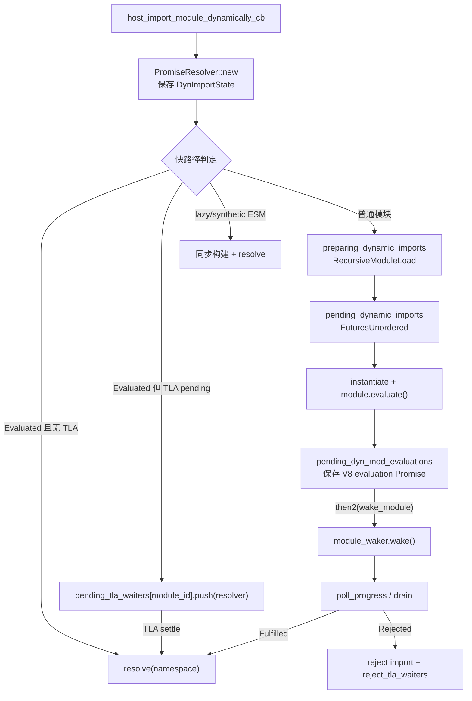

注意：`DynImportState` 里保存的是**用户 Promise 的 resolver**，`DynImportModEvaluate` 里保存的是**内部 evaluation Promise**；二者通过 `pending_dyn_mod_evaluations` 和 `pending_tla_waiters` 分开管理。

### 7.6 CLI 的 `deno_graph`

```rust
pub struct ModuleGraph {
    pub roots: IndexSet<ModuleSpecifier>,
    module_slots: BTreeMap<ModuleSpecifier, ModuleSlot>,
    pub imports: IndexMap<ModuleSpecifier, GraphImport>,
    pub redirects: BTreeMap<ModuleSpecifier, ModuleSpecifier>,
    pub packages: PackageSpecifiers,
    ...
}

enum ModuleSlot {
    Module(Module),
    Err(ModuleError),
    Pending { is_asset: bool },
}

enum Module {
    Js(JsModule),
    Json(JsonModule),
    Wasm(WasmModule),
    Npm(NpmModule),
    Node(BuiltInNodeModule),
    External(ExternalModule),
}

struct JsModule {
    is_script: bool,
    dependencies: IndexMap<String, Dependency>,
    source: ModuleTextSource,
    media_type: MediaType,
    specifier: ModuleSpecifier,
    maybe_types_dependency: ...,
    ...
}

struct Dependency {
    maybe_code: Resolution,
    maybe_type: Resolution,
    is_dynamic: bool,
    maybe_attribute_type: Option<...>,
    imports: ...,
}
```

`MainModuleGraphContainer` 用 `Arc<RwLock<Arc<ModuleGraph>>>` 做读多写少：

```text
graph() -> Arc<ModuleGraph>              // 直接 clone 内层 Arc
update:
  acquire_update_permit()
  clone graph
  graph.build(...)
  commit() -> 原子换入
```

`CliModuleLoader` 的职责：

```text
prepare_load(specifier)
  -> acquire_update_permit
  -> ModuleLoadPreparer::prepare_module_load
  -> graph.build(...) / 增量更新

load(specifier)
  -> load_code_source(graph)
  -> deno_resolver::load()
  -> ModuleSource::new_with_redirect(...)
  -> 返回 ModuleLoadResponse::Async/Sync

resolve(specifier, referrer)
  -> resolver.resolve_with_graph(graph, ...)
  -> import map / npm / JSR / node: / permissions
```

`deno info --json` 输出的就是 `deno_graph` 的结构：

```json
{
  "roots": ["file:///.../main1.js"],
  "modules": [
    { "kind": "esm", "specifier": "file:///.../a.js", ... },
    { "kind": "esm", "specifier": "file:///.../main1.js",
      "dependencies": [
        { "specifier": "./a.js",
          "code": { "specifier": "file:///.../a.js", "resolutionMode": "import" } }
      ] }
  ],
  "redirects": {}
}
```

### 7.7 Extension builtin

```rust
pub struct Extension {
    pub name: &'static str,
    pub deps: &'static [&'static str],
    pub js_files: Cow<'static, [ExtensionFileSource]>,
    pub esm_files: Cow<'static, [ExtensionFileSource]>,
    pub lazy_loaded_esm_files: Cow<'static, [ExtensionFileSource]>,
    pub lazy_loaded_js_files: Cow<'static, [ExtensionFileSource]>,
    pub synthetic_esm_modules: Cow<'static, [(&'static str, &'static str)]>,
    pub esm_entry_point: Option<&'static str>,
    pub ops: Cow<'static, [OpDecl]>,
    ...
}
```

四种交付方式：

| 形式 | 字段 | 加载/求值 |
|---|---|---|
| **ESM extension** | `esm_files` | 启动时 `load_side_es_module` 注册，不自动 evaluate；`esm_entry_point` 指定的模块在启动时 evaluate |
| **lazy ESM** | `lazy_loaded_esm_files` | 注册源码到 `lazy_esm_sources`，首次 import 时 `LazyEsmModuleLoader` 同步加载+求值 |
| **synthetic ESM** | `synthetic_esm_modules` | 先执行 backing IIFE 得到 exports 对象，再 `new_synthetic_module_from_exports_object` 包成 ESM facade |
| **snapshot** | 同 extension | 源码和 entry point 可进入 V8 snapshot；已进 snapshot 的扩展不再重跑 js/esm |

`ext:` 的访问限制：

```rust
// map.rs
fn validate_ext_module_import(...) {
    if will_snapshot || loading_internal_modules {
        if referrer == "." || is_internal_referrer(referrer) { return Ok(()) }
    }
    Err(TypeError("Importing ext: modules is only allowed from ext: and node: modules"))
}
```

实测用户代码 `import("ext:core/mod.js")` 会被拒绝；`node:fs` 则由 CLI/Node compat 层提供 facade。

### 7.8 tokio 的角色

Deno 的 module loading **本身不用 tokio 调度**：

- `RecursiveModuleLoad` 用 `FuturesUnordered` + `StreamFuture`；
- 动态 import 的 prepare future 也是 `FuturesUnordered`；
- `module_waker: AtomicWaker` 把 V8 promise 的回调接回事件循环；
- 求值用 `tokio::sync::oneshot` 把 V8 Promise 桥回 Rust future；
- CLI 的 JS 跑在 **current-thread tokio runtime** 上，V8 永远在 `block_on` 的线程执行；`spawn_blocking` 只用于 swc 解析等阻塞工作。

所以 Deno 的“异步”是 **futures + waker** 驱动，不是“每个 import 一个 tokio task”。

### 7.9 运行验证

```bash
deno run --quiet main1.js   # A same-namespace: true true 1 1
deno run --quiet main2.js   # B tla: slow-done true eval:slow:start,eval:slow:end
deno run --quiet main3.js   # C cycle error: ReferenceError Cannot access 'c1v' before initialization
deno run --quiet main4.js   # D meta: file:///abs/main4.js true
deno run --quiet deno_ext.js
# ext blocked: TypeError Importing ext: modules is only allowed from ext: and node: modules...
# node:fs facade: function false
deno info --json main1.js   # 输出 roots/modules/dependencies 图
```

结论：

- 运行时图是“双索引 + 句柄分离”：`ModuleId` 下标、`by_name` 名字索引、`handles` 独立数组；
- 装载是 futures 并行 + `visited` 两级去重；
- 链接通过 `instantiate_module2` 的 resolve/source 回调把 `ModuleInfo.requests` 映射回 V8 handle；
- TLA 由 `pending_dyn_mod_evaluations` / `pending_tla_waiters` 显式跟踪；
- CLI 的 `deno_graph` 与运行时 `ModuleMap` 是两张不同的图。

---

## 8. Node.js：JS 层 ESM loader + 独立 CJS loader

### 8.1 两套 loader

Node 的独特之处：CJS 是原生起点，ESM 是后加并通过 bridge 兼容。它不是一套 loader，而是两套：

```text
ESM:
  import / import()
    -> V8 host callback
    -> src/module_wrap.cc
    -> lib/internal/modules/esm/utils.js
    -> ModuleLoader.import
    -> ModuleJobSync / ModuleJob
    -> ModuleWrap (C++)
    -> v8::Module

CJS:
  require()
    -> Module._load
    -> Module._resolveFilename
    -> Module._findPath
    -> Module._cache
    -> compile wrapper
    -> execute
```

2026 快照的一个重要变化：**主线程上的 ESM 入口统一使用 `ModuleJobSync`**（[`loader.js:620-622`](https://github.com/nodejs/node/blob/a232998e0de60db23769571dcf981beb4fd4f176/lib/internal/modules/esm/loader.js#L620-L622)），同步 link，无 TLA 时同步 evaluate；只有 `kRequireInImportedCJS` 等少数路径仍用异步 `ModuleJob`。

### 8.2 ESM 数据结构

```js
// lib/internal/modules/esm/loader.js
class ModuleLoader {
  #defaultConditions = getDefaultConditions();
  #resolveCache = new ResolveCache();
  loadCache = new LoadCache();
  isForAsyncLoaderHookWorker = false;
  #asyncLoaderHooks;
}
```

没有 `moduleJobs` 字段：job 全部存在 `loadCache` 里。

`LoadCache` 是**两级 key**：

```js
class LoadCache extends SafeMap {
  get(url, type = kImplicitTypeAttribute) {
    return super.get(url)?.[type];
  }
  set(url, type = kImplicitTypeAttribute, job) {
    const cachedJobsForUrl = super.get(url) ?? { __proto__: null };
    cachedJobsForUrl[type] = job;
    return super.set(url, cachedJobsForUrl);
  }
}
```

所以：

```text
loadCache: Map<url, { [type]: ModuleJobBase }>
  "file:///a.mjs" -> { "javascript": ModuleJobSync }
  "file:///a.json" -> { "json": ModuleJobSync }
```

`type` 默认是 `"javascript"`；`import './a.json' with { type: 'json' }` 与普通 JS 不会互相覆盖。

`#resolveCache` 是另一套 key：`specifier + '::' + sorted(JSON(attrs))`，按 `parentURL` 分桶；注册自定义 loader 时不用它。

`ModuleJobBase` / `ModuleJob` / `ModuleJobSync`：

```js
class ModuleJobBase {
  constructor(loader, url, importAttributes, phase, isMain, inspectBrk) {
    this.loader = loader;
    this.importAttributes = importAttributes;
    this.phase = phase;
    this.isMain = isMain;
    this.inspectBrk = inspectBrk;
    this.url = url;
  }

  syncLink(requestType) {
    // 先把自己写进 loadCache，再递归 link，处理循环
    const hadPreviousEntry = this.loader.loadCache.get(this.url, this.type) !== undefined;
    this.loader.loadCache.set(this.url, this.type, this);
    const moduleRequests = this.module.getModuleRequests();
    const modules = Array(moduleRequests.length);
    ...
    this.module.link(modules);
  }
}

class ModuleJob extends ModuleJobBase {
  // module 或 modulePromise
  // linked: Promise | ModuleJobBase[]
  // instantiated: Promise | undefined
  // commonJsDeps: boolean[]
}

class ModuleJobSync extends ModuleJobBase {
  // module: ModuleWrap
  // linked: ModuleJobBase[]
  // type: string
  // modulePromise getter
  instantiateSync() { this.module.instantiate(); }
  runSync(parent) { ... evaluateSync() }
}
```

对象关系：

```text
ModuleLoader
 ├─ loadCache: Map<url, {type: ModuleJobBase}>
 ├─ #resolveCache: Map<parentURL, Map<key, {url, format}>>
 └─ #asyncLoaderHooks: AsyncLoaderHooksProxiedToLoaderHookWorker
      └─ AsyncLoaderHookWorker -> Worker thread -> MessagePort/Atomics

ModuleJobBase
 ├─ url, loader, importAttributes, phase, isMain, inspectBrk
 ├─ ModuleJob: module | modulePromise, linked(Promise), instantiated, commonJsDeps
 └─ ModuleJobSync: module(ModuleWrap), linked[], type, commonJsDeps

ModuleWrap (C++ BaseObject)
 ├─ internal field kModuleSlot: v8::Global<v8::Module>
 ├─ kSyntheticEvaluationStepsSlot: JS callback
 ├─ kContextObjectSlot
 ├─ kLinkedRequestsSlot: Array<ModuleWrap>
 ├─ kModuleSourceObjectSlot
 └─ linked_module_wraps_: std::vector<ModuleWrap*>
```

### 8.3 ESM 加载流程

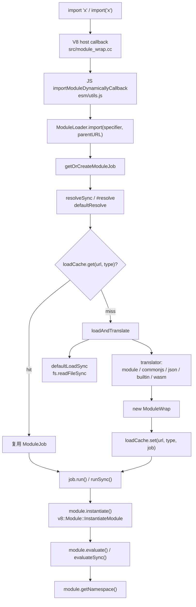

`resolve` 的关键路径：

```text
defaultResolve
  ├─ data: -> 直接返回
  ├─ node: -> 直接返回 specifier
  ├─ 入口点：parentURL = CWD
  └─ moduleResolve
       ├─ 相对/绝对 -> new URL
       ├─ '#' -> packageImportsResolve
       ├─ URL -> 直接
       └─ packageResolve
            ├─ BuiltinModule.canBeRequiredWithoutScheme -> node:
            ├─ packageJsonReader.getPackageJSONURL
            └─ packageExportsResolve / legacyMainResolve
```

`load` 的关键点：

- 主线程走 `defaultLoadSync`，`file:` 用 `readFileSync`，`data:` 用 `dataURLProcessor`；
- `node:` → `format = 'builtin'`、`source = null`；
- 判定为 `commonjs` 时，async 版本会把 source 置 null，让 CJS loader 自己重新读；
- translator 是 `SafeMap`：`module`、`commonjs-sync`、`require-commonjs`、`builtin`、`json`、`wasm`、`addon` 等。

`ModuleJob` 的状态：

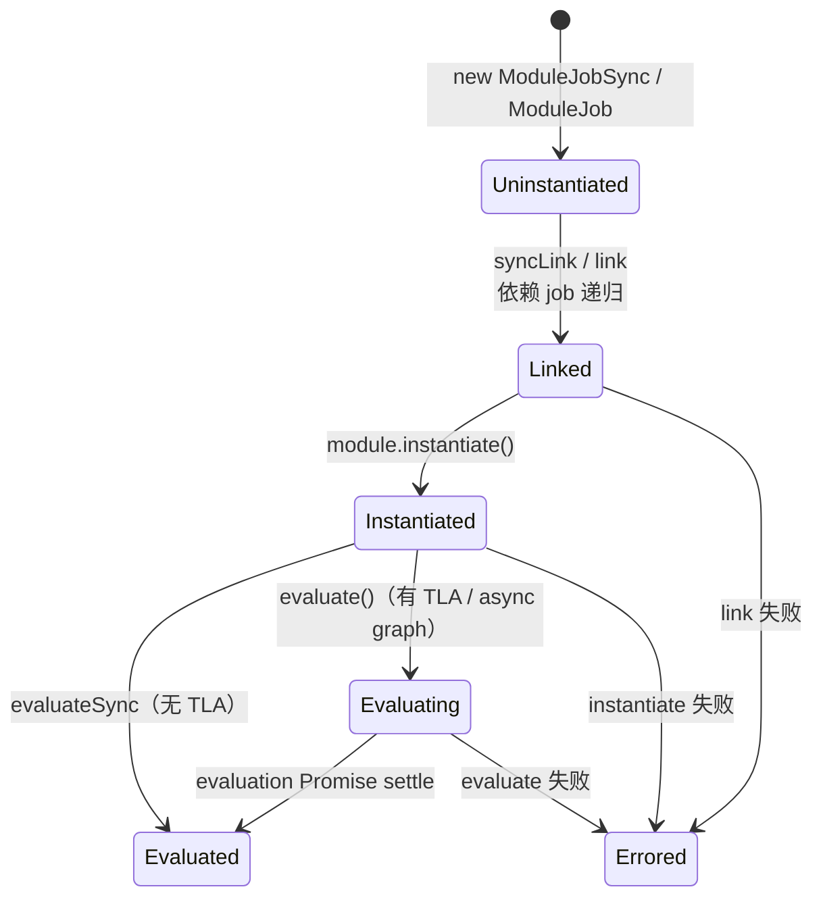

- `ModuleJobSync`：`syncLink` → `instantiateSync` → 无 TLA 时 `evaluateSync`；有 TLA 时退回异步 `evaluate`；
- `ModuleJob`：`link`/`instantiate`/`evaluate` 都是 Promise 链，用 `instantiated` 字段去重；
- 环处理：`syncLink` 先把自身写入 `loadCache`，再递归 link；`ModuleJob` 的 `#asyncInstantiate` 会先 flatten 整个依赖图，避免环导致死锁。

### 8.4 CJS 数据结构与 require 流程

```js
function Module(id = '', parent) {
  this.id = id;
  this.path = path.dirname(id);
  setOwnProperty(this, 'exports', {});
  this[kFirstModuleParent] = parent;
  this[kLastModuleParent] = parent;
  updateChildren(parent, this, false);
  this.filename = null;
  this.loaded = false;
  this.children = [];
}
```

静态表：

```text
Module._cache:     filename -> Module
Module._pathCache: request + '\x00' + paths.join('\x00') -> filename
Module._extensions: '.js' | '.json' | '.node' -> handler
```

`Module._load`：

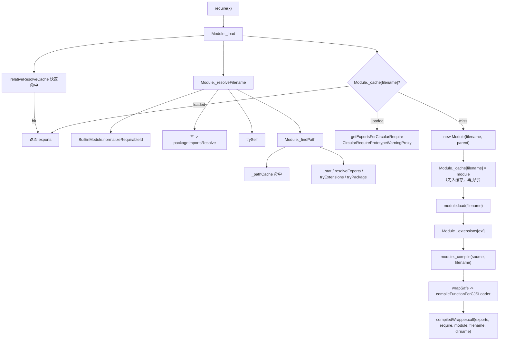

环依赖能工作，靠的是 **先 `new Module` 并写入 `Module._cache`，再执行**；尚未执行完的模块被再次 require 时，返回当前 `module.exports` 的占位对象（并用 `CircularRequirePrototypeWarningProxy` 对未定义属性发出警告）。

### 8.5 C++ `ModuleWrap` 与 V8 API

`ModuleWrap` 是一个 `BaseObject`，内部字段槽位：

```text
kModuleSlot                 -> v8::Global<v8::Module>
kModuleSourceObjectSlot     -> source-phase object
kSyntheticEvaluationStepsSlot -> JS evaluation callback（CJS/JSON/builtin）
kContextObjectSlot
kLinkedRequestsSlot         -> Array<ModuleWrap>
```

| JS 侧 | C++ | V8 API |
|---|---|---|
| `new ModuleWrap(url, ctx, source, ...)` | `ModuleWrap::New` | `ScriptCompiler::CompileModule`；synthetic 时 `Module::CreateSyntheticModule` |
| `wrap.link(modules)` | `ModuleWrap::Link` | `Module::GetModuleRequests()` + `ModuleRequest` |
| `wrap.instantiate()` | `ModuleWrap::Instantiate` | `Module::InstantiateModule(context, ResolveModuleCallback)` |
| `wrap.evaluate(t, b)` | `ModuleWrap::Evaluate` | `Module::Evaluate(context)` → Promise |
| `wrap.evaluateSync()` | `ModuleWrap::EvaluateSync` | `Module::Evaluate` + `Module::GetModuleNamespace` |
| `wrap.getNamespace()` | `ModuleWrap::GetNamespace` | `Module::GetModuleNamespace` |
| `wrap.getStatus()` | `ModuleWrap::GetStatus` | `Module::GetStatus` |
| `wrap.getModuleRequests()` | `ModuleWrap::GetModuleRequests` | `Module::GetModuleRequests` → `FixedArray` |
| `hasAsyncGraph` | C++ lazy property | `Module::IsGraphAsync` |

动态 import 的桥接：

```cpp
static MaybeLocal<Promise> ImportModuleDynamicallyWithPhase(...) {
  // 调 JS callback，拿到 thenable
  Local<Promise::Resolver> resolver;
  Promise::Resolver::New(context).ToLocal(&resolver);
  resolver->Resolve(context, result);
  return handle_scope.Escape(resolver->GetPromise());
}
```

即：JS callback 返回的 Promise 被塞进一个在 referrer context 里新建的 `v8::Promise::Resolver`，再把 resolver 的 Promise 交回 V8。`Link` 还会对 `ModuleRequest` 做 `ModuleCacheKey` 去重；同一个 request 映射到不同 `ModuleWrap` 会抛 `ERR_MODULE_LINK_MISMATCH`。

CJS 的函数编译是另一条路：`compileFunctionForCJSLoader` → `ScriptCompiler::CompileFunction`，参数表 `(exports, require, module, __filename, __dirname)`，与 `ModuleWrap` 无关。

### 8.6 CJS/ESM bridge

Node 有三条桥：

1. **`import` 一个 CJS 文件**：`createCJSModuleWrap()` 用 `cjs_lexer` 静态分析导出名，构造 synthetic `ModuleWrap`，evaluation callback 里才执行 CJS；
2. **`require` 一个 ESM 文件**：`importSyncForRequire()` 复用 `ModuleJobSync`，有 TLA 就抛 `ERR_REQUIRE_ASYNC_MODULE`；
3. **loader hooks**：`module.registerHooks()` 是同步 in-thread hook（CJS/ESM 共用全局 `resolveHooks/loadHooks`）；`module.register()` 是异步 loader hook worker，v26 已 runtime deprecated。

CJS wrapper 的导出是“静态分析 + `default` + `module.exports`”的快照，不是 live binding；动态属性不会出现在 named exports 里。

### 8.7 builtin：`BuiltinModule` map + ESM facade

```js
class BuiltinModule {
  static map = new SafeMap(builtinIds.map((id) => [id, new BuiltinModule(id)]));

  constructor(id) {
    this.filename = `${id}.js`;
    this.id = id;
    this.exports = {};
    this.loaded = false;
    this.loading = false;
    this.module = undefined;      // C++ ModuleWrap（ESM facade）
    this.exportKeys = undefined;  // ESM 具名导出名
  }
}
```

`node:` 在 ESM load 中：

```text
defaultLoadSync
  -> protocol === 'node:' -> format='builtin', source=null
translator builtin
  -> 切掉 node: 前缀
  -> loadBuiltinModule(id)
  -> BuiltinModule.getESMFacade()
       -> new ModuleWrap('node:'+id, undefined, exportKeys+['default'], cb)
       -> instantiate()
       -> evaluate()
  -> syncExports() 把 CJS exports 逐个 setExport
```

因此 builtin 同时能被 `require()` 和 `import`：

```text
require('fs')              -> BuiltinModule.exports（CJS 对象）
import fs from 'node:fs'   -> getESMFacade()（ESM namespace）
```

### 8.8 libuv 的角色：同步 fs，不经过事件循环

Node 主线程的 module 加载全程同步阻塞：

```text
ESM: getSourceSync -> loaderMethods.readFileSync -> fs.readFileSync
     -> binding.read / readFileUtf8 -> uv_fs_open/read/close
CJS: loaderMethods.readFileSync(filename, 'utf8')
     -> binding.readFileUtf8 -> uv_fs_open/read/close
```

关键在 libuv 的同步路径：

```c
/* deps/uv/src/unix/fs.c */
uv_fs_read(loop, req, fd, bufs, nbufs, off, cb)
  if (cb == NULL) goto post;
POST:
  if (cb == NULL) {
      uv__fs_work(&req->work_req);   // 在调用线程直接 read(2)
  }
```

所以：

- `loop` 甚至可以是 `NULL`；
- 不 submit 到线程池；
- 不注册 req 到 loop；
- 不占用事件循环。

唯一真正跨线程的是 **loader hooks**：

```text
module.register()
  -> AsyncLoaderHooksProxiedToLoaderHookWorker
  -> AsyncLoaderHookWorker
  -> new InternalWorker(...)
  -> MessageChannel + AtomicsWaitAsync / AtomicsWait
```

worker 与主线程的 MessagePort 收发走 libuv 的 async handle，但主线程在等待同步 hook 结果时是 futex 阻塞的。

### 8.9 运行验证

```bash
node main1.js    # A same-namespace: true true 1 1
node main2.js    # B tla: slow-done true eval:slow:start,eval:slow:end
node main3.js    # C cycle error: ReferenceError Cannot access 'c1v' before initialization
node main4.js    # D meta: file:///abs/main4.js true

node bridge.mjs  # node cjs bridge: true 2 undefined 1
                 # （c === m.default，__cjsEval === 1）
node reqesm.cjs  # node require(esm): 1 1 1
node reqtla.cjs  # require TLA: ERR_REQUIRE_ASYNC_MODULE ...

node hook.mjs    # [["resolve","./a.js"],["load","a.js"]]
```

结论：

- ESM 状态机在 JS，C++ 只是 V8 trampoline；
- `loadCache` 是 `url × type` 两级，`resolveCache` 单独一套；
- 主线程同步装载，loader hook worker 是唯一的异步/跨线程路径；
- CJS 与 ESM 各有一套缓存和环处理，通过 synthetic ModuleWrap 与 `require(esm)` 桥接。

---

## 9. 横向对比

### 9.1 所有权光谱

```text
host/embedder-owned                       engine/core-owned                  JS-owned

dune                                      Deno (deno_core)
                                          LLRT / txiki (QuickJS)              Node ESM

  自己写图                                  引擎/核心写图                         JS 写图
  自己写状态机                              自己只写 resolver/loader             C++ 只做 trampoline
```

具体到 module 生命周期的每一段：

| 阶段 | dune | LLRT | txiki | Deno | Node |
|---|---|---|---|---|---|
| resolve | host Rust | QuickJS resolver 链 | QuickJS normalizer | `deno_core` loader + CLI resolver | JS `defaultResolve` |
| load | crabuv worker | native / bytecode / fs（同步） | C / bytecode / HTTP / fs（同步） | `deno_graph` + emit cache | `readFileSync` / hooks |
| compile | host V8 | QuickJS | QuickJS | CLI transpile + `deno_core` compile | translators + V8 |
| graph | host `ModuleMap` tree | engine | engine | CLI graph + `ModuleMap` | JS `ModuleJob` |
| link | host | engine | engine | `deno_core` | JS + V8 |
| evaluate | host | engine | engine | `deno_core` | JS + V8 |
| builtin | JS ESM | native + bytecode | C + bytecode | ESM extension | `BuiltinModule` map |
| CJS | 无 | 部分 | 无 | Node compat | 原生 |

### 9.2 数据结构对照

| 维度 | dune | LLRT | txiki | Deno | Node |
|---|---|---|---|---|---|
| 全局 registry | `ModuleMap` | `ctx->loaded_modules` | `ctx->loaded_modules` | `ModuleMapData` | `loadCache` + `Module._cache` |
| 节点 | `EsModule` | `JSModuleDef` | `JSModuleDef` | `ModuleInfo` + handle | `ModuleJob` + `ModuleWrap`；CJS `Module` |
| 边 | `Vec<Rc<RefCell<EsModule>>>` | `JSReqModuleEntry[]` | `JSReqModuleEntry[]` | `Vec<ModuleRequest>` | `ModuleJob.linked`；`module.children` |
| 状态 | `ModuleStatus` | `JSModuleStatus` | `JSModuleStatus` | `pending_*` + V8 status | job 状态 + V8 status |
| 去重 | path + `seen` | name + attrs | name + attrs | `(name,type)` + alias | `url × type`；CJS filename |
| 异步装载 | crabuv `spawn` | 同步 | 同步 | `FuturesUnordered` | 同步（主线程）/ worker hooks |
| TLA 跟踪 | 不跟踪 | engine | engine | `pending_dyn_mod_evaluations` | `IsGraphAsync` + evaluate Promise |
| builtin 表 | `CORE_MODULES: HashMap` | `ModuleResolver` HashSet + phf | `builtins[]` 数组 | `Extension` | `BuiltinModule.map` |

### 9.3 引擎 API 对照

| 能力 | V8 | QuickJS |
|---|---|---|
| 编译 | `ScriptCompiler::CompileModule` | `JS_Eval(COMPILE_ONLY)` |
| 字节码 | `ScriptCompiler::CreateCodeCache`（未在本文 runtime 中使用） | `JS_ReadObject` / `JS_WriteObject` |
| 静态依赖 | `Module::GetModuleRequests` | `JSResolveModule` / `req_module_entries` |
| 链接 | `Module::InstantiateModule` + resolve callback | `js_link_module`（`JS_EvalFunction` 内部） |
| 求值 | `Module::Evaluate` → Promise | `js_evaluate_module`（`JS_EvalFunction` 内部） |
| namespace | `Module::GetModuleNamespace` | `JS_GetModuleNamespace` |
| dynamic import | host callback 返回 Promise | `js_dynamic_import` 内部建 Promise + job |
| import.meta | host callback 填充 | `JS_GetImportMeta` + host 填充 |
| native module | `Module::CreateSyntheticModule` | `JS_NewCModule` + `JS_AddModuleExport` |
| 模块缓存 | 无 | `ctx->loaded_modules` |
| 环检测 | 无（host 负责） | DFS + Tarjan SCC |

### 9.4 树形/去重策略

| Runtime | 树形 | 环处理 | 同一模块被多次 import |
|---|---|---|---|
| dune | 显式 `Rc` 树 + `seen` 表 | **不支持**，`fast_forward` 死锁 | `by_path` 命中直接复用；`Duplicate` 节点表示已见 |
| LLRT | QuickJS DAG | QuickJS SCC | `js_find_loaded_module` 命中复用；native 模块由 QuickJS 保证只 load 一次 |
| txiki | QuickJS DAG | QuickJS SCC | 同上 |
| Deno | 索引表（id/handle/name）+ futures | `instantiate_module2` 交给 V8；V8 负责绑定 | `visited` + `get_id` + alias |
| Node ESM | `ModuleJob` 图 + `ModuleWrap` | `syncLink` 先入缓存，再递归 link | `loadCache` 命中复用 job |
| Node CJS | `Module` 对象 + `children` | 先入 `Module._cache`，再执行 | `Module._cache` 命中返回 exports |

### 9.5 cycle / TLA / dynamic import 语义

| Runtime | 静态环 | TLA | `import()` resolve 时机 |
|---|---|---|---|
| dune | 空转（10s 超时） | 不等待，namespace 可能先于 TLA 完成 | evaluate 后立即 resolve namespace |
| LLRT | QuickJS 抛 TDZ ReferenceError | QuickJS 跟踪，等待完成 | 求值 promise 完成后 resolve |
| txiki | QuickJS 抛 TDZ ReferenceError | QuickJS 跟踪，等待完成 | 求值 promise 完成后 resolve |
| Deno | V8/JS 语义抛 TDZ ReferenceError | 显式跟踪 `pending_dyn_mod_evaluations` | 等待 evaluation 完成 |
| Node | TDZ ReferenceError；`require(esm)` 环抛 `ERR_REQUIRE_CYCLE_MODULE` | `IsGraphAsync` + async evaluate | 等待 `ModuleJob.run()` |

### 9.6 builtin 交付

| 形态 | 代表 | 优点 | 代价 |
|---|---|---|---|
| JS 源码内嵌，运行时编译 | dune | 简单、可读 | 启动慢；依赖需要 ESM 图 |
| native `ModuleDef` + global primordials | LLRT | 快；无需 ESM 解析 | 依赖隐式；需要初始化顺序 |
| 预编译 bytecode | LLRT、txiki | 构建期编译；启动快 | 构建复杂；调试稍难 |
| ESM source / snapshot / lazy facade | Deno（Extension）、Node（`BuiltinModule` + ESM facade） | 统一模块模型；支持懒加载/Node facade | 架构复杂；需要 snapshot/source 支持 |

builtin 之间的依赖：

| Runtime | 依赖形态 | 例子 |
|---|---|---|
| dune | 真实 ESM import | `main -> @web/fetch -> http -> net -> dns`；`test -> fs` |
| LLRT | native 共享 crate/global + JS builtin import native | `fs -> llrt_buffer`/global `Buffer`；`stream -> node:events`、`node:util` |
| txiki | core 构建期 bundle；stdlib 运行期 import internal | `tjs:path -> tjs:internal/path`；`tjs:hashing -> tjs:internal/core` |
| Deno | extension ESM import；lazy/synthetic | `node:stream` 等 lazy polyfill；`node:url` 等 synthetic ESM |
| Node | builtin map + internal require + ESM facade | CJS builtin 之间 `require`；ESM `node:fs` 通过 facade |

### 9.7 CJS / npm

| Runtime | CJS | npm | 策略 |
|---|---|---|---|
| Node.js | 原生 | 原生 | CJS 优先，ESM 后加并桥接 |
| Deno | Node compat | 原生 | ESM 优先，npm/Node 作为兼容层 |
| LLRT | 部分 | Node resolver + bundling | Lambda 场景，CJS 为 AWS SDK 服务 |
| dune | 无 | 无 | import map / URL / 预打包 |
| txiki.js | 无 | 无 | Web/URL/import map，刻意不做 Node |

### 9.8 依赖库在 module 路径中的真实角色

| Runtime | 依赖库 | module 路径中的角色 |
|---|---|---|
| dune | **crabuv**（rayon） | `handle.spawn` 把源码读取放到线程池；完成回调回到 loop 线程再编译/递归。module loading 与 fs/dns/net 共用 async 基础设施 |
| LLRT | **tokio** + rquickjs Spawner | module loader 本身是同步 `std::fs`；tokio 只服务应用 API。事件循环 = QuickJS job queue + rquickjs future 队列 |
| txiki | **libuv** | loader 用 `uv_fs_*`（`loop=NULL`，同步 syscall）；`TJS_Run` 用 `uv_run` 驱动循环，`uv_check` 排空 QuickJS job；没有把模块 I/O 放到线程池 |
| Deno | **tokio**（CLI） | deno_core 的模块装载用 `FuturesUnordered`，不是 tokio task；求值用 `tokio::sync::oneshot` 桥接 V8 Promise；CLI 的 JS 跑在 current-thread tokio |
| Node | **libuv** | 主线程 `readFileSync` → `uv_fs_*`（`cb=NULL`，同步 syscall，不进线程池）；只有 loader hook worker 的 MessagePort/Atomics 是真正异步/跨线程 |

一个常见误解是“用了 libuv/tokio，所以 module loading 是异步的”。实际上：

- txiki 和 Node 主线程都是**同步**加载；
- LLRT 是**同步**加载；
- dune 是**异步**加载（crabuv 线程池）；
- Deno 的 deno_core 是 **futures 异步**，但 CLI 的 `prepare_load` 可能在 current-thread runtime 上同步等待。

### 9.9 启动与懒加载

| Runtime | 构建期 | 启动期 | 懒加载 |
|---|---|---|---|
| dune | 几乎不做 | 按 import 图解析 builtin，`main.js` 拉起大部分 | 未 import 的 builtin |
| LLRT | 编译 JS builtin 为 bytecode | 注册 native module / 解压 bytecode | 首次 import |
| txiki | esbuild + qjsc | core/polyfills eager | stdlib `tjs:*` |
| Deno | snapshot + `deno_graph` + emit/code cache | extension entry point | `lazy_loaded_esm` |
| Node | js2c + startup snapshot | builtin map / CJS bootstrap | CJS require / 动态 ESM |

### 9.10 五套状态机放在一起

```text
dune (host-owned)
  Fetching ──compile/insert──► Resolving ──deps ready──► Ready
       │                          │  ▲
       │                          │  └── deps not ready (self-loop)
       └── load fail ──► exception  └── seen[path] ──► Duplicate ──seen Ready──► Ready
  Ready ──► instantiate_module ──► evaluate (Promise dropped) ──► namespace (立即)

QuickJS (engine-owned)
  UNLINKED ──js_link_module──► LINKING ──DFS/SCC──► LINKED
       ▲                         │
       └──── link fail ──────────┘
  LINKED ──js_evaluate_module──► EVALUATING ──sync──► EVALUATED
                                     └──TLA──► EVALUATING_ASYNC ──deps settle──► EVALUATED

Deno (core-owned)
  prepare ──► pending_dynamic_imports (RecursiveModuleLoad)
        ──► compile + create_module_info
        ──► instantiate_module2
        ──► module.evaluate()
        ──► pending_dyn_mod_evaluations
        ──► fulfilled ──► resolve(namespace)
        └──► rejected  ──► reject(exception)

Node ESM (JS-owned)
  Uninstantiated ──syncLink/link──► Linked ──instantiate──► Instantiated
        ──evaluateSync (无 TLA)──► Evaluated
        └──evaluate() (有 TLA)──► Evaluating ──settle──► Evaluated

Node CJS (sync)
  new Module ──► Module._cache[filename] = module ──► compile wrapper
        ──► execute ──► module.loaded = true
```

| 状态机 | 状态存在哪 | 谁推进 | 最终交付 |
|---|---|---|---|
| dune | `EsModule.status` + `ModuleMap.seen` | `EsModuleFuture` + `fast_forward_imports` | `get_module_namespace()`（不等 TLA） |
| QuickJS（LLRT/txiki） | `JSModuleDef.status` | `js_link_module` / `js_evaluate_module` | engine evaluation Promise |
| Deno | `ModuleInfo` + `TrackedFutures` + `pending_*` | `poll_progress` + `module_waker` | evaluation fulfilled 后 resolve |
| Node ESM | `ModuleJob` 字段 + V8 `ModuleWrap` | `syncLink` / `instantiate` / `evaluate` | job.run() 后 `getNamespace()` |
| Node CJS | `Module.loaded` + `Module._cache` | `Module._load` 同步执行 | `module.exports` |

这张表是全文的“状态归属”总结：

- **host-owned** 的状态机必须自己写“什么时候算 ready、什么时候算失败、TLA 要不要等”；
- **engine-owned** 的状态机由 QuickJS 保证，host 只需要把 loader 写对；
- **core-owned** 的状态机由 `deno_core` 的 futures 和 V8 共同推进；
- **JS-owned** 的状态机最灵活，但 CJS/ESM 两套状态必须自己桥接。

---

## 10. 行为验证：编译并运行五个 runtime

### 10.1 实验设计

实验文件位于 `.modtest/exp/`（临时目录，不属于交付物）：

| 文件 | 目的 |
|---|---|
| `main1.js` + `a.js` | 静态 import 两次 + 动态 import 一次，检查 namespace 身份与去重 |
| `main2.js` + `slow.js` | 模块内 TLA（`await setTimeout(300)`），检查 `import()` 是否等待 |
| `main3.js` + `cyc1.js`/`cyc2.js` | 静态环，检查 TDZ/死锁 |
| `main4.js` | `import.meta.url` / `import.meta.main` |
| `bridge.mjs` / `cjs.cjs` | Node/LLRT 的 CJS ↔ ESM 桥接 |
| `reqesm.cjs` / `reqtla.cjs` | `require(esm)`、`require(TLA esm)` |
| `internal.js` / `stdlib.js` | txiki 的 `tjs:internal/*` 限制、`tjs:path` |
| `deno_ext.js` | Deno 的 `ext:` 限制、`node:fs` facade |

核心代码：

```js
// a.js
globalThis.__log ??= [];
globalThis.__log.push("eval:a");
export const v = 1;
export default { v };

// main1.js
globalThis.__log = [];
import * as a1 from "./a.js";
import * as a2 from "./a.js";
const a3 = await import("./a.js");
console.log("A same-namespace:", a1 === a2, a1 === a3, a1.v, a3.default.v);
```

```js
// slow.js
globalThis.__log ??= [];
globalThis.__log.push("eval:slow:start");
await new Promise((r) => setTimeout(r, 300));
globalThis.__log.push("eval:slow:end");
export default "slow-done";

// main2.js
globalThis.__log = [];
const p1 = import("./slow.js");
const p2 = import("./slow.js");
const [m1, m2] = await Promise.all([p1, p2]);
console.log("B tla:", m1.default, m1 === m2, globalThis.__log.join(","));
```

### 10.2 结果矩阵

| 实验 | dune 0.11.4 | LLRT 0.9.0-beta | txiki v26.6.0 | Deno 2.9.7 | Node 26.12.1 |
|---|---|---|---|---|---|
| **命名空间身份**（静态两次 + 动态一次） | `true true 1 1` | `true true 1 1` | `true true 1 1` | `true true 1 1` | `true true 1 1` |
| **TLA + 并发 import** | `ReferenceError: Cannot access 'default' before initialization` | `slow-done true eval:slow:start,eval:slow:end` | 同 LLRT | 同 LLRT | 同 LLRT |
| **静态环** | `timeout`（空转） | `ReferenceError c1v is not initialized` | 同 LLRT | `ReferenceError Cannot access 'c1v' before initialization` | 同 Deno |
| **`import.meta.main`** | `false` | `undefined`（无此字段） | `true` | `true` | `true` |
| **`import.meta.url`** | 绝对路径 | `file://` URL | `file://` URL | `file://` URL | `file://` URL |
| **CJS/ESM 桥接** | 不支持 CJS | `c === m.default`，CJS 只 eval 一次 | 无 CJS | Node compat | `c === m.default`，CJS 只 eval 一次 |
| **`require(esm)`** | 无 | 可用，ESM 只 eval 一次 | 无 | Node compat | 可用；TLA 抛 `ERR_REQUIRE_ASYNC_MODULE` |
| **builtin 限制** | 无 | native 模块 | `tjs:internal/core` 被拒绝 | `ext:core/mod.js` 被拒绝 | `node:` 正常 |

### 10.3 逐项观察

**(1) 命名空间身份**

五个 runtime 都返回 `true true`：

- 静态 import 同一 URL 两次，得到同一个 namespace；
- 动态 `import()` 与静态 import 也共享同一个 namespace。

这说明它们的 module cache 在“同一 canonical name”上是一致的，即使内部结构完全不同：

- dune 靠 `by_path`；
- QuickJS 靠 `ctx->loaded_modules` 的 name + attributes；
- Deno 靠 `get_id` + `by_name`；
- Node 靠 `loadCache[url][type]`。

**(2) TLA**

只有 dune 失败：

```text
Uncaught (in promise) ReferenceError: Cannot access 'default' before initialization
```

原因是 dune 在 `module.evaluate()` 后立刻用 `get_module_namespace()` resolve dynamic import Promise，不等待 evaluation Promise。其它四个 runtime 都等到了 `slow-done`，且日志显示 `eval:slow:start,eval:slow:end` 在 `await` 返回前完成。

**(3) 静态环**

- dune：`fast_forward` 的两个 `Resolving` 节点互相等待，`pending` 永远非空，进程空转；`timeout 10` 返回 124。
- LLRT/txiki：QuickJS 的链接/求值按 SCC 处理，访问未初始化的 `c1v` 抛 TDZ `ReferenceError`。
- Deno/Node：V8 的 ESM 语义抛 TDZ `ReferenceError`。

注意：三种错误文案不同，但都符合 ECMAScript 的 TDZ 语义；dune 是唯一没有正确进入求值阶段的。

**(4) `import.meta`**

| Runtime | `url` | `main` |
|---|---|---|
| dune | 绝对路径（不是 `file://`） | false |
| LLRT | `file://` | 不存在（`undefined`） |
| txiki | `file://` | true |
| Deno | `file://` | true |
| Node | `file://` | true |

dune 的 `url` 也不符合 ESM 规范（应为 `file://` URL），这是 host 自己实现 `import.meta` 的代价。

**(5) Node CJS/ESM 桥接**

```text
node bridge.mjs
# node cjs bridge: true 2 undefined 1

node reqesm.cjs
# node require(esm): 1 1 1

node reqtla.cjs
# require TLA: ERR_REQUIRE_ASYNC_MODULE require() cannot be used on an ESM graph
# with top-level await. Use import() instead. ...
```

- `c === m.default` 为 true：`import` CJS 得到 synthetic namespace，`default` 指向 `module.exports`；
- `m.x` 为 `undefined`：CJS 的 `x` 不是静态可分析的 named export，只有 `default`；
- CJS 只 eval 一次（`__cjsEval === 1`）；
- `require(esm)` 可以工作，且 ESM 只 eval 一次；
- `require(TLA esm)` 抛 `ERR_REQUIRE_ASYNC_MODULE`。

**(6) LLRT CJS**

```text
llrt llrt_bridge.js
# llrt cjs eval count: 1
# llrt cjs bridge: true 2 2 1

llrt cjsesm.cjs
# llrt require(esm) count: 1 1 1
```

LLRT 的 `import` CJS 与 `require` CJS 共享同一个实例；与 Node 不同，`m.x` 有值（LLRT 会从 `exports` 对象拷贝具名属性）。

**(7) txiki 的 builtin 与 import map**

```text
tjs run internal.js
# internal blocked: ReferenceError module 'tjs:internal/core' is not exposed to user code

tjs run stdlib.js
# tjs:path a/b function
# meta file:///abs/stdlib.js true /abs

tjs run --import-map importmap.json map.js
# mapped ok 1 file:///abs/map.js
```

- `tjs:internal/*` 的闸门在 normalizer，用户模块名不以 `tjs:` 开头，直接被拒绝；
- `tjs:path` 是 lazy bytecode builtin；
- import map 由 JS 闭包实现，C 侧 normalizer 只调用它。

**(8) Deno 的 `ext:` 与 `node:`**

```text
deno run --quiet deno_ext.js
# ext blocked: TypeError Importing ext: modules is only allowed from ext: and node: modules.
# Tried to import ext:core/mod.js from file:///.../deno_ext.js
# node:fs facade: function false
```

- `ext:` 只允许内部模块 import；
- `import("node:fs")` 拿到的是 ESM facade，`fs.default !== fs`，说明它不是一个普通 CJS namespace。

**(9) `deno info --json`**

```bash
deno info --json main1.js
```

输出包含 `roots`、`modules[]`、每个 module 的 `dependencies[]`（`specifier`、`code.specifier`、`resolutionMode`、`span`）、`redirects`。这直接展示了 `deno_graph` 的节点/边结构，而不是运行时 `ModuleMap`。

### 10.4 实验结论与注意事项

- **行为差异最大的地方不是 resolve/load，而是 link/evaluate 的所有权**：dune 因为自己实现状态机，在环和 TLA 上偏离规范；其它四个 runtime 把这一层交给 V8/QuickJS。
- **QuickJS 与 V8 都能正确处理环和 TLA**，差异主要在 loader/host 的缓存与 builtin 交付。
- **`import.meta` 是 host 责任**：dune 的 `url` 不是 `file://`，`main` 为 false；LLRT 没有 `main`。
- 运行版本与源码 HEAD 可能不同（尤其 Deno/Node 安装版），上表只用于语义对照，不作为版本兼容性承诺。

---

## 11. 对 rsvim 的映射

rsvim 当前是 **V8 + host-owned module graph**，但比 dune 更简化：只有静态 module map，没有 dune 的 `EsModule`/`ModuleGraph`/`pending` 状态机。

### 11.1 当前数据结构

`rsvim_core/src/js/module/module_map.rs`：

```rust
pub struct ModuleMap {
    main: Option<ModulePath>,
    by_path: FoldMap<ModulePath, v8::Global<v8::Module>>,
    by_id: FoldMap<i32, Vec<(ModulePath, v8::Global<v8::Module>)>>,
}
```

与 dune 的差异：

| 字段/能力 | dune | rsvim 当前 |
|---|---|---|
| `by_path` | `HashMap<String, Global<Module>>` | `FoldMap`（插入顺序，便于测试/调试） |
| `by_id` | `HashMap<i32, Vec<(path, module)>>` | 同构 |
| `main` | 有 | 有 |
| `seen: HashMap<path, ModuleStatus>` | 有 | **无** |
| `pending: Vec<Rc<RefCell<ModuleGraph>>>` | 有 | **无** |
| `EsModule` 依赖树 | 有 | **无** |
| 动态 import 回调 | 有 | **注释掉**（`js.rs:106-107`） |
| `fetch_module_tree` | 有 | 有，但只做静态递归 |
| `fetch_module` | 无（dune 用 tree） | 有，用于无依赖的 builtin |

`fetch_module_tree()` 的流程：

```text
fetch_module(filename, source)
  -> compile_module
  -> get_identity_hash
  -> ModuleMap.insert(filename, id, Global(module))
  -> for each request:
       resolve_import(base=parent(filename), specifier)
       if !module_map.contains(specifier):
           fetch_module_tree(specifier, None)
```

它没有 `seen`/`pending`，依赖去重只看 `by_path.contains_key()`；因此：

- 菱形依赖可以工作（第二次遇到已存在 path 就跳过）；
- 环依赖会怎样？`fetch_module_tree` 在**编译当前模块后、递归依赖前**就调用了 `insert`，所以环的第二次 resolve 会看到 `by_path` 已有该 path，直接跳过，不会无限递归。链接阶段 V8 的 `instantiate_module` 会用 `module_resolve_cb` 找到已存在的 module，因此 rsvim 的静态环可能比 dune 更“幸运”；
- 但没有状态/错误传播：如果子模块编译失败，`fetch_module_tree` 返回 `None`，父模块的依赖边没有对应 module，后续 `instantiate_module` 会在 `module_resolve_cb` 里 `unwrap` panic。

`module_resolve_cb` 的关键行为（`rsvim_core/src/js/hook.rs`）：

```rust
let referrer_id = referrer.get_identity_hash().get();
let referrer = v8::Global::new(scope, referrer);
let dependant = state.module_map.get_path(referrer_id, referrer).unwrap();
let dependant = paths::maybe_parent(&dependant);
let specifier = resolve_import(&dependant, &specifier, import_map).unwrap();
let module = state.module_map.get(&specifier).unwrap();
Some(v8::Local::new(scope, module))
```

两个 `unwrap` 是硬约束：

- referrer 必须已在 `ModuleMap`；
- 目标 specifier 必须已加载。

因此 `fetch_module_tree` 必须在 `instantiate_module` 之前把整棵树（包括 builtin）全部放进 map。

### 11.2 builtin 初始化

`js.rs::init_builtin_modules()` 用 `fetch_module()` 编译两个无依赖的 bundle：

```rust
static BUILTIN_MODULES: [(&str, &str); 2] = [
    ("00__web.js", include_str!("js/00__web.min.js")),
    ("01__rsvim.js", include_str!("js/01__rsvim.min.js")),
];
```

然后 `instantiate_module` + `evaluate`。因为这两个 bundle 没有静态 import，`fetch_module` 就足够；如果以后把 builtin 拆成互相 import 的模块，必须改用 `fetch_module_tree`，否则 `module_resolve_cb` 找不到依赖。

### 11.3 与五者的关系

```text
rsvim 当前 ≈ dune 的静态子集
  - 有 ModuleMap / by_path / by_id
  - 有 module_resolve_cb / import.meta
  - 无 EsModule/ModuleGraph/seen/pending
  - 无动态 import
  - builtin 是无依赖 bundle
```

如果要把 rsvim 往“完整 host-owned 图”推进，可以参考三条路线：

1. **dune 路线**：补 `EsModule`/`ModuleGraph`/`ModuleStatus`/`fast_forward`，但必须同时修掉 dune 的环死锁和 TLA 丢弃问题（例如用 SCC 或直接委托 V8 的 `InstantiateModule` 状态机）；
2. **Deno 路线**：把图放进 core 层，用 `ModuleId` + handle 数组 + `by_name` 索引，装载用 futures，求值用 V8 Promise + waker；
3. **Node 路线**：把 ESM 状态机放进 JS，C++ 只做 `ModuleWrap` trampoline；适合需要大量 JS 层策略（hooks、CJS bridge）的场景。

对于 rsvim 当前“编辑器内嵌 JS、builtin 为主、用户脚本为辅”的定位，最小可行演进是：

```text
短期:
  - 保持静态图
  - 给 fetch_module_tree 增加 seen/status + 失败传播
  - 把 module_resolve_cb 的 unwrap 改成可报告错误
中期:
  - 补 EsModule/ModuleGraph + 动态 import（参考 dune，但修环/TLA）
长期:
  - 若需要 npm/CJS，参考 Deno/Node 的分层，而不是在 host 里手写完整状态机
```

---

## 12. 证据索引

> 行号会随上游提交漂移；优先按函数/结构名搜索。

### dune

| 内容 | 位置 |
|---|---|
| `CORE_MODULES` | [`src/modules.rs:35-60`](https://github.com/aalykiot/dune/blob/5958b6460d4a567a41e6194f637a86a45b265f95/src/modules.rs#L35-L60) |
| `ModuleMap` | [`src/modules.rs:82-150`](https://github.com/aalykiot/dune/blob/5958b6460d4a567a41e6194f637a86a45b265f95/src/modules.rs#L82-L150) |
| `ModuleStatus` | [`src/modules.rs:160-170`](https://github.com/aalykiot/dune/blob/5958b6460d4a567a41e6194f637a86a45b265f95/src/modules.rs#L160-L170) |
| `EsModule` / `fast_forward` | [`src/modules.rs:172-224`](https://github.com/aalykiot/dune/blob/5958b6460d4a567a41e6194f637a86a45b265f95/src/modules.rs#L172-L224) |
| `ModuleGraph` | [`src/modules.rs:227-268`](https://github.com/aalykiot/dune/blob/5958b6460d4a567a41e6194f637a86a45b265f95/src/modules.rs#L227-L268) |
| `EsModuleFuture` | [`src/modules.rs:271-420`](https://github.com/aalykiot/dune/blob/5958b6460d4a567a41e6194f637a86a45b265f95/src/modules.rs#L271-L420) |
| `resolve_import` / `load_import` | [`src/modules.rs:425-500`](https://github.com/aalykiot/dune/blob/5958b6460d4a567a41e6194f637a86a45b265f95/src/modules.rs#L425-L500) |
| `ImportMap` | [`src/modules.rs:502-540`](https://github.com/aalykiot/dune/blob/5958b6460d4a567a41e6194f637a86a45b265f95/src/modules.rs#L502-L540) |
| `fetch_module_tree` | [`src/modules.rs:542-612`](https://github.com/aalykiot/dune/blob/5958b6460d4a567a41e6194f637a86a45b265f95/src/modules.rs#L542-L612) |
| dynamic import callback | [`src/hooks.rs:151-243`](https://github.com/aalykiot/dune/blob/5958b6460d4a567a41e6194f637a86a45b265f95/src/hooks.rs#L151-L243) |
| `module_resolve_cb` | [`src/hooks.rs:14-48`](https://github.com/aalykiot/dune/blob/5958b6460d4a567a41e6194f637a86a45b265f95/src/hooks.rs#L14-L48) |
| `import.meta` callback | [`src/hooks.rs:50-97`](https://github.com/aalykiot/dune/blob/5958b6460d4a567a41e6194f637a86a45b265f95/src/hooks.rs#L50-L97) |
| `fast_forward_imports` | [`src/runtime.rs:507-620`](https://github.com/aalykiot/dune/blob/5958b6460d4a567a41e6194f637a86a45b265f95/src/runtime.rs#L507-L620) |
| `execute_module` | [`src/runtime.rs:371-424`](https://github.com/aalykiot/dune/blob/5958b6460d4a567a41e6194f637a86a45b265f95/src/runtime.rs#L371-L424) |
| iso callbacks | [`src/runtime.rs:151-154`](https://github.com/aalykiot/dune/blob/5958b6460d4a567a41e6194f637a86a45b265f95/src/runtime.rs#L151-L154) |
| crabuv `spawn` | [`crabuv/src/event_loop.rs:732`](https://github.com/aalykiot/crabuv/blob/2fda099a374bccf6d928bd59aa576be944ed2b39/src/event_loop.rs#L732) |
| crabuv thread pool | [`crabuv/src/thread_pool.rs:33`](https://github.com/aalykiot/crabuv/blob/2fda099a374bccf6d928bd59aa576be944ed2b39/src/thread_pool.rs#L33) |
| crabuv task | [`crabuv/src/task.rs`](https://github.com/aalykiot/crabuv/blob/2fda099a374bccf6d928bd59aa576be944ed2b39/src/task.rs) |

### LLRT

| 内容 | 位置 |
|---|---|
| loader 装配 | [`llrt_core/src/vm.rs:84-117`](https://github.com/awslabs/llrt/blob/d2ae1d90f3740d7c397c47f6469a3fe5e330aa51/llrt_core/src/vm.rs#L84-L117) |
| `ModuleResolver` | [`llrt_modules/src/module/resolver.rs:21-68`](https://github.com/awslabs/llrt/blob/d2ae1d90f3740d7c397c47f6469a3fe5e330aa51/llrt_modules/src/module/resolver.rs#L21-L68) |
| `ModuleLoader` | [`llrt_modules/src/module/loader.rs:20-77`](https://github.com/awslabs/llrt/blob/d2ae1d90f3740d7c397c47f6469a3fe5e330aa51/llrt_modules/src/module/loader.rs#L20-L77) |
| `RequireState` / `ModuleCache` | [`llrt_modules/src/module/mod.rs:47-84`](https://github.com/awslabs/llrt/blob/d2ae1d90f3740d7c397c47f6469a3fe5e330aa51/llrt_modules/src/module/mod.rs#L47-L84) |
| CJS require | [`llrt_modules/src/module/require.rs:18-188`](https://github.com/awslabs/llrt/blob/d2ae1d90f3740d7c397c47f6469a3fe5e330aa51/llrt_modules/src/module/require.rs#L18-L188) |
| `ModuleBuilder` | [`llrt_modules/src/module_builder.rs:38-42, 206-228`](https://github.com/awslabs/llrt/blob/d2ae1d90f3740d7c397c47f6469a3fe5e330aa51/llrt_modules/src/module_builder.rs#L38-L42) |
| `EmbeddedResolver` | [`llrt_core/src/modules/embedded/resolver.rs:38-53`](https://github.com/awslabs/llrt/blob/d2ae1d90f3740d7c397c47f6469a3fe5e330aa51/llrt_core/src/modules/embedded/resolver.rs#L38-L53) |
| `EmbeddedLoader` | [`llrt_core/src/modules/embedded/loader.rs:93-159`](https://github.com/awslabs/llrt/blob/d2ae1d90f3740d7c397c47f6469a3fe5e330aa51/llrt_core/src/modules/embedded/loader.rs#L93-L159) |
| `BYTECODE_CACHE` 生成 | [`llrt_core/build.rs:95-198`](https://github.com/awslabs/llrt/blob/d2ae1d90f3740d7c397c47f6469a3fe5e330aa51/llrt_core/build.rs#L95-L198) |
| `.lrt` 格式 | [`llrt_core/src/bytecode.rs:4-32`](https://github.com/awslabs/llrt/blob/d2ae1d90f3740d7c397c47f6469a3fe5e330aa51/llrt_core/src/bytecode.rs#L4-L32) |
| `PackageResolver` | [`llrt_modules/src/package/resolver.rs:91-248`](https://github.com/awslabs/llrt/blob/d2ae1d90f3740d7c397c47f6469a3fe5e330aa51/llrt_modules/src/package/resolver.rs#L91-L248) |
| `PackageLoader` | [`llrt_modules/src/package/loader.rs:80-149`](https://github.com/awslabs/llrt/blob/d2ae1d90f3740d7c397c47f6469a3fe5e330aa51/llrt_modules/src/package/loader.rs#L80-L149) |
| CJS 前缀 | [`llrt_modules/src/lib.rs:78-81`](https://github.com/awslabs/llrt/blob/d2ae1d90f3740d7c397c47f6469a3fe5e330aa51/llrt_modules/src/lib.rs#L78-L81) |
| rquickjs loader | [`rquickjs-core/src/loader.rs:44-146, 242-311`](https://github.com/DelSkayn/rquickjs/blob/d7ef5eeae702fea24c03643064de454f1c1dd4b0/core/src/loader.rs#L44-L146) |

### txiki.js

| 内容 | 位置 |
|---|---|
| loader 注册 | [`src/vm.c:550`](https://github.com/saghul/txiki.js/blob/fc2b5f3b2d09e6db739eb619cfb1acca37d6bdf0/src/vm.c#L550) |
| `tjs_module_normalizer` | [`src/modules.c:338-442`](https://github.com/saghul/txiki.js/blob/fc2b5f3b2d09e6db739eb619cfb1acca37d6bdf0/src/modules.c#L338-L442) |
| `tjs_module_loader` | [`src/modules.c:136-246`](https://github.com/saghul/txiki.js/blob/fc2b5f3b2d09e6db739eb619cfb1acca37d6bdf0/src/modules.c#L136-L246) |
| `js_module_set_import_meta` | [`src/modules.c:257-322`](https://github.com/saghul/txiki.js/blob/fc2b5f3b2d09e6db739eb619cfb1acca37d6bdf0/src/modules.c#L257-L322) |
| `builtins[]` | [`src/builtins.c:54-76`](https://github.com/saghul/txiki.js/blob/fc2b5f3b2d09e6db739eb619cfb1acca37d6bdf0/src/builtins.c#L54-L76) |
| `tjs__load_builtin` | [`src/builtins.c:78-102`](https://github.com/saghul/txiki.js/blob/fc2b5f3b2d09e6db739eb619cfb1acca37d6bdf0/src/builtins.c#L78-L102) |
| import map resolver setter | [`src/vm.c:226-239, 299-303`](https://github.com/saghul/txiki.js/blob/fc2b5f3b2d09e6db739eb619cfb1acca37d6bdf0/src/vm.c#L226-L239) |
| import map JS 实现 | [`src/js/core/import-map.js:56-92`](https://github.com/saghul/txiki.js/blob/fc2b5f3b2d09e6db739eb619cfb1acca37d6bdf0/src/js/core/import-map.js#L56-L92) |
| `TJS_Run` | [`src/vm.c:1089-1147`](https://github.com/saghul/txiki.js/blob/fc2b5f3b2d09e6db739eb619cfb1acca37d6bdf0/src/vm.c#L1089-L1147) |
| job drain | [`src/vm.c:938-980, 1058-1065`](https://github.com/saghul/txiki.js/blob/fc2b5f3b2d09e6db739eb619cfb1acca37d6bdf0/src/vm.c#L938-L980) |
| sync file load | [`src/vm.c:1158-1191`](https://github.com/saghul/txiki.js/blob/fc2b5f3b2d09e6db739eb619cfb1acca37d6bdf0/src/vm.c#L1158-L1191) |
| QuickJS `JSModuleDef` | [`deps/quickjs/quickjs.c:1020-1074`](https://github.com/quickjs-ng/quickjs/blob/10b99693cdc3f37cdf05114bc2d5225de495c4a3/quickjs.c#L1020-L1074) |
| QuickJS host resolve | [`deps/quickjs/quickjs.c:30759-30822`](https://github.com/quickjs-ng/quickjs/blob/10b99693cdc3f37cdf05114bc2d5225de495c4a3/quickjs.c#L30759-L30822) |
| QuickJS link | [`deps/quickjs/quickjs.c:31486-31725`](https://github.com/quickjs-ng/quickjs/blob/10b99693cdc3f37cdf05114bc2d5225de495c4a3/quickjs.c#L31486-L31725) |
| QuickJS evaluate | [`deps/quickjs/quickjs.c:32269-32430`](https://github.com/quickjs-ng/quickjs/blob/10b99693cdc3f37cdf05114bc2d5225de495c4a3/quickjs.c#L32269-L32430) |
| QuickJS dynamic import | [`deps/quickjs/quickjs.c:31839-32029`](https://github.com/quickjs-ng/quickjs/blob/10b99693cdc3f37cdf05114bc2d5225de495c4a3/quickjs.c#L31839-L32029) |

### Deno

| 内容 | 位置 |
|---|---|
| `ModuleMap` | [`libs/core/modules/map.rs:110-141`](https://github.com/denoland/deno/blob/d7205acbed60f68414d1485407a5b50bc867131e/libs/core/modules/map.rs#L110-L141) |
| `ModuleMapData` | [`libs/core/modules/module_map_data.rs:186-251`](https://github.com/denoland/deno/blob/d7205acbed60f68414d1485407a5b50bc867131e/libs/core/modules/module_map_data.rs#L186-L251) |
| `ModuleInfo` | [`libs/core/modules/mod.rs:782-793`](https://github.com/denoland/deno/blob/d7205acbed60f68414d1485407a5b50bc867131e/libs/core/modules/mod.rs#L782-L793) |
| `ModuleId` | [`libs/core/modules/mod.rs:50`](https://github.com/denoland/deno/blob/d7205acbed60f68414d1485407a5b50bc867131e/libs/core/modules/mod.rs#L50) |
| `create_module_info` | [`libs/core/modules/module_map_data.rs:344-390`](https://github.com/denoland/deno/blob/d7205acbed60f68414d1485407a5b50bc867131e/libs/core/modules/module_map_data.rs#L344-L390) |
| `by_name` / `SymbolicModule` | [`libs/core/modules/module_map_data.rs:27-115`](https://github.com/denoland/deno/blob/d7205acbed60f68414d1485407a5b50bc867131e/libs/core/modules/module_map_data.rs#L27-L115) |
| `get_id` / alias | [`libs/core/modules/module_map_data.rs:394-417`](https://github.com/denoland/deno/blob/d7205acbed60f68414d1485407a5b50bc867131e/libs/core/modules/module_map_data.rs#L394-L417) |
| `RecursiveModuleLoad` | [`libs/core/modules/recursive_load.rs:76-96`](https://github.com/denoland/deno/blob/d7205acbed60f68414d1485407a5b50bc867131e/libs/core/modules/recursive_load.rs#L76-L96) |
| 装载去重 | [`libs/core/modules/recursive_load.rs:440-601`](https://github.com/denoland/deno/blob/d7205acbed60f68414d1485407a5b50bc867131e/libs/core/modules/recursive_load.rs#L440-L601) |
| `ModuleLoader` trait | [`libs/core/modules/loaders.rs:61-252`](https://github.com/denoland/deno/blob/d7205acbed60f68414d1485407a5b50bc867131e/libs/core/modules/loaders.rs#L61-L252) |
| dynamic import | [`libs/core/modules/map/dynamic.rs:46-192`](https://github.com/denoland/deno/blob/d7205acbed60f68414d1485407a5b50bc867131e/libs/core/modules/map/dynamic.rs#L46-L192) |
| TLA / evaluations | [`libs/core/modules/map/dynamic.rs:300-479`](https://github.com/denoland/deno/blob/d7205acbed60f68414d1485407a5b50bc867131e/libs/core/modules/map/dynamic.rs#L300-L479) |
| `instantiate_module2` | [`libs/core/modules/map.rs:1171-1221`](https://github.com/denoland/deno/blob/d7205acbed60f68414d1485407a5b50bc867131e/libs/core/modules/map.rs#L1171-L1221) |
| resolve callback | [`libs/core/modules/map.rs:1307-1384`](https://github.com/denoland/deno/blob/d7205acbed60f68414d1485407a5b50bc867131e/libs/core/modules/map.rs#L1307-L1384) |
| evaluate / oneshot | [`libs/core/modules/map/evaluation.rs:47-229`](https://github.com/denoland/deno/blob/d7205acbed60f68414d1485407a5b50bc867131e/libs/core/modules/map/evaluation.rs#L47-L229) |
| `Extension` | [`libs/core/extensions.rs:722-745`](https://github.com/denoland/deno/blob/d7205acbed60f68414d1485407a5b50bc867131e/libs/core/extensions.rs#L722-L745) |
| `ext:` 限制 | [`libs/core/modules/map.rs:1520-1549`](https://github.com/denoland/deno/blob/d7205acbed60f68414d1485407a5b50bc867131e/libs/core/modules/map.rs#L1520-L1549) |
| `EventLoopPendingState` | [`libs/core/runtime/jsruntime.rs:3050-3063, 3078-3081`](https://github.com/denoland/deno/blob/d7205acbed60f68414d1485407a5b50bc867131e/libs/core/runtime/jsruntime.rs#L3050-L3063) |
| CLI `deno_graph` | [`deno_graph-0.111.1/src/graph.rs:2193-2213`](https://github.com/denoland/deno_graph/blob/c8786dc541753ffd12222890d3be24c4113a0102/src/graph.rs#L2193-L2213) |
| `CliModuleLoader` | [`cli/module_loader.rs:600-618, 1322-1324`](https://github.com/denoland/deno/blob/d7205acbed60f68414d1485407a5b50bc867131e/cli/module_loader.rs#L600-L618) |
| `MainModuleGraphContainer` | [`cli/graph_container.rs:40-49`](https://github.com/denoland/deno/blob/d7205acbed60f68414d1485407a5b50bc867131e/cli/graph_container.rs#L40-L49) |

### Node.js

| 内容 | 位置 |
|---|---|
| `ModuleLoader` | [`lib/internal/modules/esm/loader.js:143-181`](https://github.com/nodejs/node/blob/a232998e0de60db23769571dcf981beb4fd4f176/lib/internal/modules/esm/loader.js#L143-L181) |
| `LoadCache` | [`lib/internal/modules/esm/module_map.js:93-126`](https://github.com/nodejs/node/blob/a232998e0de60db23769571dcf981beb4fd4f176/lib/internal/modules/esm/module_map.js#L93-L126) |
| `ResolveCache` | [`lib/internal/modules/esm/module_map.js:34-58`](https://github.com/nodejs/node/blob/a232998e0de60db23769571dcf981beb4fd4f176/lib/internal/modules/esm/module_map.js#L34-L58) |
| `ModuleJobBase` | [`lib/internal/modules/esm/module_job.js:295-345`](https://github.com/nodejs/node/blob/a232998e0de60db23769571dcf981beb4fd4f176/lib/internal/modules/esm/module_job.js#L295-L345) |
| `ModuleJob` | [`lib/internal/modules/esm/module_job.js:393-430`](https://github.com/nodejs/node/blob/a232998e0de60db23769571dcf981beb4fd4f176/lib/internal/modules/esm/module_job.js#L393-L430) |
| `ModuleJobSync` | [`lib/internal/modules/esm/module_job.js:595-631`](https://github.com/nodejs/node/blob/a232998e0de60db23769571dcf981beb4fd4f176/lib/internal/modules/esm/module_job.js#L595-L631) |
| `defaultResolve` | [`lib/internal/modules/esm/resolve.js:928-998`](https://github.com/nodejs/node/blob/a232998e0de60db23769571dcf981beb4fd4f176/lib/internal/modules/esm/resolve.js#L928-L998) |
| `packageResolve` | [`lib/internal/modules/esm/resolve.js:729-800`](https://github.com/nodejs/node/blob/a232998e0de60db23769571dcf981beb4fd4f176/lib/internal/modules/esm/resolve.js#L729-L800) |
| `defaultLoadSync` | [`lib/internal/modules/esm/load.js:134-175`](https://github.com/nodejs/node/blob/a232998e0de60db23769571dcf981beb4fd4f176/lib/internal/modules/esm/load.js#L134-L175) |
| CJS wrapper | [`lib/internal/modules/esm/translators.js:208-278`](https://github.com/nodejs/node/blob/a232998e0de60db23769571dcf981beb4fd4f176/lib/internal/modules/esm/translators.js#L208-L278) |
| builtin translator | [`lib/internal/modules/esm/translators.js:475-486`](https://github.com/nodejs/node/blob/a232998e0de60db23769571dcf981beb4fd4f176/lib/internal/modules/esm/translators.js#L475-L486) |
| `ModuleWrap` | [`src/module_wrap.cc:258-1200`](https://github.com/nodejs/node/blob/a232998e0de60db23769571dcf981beb4fd4f176/src/module_wrap.cc#L258-L1200) |
| V8 `instantiate` | [`src/module_wrap.cc:732-749`](https://github.com/nodejs/node/blob/a232998e0de60db23769571dcf981beb4fd4f176/src/module_wrap.cc#L732-L749) |
| V8 `evaluate` | [`src/module_wrap.cc:764-803`](https://github.com/nodejs/node/blob/a232998e0de60db23769571dcf981beb4fd4f176/src/module_wrap.cc#L764-L803) |
| dynamic import 桥 | [`src/module_wrap.cc:1126-1191`](https://github.com/nodejs/node/blob/a232998e0de60db23769571dcf981beb4fd4f176/src/module_wrap.cc#L1126-L1191) |
| CJS `Module` | [`lib/internal/modules/cjs/loader.js:382-399`](https://github.com/nodejs/node/blob/a232998e0de60db23769571dcf981beb4fd4f176/lib/internal/modules/cjs/loader.js#L382-L399) |
| `Module._load` | [`lib/internal/modules/cjs/loader.js:1341-1449`](https://github.com/nodejs/node/blob/a232998e0de60db23769571dcf981beb4fd4f176/lib/internal/modules/cjs/loader.js#L1341-L1449) |
| 环处理 | [`lib/internal/modules/cjs/loader.js:1107-1132`](https://github.com/nodejs/node/blob/a232998e0de60db23769571dcf981beb4fd4f176/lib/internal/modules/cjs/loader.js#L1107-L1132) |
| `Module._findPath` | [`lib/internal/modules/cjs/loader.js:784-883`](https://github.com/nodejs/node/blob/a232998e0de60db23769571dcf981beb4fd4f176/lib/internal/modules/cjs/loader.js#L784-L883) |
| `BuiltinModule` | [`lib/internal/bootstrap/realm.js:245-276`](https://github.com/nodejs/node/blob/a232998e0de60db23769571dcf981beb4fd4f176/lib/internal/bootstrap/realm.js#L245-L276) |
| `getESMFacade` | [`lib/internal/bootstrap/realm.js:389-407`](https://github.com/nodejs/node/blob/a232998e0de60db23769571dcf981beb4fd4f176/lib/internal/bootstrap/realm.js#L389-L407) |
| libuv 同步 fs | [`deps/uv/src/unix/fs.c:139-152, 2016`](https://github.com/nodejs/node/blob/a232998e0de60db23769571dcf981beb4fd4f176/deps/uv/src/unix/fs.c#L139-L152) |
| Node fs 同步调用 | [`src/node_file.cc:3470, 3505-3540`](https://github.com/nodejs/node/blob/a232998e0de60db23769571dcf981beb4fd4f176/src/node_file.cc#L3470) |

### QuickJS / rquickjs 通用

| 内容 | 位置 |
|---|---|
| `JS_SetModuleLoaderFunc2` | [`quickjs.h:1217-1224`](https://github.com/quickjs-ng/quickjs/blob/10b99693cdc3f37cdf05114bc2d5225de495c4a3/quickjs.h#L1217-L1224)；[`quickjs.c:30562-30574`](https://github.com/quickjs-ng/quickjs/blob/10b99693cdc3f37cdf05114bc2d5225de495c4a3/quickjs.c#L30562-L30574) |
| `JSModuleDef` | [`quickjs.c:1020-1074`](https://github.com/quickjs-ng/quickjs/blob/10b99693cdc3f37cdf05114bc2d5225de495c4a3/quickjs.c#L1020-L1074) |
| `js_find_loaded_module` | [`quickjs.c:30723-30742`](https://github.com/quickjs-ng/quickjs/blob/10b99693cdc3f37cdf05114bc2d5225de495c4a3/quickjs.c#L30723-L30742) |
| `js_host_resolve_imported_module` | [`quickjs.c:30759-30822`](https://github.com/quickjs-ng/quickjs/blob/10b99693cdc3f37cdf05114bc2d5225de495c4a3/quickjs.c#L30759-L30822) |
| `js_resolve_module` | [`quickjs.c:31342-31375`](https://github.com/quickjs-ng/quickjs/blob/10b99693cdc3f37cdf05114bc2d5225de495c4a3/quickjs.c#L31342-L31375) |
| `js_link_module` | [`quickjs.c:31697-31725`](https://github.com/quickjs-ng/quickjs/blob/10b99693cdc3f37cdf05114bc2d5225de495c4a3/quickjs.c#L31697-L31725) |
| `js_evaluate_module` | [`quickjs.c:32384-32430`](https://github.com/quickjs-ng/quickjs/blob/10b99693cdc3f37cdf05114bc2d5225de495c4a3/quickjs.c#L32384-L32430) |
| `js_dynamic_import` | [`quickjs.c:31935-32029`](https://github.com/quickjs-ng/quickjs/blob/10b99693cdc3f37cdf05114bc2d5225de495c4a3/quickjs.c#L31935-L32029) |
| rquickjs `Loader` / `Resolver` | [`rquickjs-core/src/loader.rs:44-146`](https://github.com/DelSkayn/rquickjs/blob/d7ef5eeae702fea24c03643064de454f1c1dd4b0/core/src/loader.rs#L44-L146) |
| rquickjs tuple fallthrough | [`rquickjs-core/src/loader.rs:242-311`](https://github.com/DelSkayn/rquickjs/blob/d7ef5eeae702fea24c03643064de454f1c1dd4b0/core/src/loader.rs#L242-L311) |

---

## 13. 结论

把这五个 runtime 放在一条光谱上：

```text
host/embedder-owned        engine/core-owned                    JS-owned

dune                       Deno (deno_core)                     Node
                           LLRT / txiki (QuickJS)
```

- **dune**：V8 的“手工 module graph”参考实现。`ModuleMap` + `EsModule` + `ModuleGraph` + `fast_forward` 展示了 host 拥有状态机的最大控制力，也展示了最大语义负担：环死锁、TLA 丢弃、`import.meta` 不规范。
- **LLRT**：QuickJS engine 拥有图，host 提供 native `ModuleDef` + phf 字节码 + Node resolver 的兼容层；CJS 通过 `__cjs:`/`__cjsm:` 两个前缀和 `RequireState` 嫁接。
- **txiki.js**：QuickJS engine 拥有图，host 只有一个 normalizer/loader + 静态 `builtins[]` + JS 实现的 import map；构建期 esbuild/qjsc，运行期 lazy bytecode。
- **Deno**：`deno_core::ModuleMap` 拥有运行时图，CLI `deno_graph` 拥有解析/构建策略；`ModuleId` 下标、`by_name` 索引、独立 `handles` 数组、`RecursiveModuleLoad` 的 futures + 两级 visited 去重，是五者中最工程化的设计。
- **Node.js**：JS 拥有 ESM 状态机（`ModuleLoader` + `ModuleJob` + `loadCache`），C++ `ModuleWrap` 只做 V8 适配；CJS 是独立同步 loader，通过 synthetic namespace 和 `require(esm)` 桥接。

选择哪一种，本质上是在回答三个问题：

1. **你愿意自己维护 module graph 吗？**
   - 愿意：dune 路线，控制力最强，但必须自己处理环、TLA、错误传播、缓存失效；
   - 不愿意：QuickJS 路线，host 只写 resolver/loader；
   - 中间：Deno 路线，把图放进 core，把策略放进 CLI。

2. **你需要 Node/npm/CJS 生态吗？**
   - 需要：Node（原生）或 Deno（兼容层）；LLRT 是 Lambda 子集；
   - 不需要：dune/txiki 的 import map + URL/ESM 更简单。

3. **你希望 builtin 是 ESM 源文件、native module，还是预编译 bytecode？**
   - ESM 源文件：dune，简单可读但启动慢、依赖需要 ESM 图；
   - native module：LLRT，快但依赖隐式、初始化顺序敏感；
   - bytecode：LLRT/txiki，启动快但构建复杂；
   - extension/snapshot：Deno/Node，统一模型但架构复杂。

对 rsvim 而言，当前是 dune 的静态子集：`ModuleMap` + `fetch_module_tree` + `module_resolve_cb`，没有 `EsModule`/`ModuleGraph`/动态 import。最小演进路径是先把静态图的状态/错误传播补好，再决定是否引入 dune 式动态图或 Deno 式 core 图；在引入之前，dune 的环死锁与 TLA 丢弃是两个必须避开的坑。
